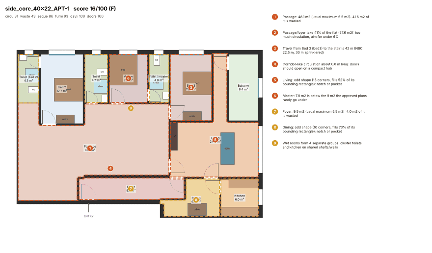
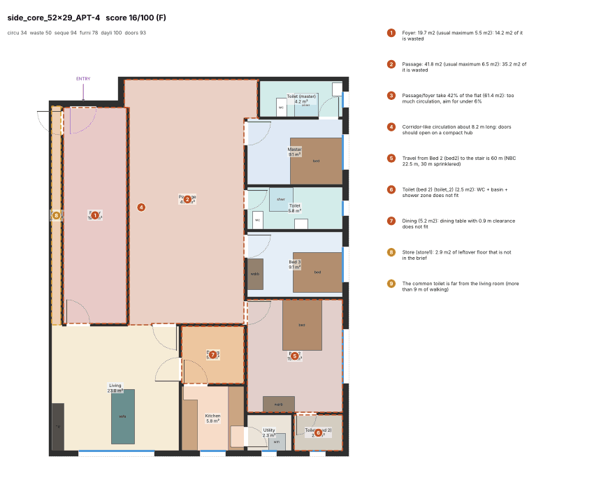
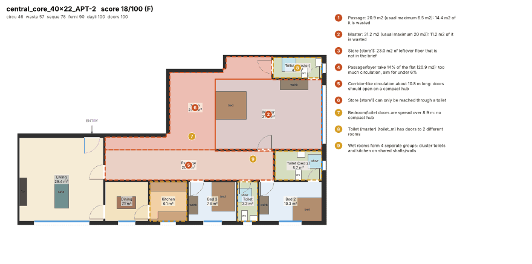
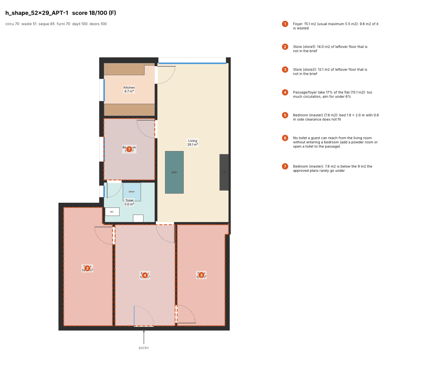
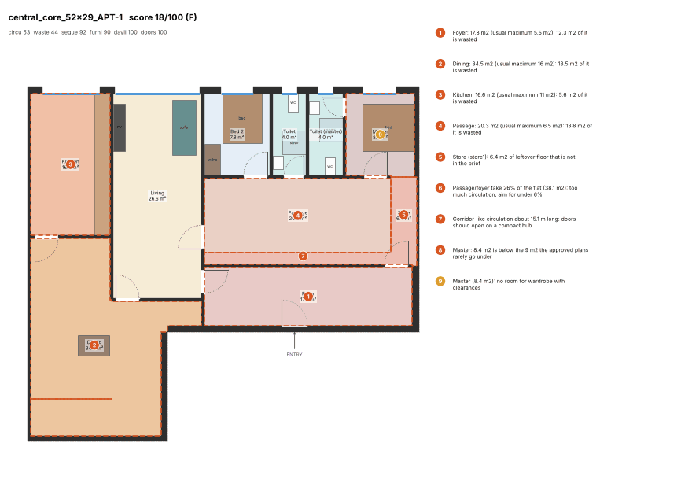
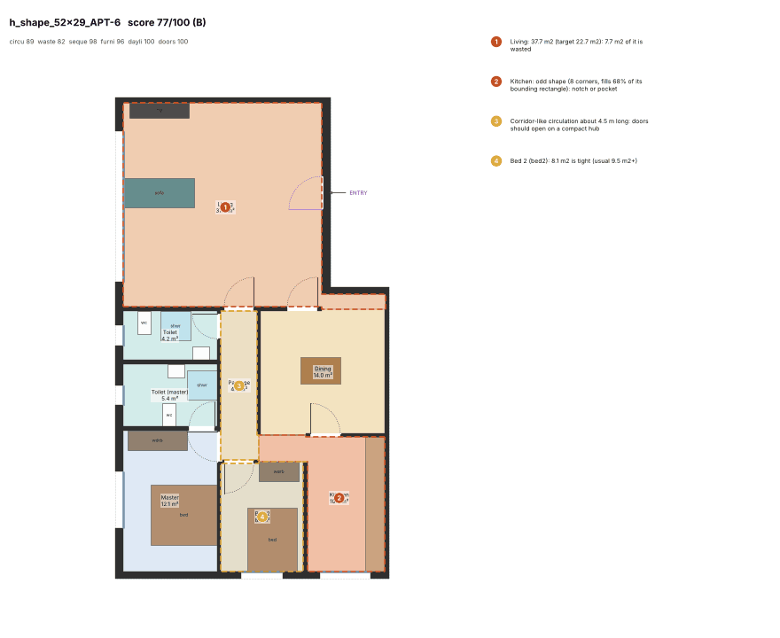
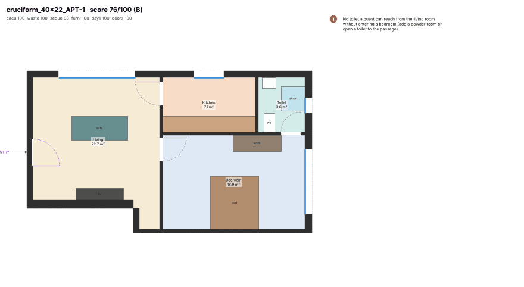
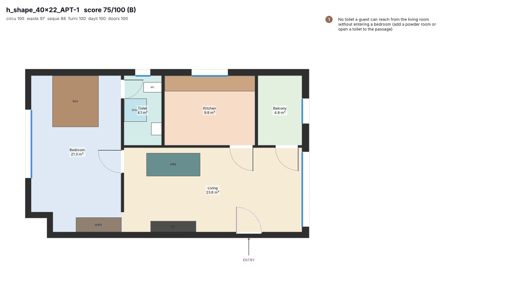
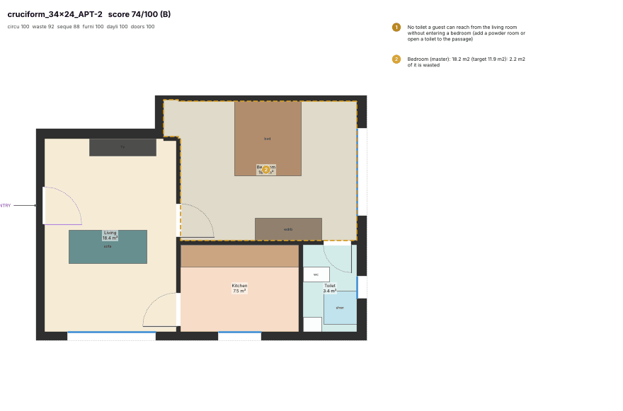
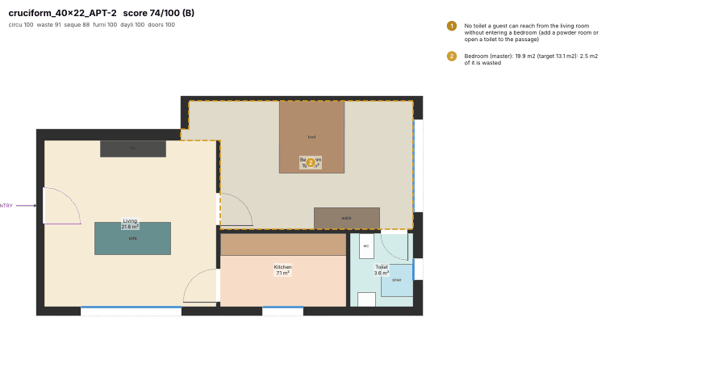

# Plan critic (quality-control harness)

Deterministic scorer that looks at a solved flat the way an Indian architect does and says what is wrong with it.
Code: `engine/planner_engine/quality.py` (critic), `engine/planner_engine/render.py` (PNG), `engine/planner_engine/approved_bench.py`
(scores the approved flats, section 11), tests in `engine/tests/test_quality.py`. Baseline of the first generator: section 6 and
`docs/quality/baseline/`; generator v2 re-scored with the realism rules: section 10.

## 1. What and why

The owner's verdict is that generated plans are not realistic or usable. "Not usable" was a feeling; this module turns it
into numbers so that every later change to the solver, the core designs or the tower placement can be measured:
nothing is "done" until `critique()` and a rendered picture agree it is better.

```python
from planner_engine.quality import critique, top_issues
from planner_engine.render import plan_png
res = critique(plan, unit, plate)          # Plan / Unit / Plate objects or their dicts
res["score"], res["grade"], res["subscores"], res["weakest_link"]
for i in res["issues"]:                    # severity critical|major|minor|info, code, message, rooms, metric, cost, at=(x, y)
    print(i["severity"], i["message"])
plan_png(plan, "flat.png", furniture=True, issues=res, unit=unit)
```

CLI: `python -m planner_engine.quality plan.json`, `--baseline DIR [--resolve]` (rebuild scorecard and PNGs; uses the
cached solved plans unless `--resolve`; `--scores NAME` writes the scorecard under another name, `--no-render` skips the PNGs, e.g.
`--baseline docs/quality/after --scores scores_critic_v2.json --no-render`), `--approved` (re-derive the calibration figures from
the mined approved plans). `python -m planner_engine.approved_bench [--n 240 | --all] [--json OUT] [--render DIR]` runs the
approved-plan benchmark. `critique(..., exclude=(metric keys), imported=True)` leaves metrics out of a plan that was imported
from a drawing (no door swings, no dining fit).

`unit` (gross area, programme) and `plate` (stairs, for travel distance) are optional; metrics that need a missing input are
skipped and the weights renormalised. Everything is metres in the plan's own frame; rotation does not matter because all
geometry is derived from room edges. Cost: about 0.18 s per flat (max 0.50 s on the 78 generated flats, mean 0.13 s / max 0.38 s on approved flats). Same input
gives the same output (tested).

## 2. How the score is made

1. Each metric has a measured value, a **good** threshold, a **bad** threshold and a **weight**. Satisfaction is 1 at
   good, 0 at bad, linear between (works for "higher is better" too, when bad < good).
2. `base` = weighted mean of satisfactions x 100.
3. `linear = 100 - 1.5 x (100 - base) - critical penalty`. The factor 1.5 (`STRICTNESS`) exists because an architect does
   not average a sealed 30 m2 store against nice door widths; a critical finding (front door into a bedroom, bedroom
   only through another bedroom or a toilet, room nobody can reach) takes 10 points off, capped at 40.
4. **Weakest link:** the worst *gate* metric multiplies the score by `(1 - G) + G x satisfaction`. Gates (G): `waste_share` 0.7, `circ_share` 0.3, `entry_seq` 0.55, `privacy` 0.55, `through_wet` 0.55, `kitchen_near` 0.45, `fit_sleep` 0.4, `fit_living` 0.35, `fit_kitchen` 0.4, `fit_toilet` 0.3, `hab_window` 0.4, `room_size` 0.3, `room_shape` 0.3, `room_aspect` 0.25, `corridor_len` 0.25, `common_toilet` 0.25, `efficiency` 0.25, `hub_spread` 0.2, and the realism rules `entry_privacy` 0.4, `toilet_door` 0.35, `orphan` 0.3, `zone_order` 0.2, `dining_kitchen` 0.2.
   A flat with 57 % wasted floor cannot be a 70 because its doors are fine.
5. Grades: A >= 85, B >= 70, C >= 55, D >= 40, F below. The score is reported to 0.1.

Weights are relative (every score renormalises over the metrics it could compute). They add up to circulation 20, waste 25,
sequence 39, furniture 20, daylight 10, doors 5 (total 119; 100 before the realism rules of section 10 added 19).

## 3. Metrics, thresholds, weights, sources

"NBC" = National Building Code of India 2016, "DCPR" = Mumbai DCPR 2034, "approved plans" = the 986 clean flats of
`data/mined/topology_v1.jsonl.gz` (42 projects; see calibration, section 5). Where the source says "practice" the figure
is architectural rule of thumb, not statute, and is meant to be tuned by the owner.

### Circulation
| Metric | Weight | Good | Bad | Unit | What it measures | Source / calibration |
|---|---|---|---|---|---|---|
| `circ_share` | 6 | 6 | 15 | % of net | passage + foyer area as % of net room area | approved plans: p90 = 5 % (topology_v1, 986 clean flats; median 0 %); practice: <= 8 % |
| `corridor_len` | 3 | 2.5 | 7 | m | length of corridor-like circulation (area / clear width) | practice: a flat passage over ~3 m is a corridor; > 7 m is a gallery |
| `hub_spread` | 3 | 4.5 | 8 | m | max distance between bedroom / common-toilet doors; limit grows with the bedrooms (3 BHK 8.5 / 14, 4+ BHK 10 / 16, `HUB_SPREAD`) | approved plans (graphs_v2, section 11): 1-2 BHK p88 = 4.5 m, 3 BHK p50 = 6.7 m, p88 = 11 m; compact hub wanted by the owner |
| `hub_share` | 3 | 0.5 | 0.25 | share | share of private doors that open onto one space | owner brief: one compact hub; fitted to approved plans (p10 = 0.40, median 0.75; was 0.75 / 0.40) |
| `dead_end` | 2 | 1 | 2.5 | m | passage length beyond its last door (dead end) | practice: dead-end stub <= 1 m |
| `travel_to_exit` | 3 | 22.5 | 40 | m | farthest habitable room -> flat door -> nearest stair | NBC 2016 Part 4: residential travel distance 22.5 m (30 m sprinklered) |

### Wasted space
| Metric | Weight | Good | Bad | Unit | What it measures | Source / calibration |
|---|---|---|---|---|---|---|
| `room_aspect` | 3 | 1 | 0.5 | score | area-weighted aspect-ratio score of rooms | practice; see ASPECT |
| `room_shape` | 4 | 1 | 0.5 | score | area-weighted rectangularity (no notches / odd corners) | practice; see SHAPE |
| `waste_share` | 9 | 4 | 30 | % of net | leftover rooms + area beyond 1.3 x the room's target | owner brief: no wasted space; approved area_ratio p50 = 1.0 |
| `efficiency` | 3 | 0.8 | 0.65 | ratio | net room area / gross flat area | practice: 0.80-0.85 carpet/gross for flats excluding the core |
| `room_size` | 3 | 1 | 0.5 | score | rooms below the comfortable size for their type | approved plans p10 and p25 per type (topology_v1) |
| `orphan` | 3 | 0 | 2 | count | orphan pockets: passage / store / utility / dress / pooja with no door, a passage joining fewer than 2 spaces, a room outside the flat outline or detached from the flat (rule 4) | owner review; approved flats: none (clean flats) |

Room-type tables inside `quality.py` hold the per-type numbers: `ASPECT` (good/bad aspect ratio, e.g. bedroom 1.6 / 2.5),
`SHAPE` (rectangularity = area / minimum rotated rectangle, e.g. bedroom 0.85 / 0.62, living 0.78 / 0.55; fitted to the approved flats, section 11; `VERTS` = corners allowed before a room counts as notched: living 14, dining 12, master and bedroom 10, others 8), `OVERSIZE` (area beyond which the
surplus counts as waste = approved p90 x ~1.3, e.g. master 20 m2, living 32 m2, passage 6.5 m2, foyer 5.5 m2) and `SIZE`
(comfortable / unacceptable area = approved p25 / p10, e.g. master 11 / 9 m2, kitchen 5.8 / 4.5 m2). A "leftover" room
(store, utility, alcove that is not in the brief) counts fully as waste. Passages, foyers, balconies, stores, dress and
pooja are exempt from the aspect and shape tests (passages are meant to be long).

### Indian sequence
| Metric | Weight | Good | Bad | Unit | What it measures | Source / calibration |
|---|---|---|---|---|---|---|
| `entry_seq` | 6 | 1 | 0 | score | front door opens into living (or foyer -> living) | approved plans: 95 % of entrances are the living room (topology_v1) |
| `kitchen_near` | 4 | 1 | 0 | score | kitchen next to / one step from living-dining | approved plans: kitchen touches living/dining/foyer in 98 %, door-linked in 82 % |
| `common_toilet` | 4 | 1 | 0 | score | powder / common toilet reachable from living without a bedroom | approved plans: 80 % of flats have one |
| `privacy` | 4 | 1 | 0 | score | bedrooms not entered from kitchen, another bedroom or a toilet | practice; approved plans: 94 % of bedrooms reachable without crossing another bedroom (rest mostly link-extraction gaps) |
| `through_wet` | 2 | 1 | 0 | score | no room reachable only through a toilet | practice; NBC habitability |
| `attached_share` | 2 | 0.5 | -0.5 | share | bedrooms with an attached toilet (none at all costs half the weight) | approved plans: master 88 %, other bedrooms 53 % (1BHK 83 %, 2BHK 51 %, 3BHK 62 %); 15-20 % of approved flats have no attached toilet |
| `master_attached` | 2 | 1 | 0 | score | master bedroom has an attached toilet | approved plans: 88 % |
| `wet_cluster` | 2 | 0.45 | 0.15 | share | share of wet rooms in the largest wet cluster (shared shaft/wall) | approved plans (graphs_v2): p10 0.25, p25 0.33, median 0.5, p75 0.67 (was 0.6 / 0.3) |
| `entry_privacy` | 4 | 1 | 0 | score | no bedroom at the front door (section 10, rule 1) | owner review of generator v2; approved: 8.5 % of flats have a bedroom wall within 1.8 m of the door |
| `entry_sight` | 2 | 1 | 0 | score | no bedroom door in the line of sight from the front door (rule 6b) | owner review; approved: 2 % of flats |
| `zone_order` | 2 | 1 | 0 | score | hop depth from the entry rises public -> hub -> private (rule 6a) | approved hop medians: living 0, dining 1, passage 1, kitchen 2, bedroom 2, master 3, toilet 3 |
| `toilet_door` | 3 | 1 | 0 | score | attached toilet opens into its bedroom; common toilet not into dining / kitchen (rule 2) | owner review; approved: 10 % of flats lose something, 3 % lose more than half |
| `dining_kitchen` | 2 | 1 | 0 | score | dining joined to the kitchen by a door (1), a shared wall (0.7), a short route (0.6) (rule 7) | approved: 67 % of dining-kitchen pairs share a door, via-living route 7-8 m |

Checks behind these: the flat door must open into the living room or into a foyer whose next room is the living room
(a passage at the entry is major; any other room, e.g. bedroom or kitchen, is critical); the kitchen must touch or be one door
from living / dining and must share a wall of at least 1 m or an opening with it (a 0.4-1 m sliver scores 0.5, no contact at all
at most 0.4 and a major finding; a shared wall with the door elsewhere scores 0.85 because approved kitchens are door-linked in only
82 %); a toilet must be reachable from the living room by a route that crosses no bedroom (powder room or common toilet; in a flat
of at most 2 bedrooms whose toilets are all attached this is minor, 0.55, because that is an approved pattern); the door graph is
searched for bedrooms entered from the kitchen, another bedroom or a toilet and for rooms reachable only through a toilet. The
"bedrooms away from the entry" check moved from `privacy` to `entry_privacy` (section 10).

### Furniture fit
| Metric | Weight | Good | Bad | Unit | What it measures | Source / calibration |
|---|---|---|---|---|---|---|
| `fit_sleep` | 6 | 1 | 0 | score | bed + wardrobe fit with clearances | practice; see FURNITURE |
| `fit_living` | 4 | 1 | 0 | score | sofa set + TV wall + dining table fit | practice |
| `fit_kitchen` | 5 | 1 | 0 | score | counter run >= 2.4 m with a 0.9 m aisle | practice (NBC kitchen 5.5 m2 x 1.8 m) |
| `fit_toilet` | 5 | 1 | 0 | score | WC + basin + shower zone with clearances | practice; NBC 2016 Part 3 sanitation |

Furniture is really placed (bounded depth-first search over wall and free positions on a 10-15 cm step, on the polygon of
each room), not estimated from area. Attempts in order: full clearances with every item; tight clearances with every item;
full / tight without the optional wardrobe. The first complete attempt wins; a room scores 1.0 (full), 0.75 (tight) or the
share of item weight placed (x 0.75 if tight), and 0 = "does not fit". Door swings, door landings and a 0.7 m route between
the doors of the room are kept clear. The standard set:

| Room | Furniture and clearances (full tier) | Tight tier |
|---|---|---|
| Master | bed 1.8 x 2.0 m, 0.6 m clear on both long sides and 0.6 m at the foot; wardrobe 1.8 x 0.6 m with 0.75 m clear in front (optional item, weight 1 of 4) | clear on one side only |
| Other bedroom | bed 1.5 x 1.9 m, same clearances; wardrobe 1.2 x 0.6 m | clear on one side only |
| Living | 3-seat sofa 2.1 x 0.9 m facing a 1.8 x 0.45 m TV unit, viewing distance 1.8-4.5 m, 0.45 m coffee-table gap, TV not on a window | 1.4-5.5 m, 0.3 m gap, TV may stand in front of a window |
| Dining | table for 4 (1.2 x 0.8) or 6 (1.8 x 0.9), 0.9 m chair clearance on all 4 sides | 0.75 m on 3 sides |
| Kitchen | counter 0.6 m deep along 1-4 walls (L, parallel, U) with a total run >= 2.4 m and a clear aisle >= 0.9 m | run 1.8-2.4 m scores 0.5; below 1.8 m none |
| Toilet | WC 0.4 x 0.7 m with 0.6 m clear in front and 0.2 m each side, basin 0.5 x 0.4 m with 0.5 m in front, shower 0.9 x 0.9 m (wc room: WC only; bath: shower + basin) | 0.45 m front, 0.15 m sides, door assumed to open outward |

### Daylight and ventilation
| Metric | Weight | Good | Bad | Unit | What it measures | Source / calibration |
|---|---|---|---|---|---|---|
| `hab_window` | 3 | 1 | 0.5 | share | habitable rooms with a window on the facade | DCPR 2034 Reg 39(1) |
| `window_ratio` | 1 | 0.1667 | 0.1 | ratio | smallest window / floor area among habitable rooms | DCPR 2034 Reg 39(1): 1/6 |
| `wet_vent` | 3 | 1 | 0.5 | share | toilets ventilated to facade or shaft | DCPR 2034 Reg 39(2) |
| `wet_duct` | 3 | 0 | 3 | count | wet rooms on a mechanical duct instead of the facade or a shaft (rule 5) | owner review of generator v2; DCPR 2034 Reg 39(2) |

### Doors
| Metric | Weight | Good | Bad | Unit | What it measures | Source / calibration |
|---|---|---|---|---|---|---|
| `swing_clash` | 2 | 0 | 3 | count | door swings that overlap each other | practice |
| `swing_free` | 1 | 0 | 3 | count | doors whose swing does not fit in the room | practice |
| `passage_door` | 1 | 0 | 3 | count | doors onto a passage narrower than 0.9 m / swinging into one < 1.2 m | NBC 2016 Part 4 |
| `door_width` | 1 | 0 | 3 | count | doors narrower than the minimum for their use | NBC 2016 Part 4: 1.0 m flat door, 0.75 m WC |

## 4. Issues and rendering

Each issue has `severity` (critical / major / minor / info), a stable `code` (e.g. `circ_share_high`, `bloated`,
`leftover`, `corridor_long`, `dead_end`, `no_common_toilet`, `common_toilet_far`, `furniture_none`, `furniture_partial`,
`through_toilet`, `unreachable`, `swing_clash`, `bedroom_at_entry`), a sentence in architect's language, the rooms involved,
the metric it belongs to, a `cost` (weight x lost satisfaction, used for ranking) and a point `at` for the marker.
`render.plan_png` draws walls, doors with swing arcs, windows, room tints, labels with areas, the placed furniture,
the entry arrow, the issue rooms outlined (red = critical/major, amber = minor) with numbered markers, and the numbered
issue list beside the plan, plus the sub-scores in the title.

## 5. Calibration against the approved plans

`python -m planner_engine.quality --approved` recomputes these figures from `topology_v1.jsonl.gz` (986 clean flats: not a
suspected merge, 1-4 BHK, kitchen + living + toilet + bedroom present, at most one untyped room, entrance known, 28-260 m2).
The mined data has room areas, links and neighbours but **no polygons**, so geometry-based metrics (shape, notches, furniture,
swings) cannot be calibrated on it and rest on architectural practice; a test locks the calibration numbers to the thresholds.

| Figure from approved plans | Value | Used for |
|---|---|---|
| Passage + foyer as % of net area | p50 0 %, p75 3.7 %, p90 4.7 %; 55 % of flats have none at all | `circ_share` good 6 %, bad 15 % |
| Passage area (m2) | p50 2.2, p90 3.1 | `OVERSIZE` passage 6.5 |
| Living / master / bedroom area p50 (m2) | 15.8 / 12.6 / 10.9 | `OVERSIZE`, `SIZE` |
| Kitchen / toilet area p50 (m2) | 6.9 / 2.75 | `SIZE` |
| Aspect ratio p90 living / kitchen / master / bedroom | 1.78 / 1.75 / 1.49 / 1.43 | `ASPECT` (set looser, see limits) |
| Entrance is the living room | 95.4 % (bedroom 0.9 %, kitchen 0.5 %) | `entry_seq` |
| Kitchen touches living/dining/foyer; door-linked | 98.4 %; 82 % | `kitchen_near` |
| Flat has a toilet reachable without a bedroom | 80.5 % | `common_toilet` (weight 4, gate 0.25) |
| Master / other bedroom has an attached toilet | 88 % / 53 % | `master_attached`, `attached_share` |
| Bedroom reachable only through another room | 6.1 % (mostly link-extraction gaps) | `privacy` |
| Bedroom centroid spread p25 / p50 / p75 / p90 | 3.0 / 3.7 / 6.7 / 11.7 m | `hub_spread` good 4.5, bad 10 |
| Largest wet cluster share | p50 0.5, p75 0.67 | `wet_cluster` |

Reading: approved Mumbai flats have almost no circulation area (median zero, 90 % under 5 %), enter into the living room 95 % of
the time and put the kitchen against the living/dining 98 % of the time. The generator's flats have a median of 15 %
circulation. The thresholds are therefore not arbitrary: they sit at the approved plans' p90 (good) and at about three times
that (bad).

## 6. Baseline: today's generator on the golden flats

Setup: `planner_engine.golden.golden_flats()` = shapes central_core, cruciform, h_shape, t_shape, side_core x envelopes
52.9x29, 40x22, 34x24, split into flats by `split_units`, solved with `layout.solve_flat` (CP-SAT, 2 processes),
critiqued and rendered. Solved plans are cached in `baseline/golden_plans.json.gz` so the report is reproducible without the
solver (CP-SAT with several workers is not bit-for-bit repeatable; re-solve with `--resolve`).
Renders: `baseline/*.png` (75 images, 1.6 MB in total).

**75 of 78 golden flats solved** (3 plates x 5 shapes; the other 3 are solver failures, listed below). Score: mean **42.8**, median 43.7, quartiles 21 / 59, min 16, max 77.

| Grade | Range | Flats | Share |
|---|---|---|---|
| A | 85-100 | 0 | 0 % |
| B | 70-84 | 11 | 15 % |
| C | 55-69 | 12 | 16 % |
| D | 40-54 | 17 | 23 % |
| F | 0-39 | 35 | 47 % |

Not a single golden flat reaches grade A; only 11 of 75 reach B (best 77).

**By plate shape**

| Shape | Solved | Mean | Best | Worst |
|---|---|---|---|---|
| central_core | 16/16 | 33.2 | 70 | 18 |
| cruciform | 16/16 | 53.1 | 76 | 19 |
| h_shape | 14/16 | 59.3 | 77 | 18 |
| side_core | 15/16 | 27.2 | 49 | 16 |
| t_shape | 14/14 | 42.0 | 72 | 20 |

**By flat size**

| BHK | Flats | Mean score |
|---|---|---|
| 1 | 28 | 50.3 |
| 2 | 17 | 43.1 |
| 3 | 30 | 35.5 |

**Sub-scores (mean over solved flats, 0-100)**

| circulation | waste | sequence | furniture | daylight | doors |
|---|---|---|---|---|---|
| 62 | 73 | 89 | 89 | 100 | 99 |

**Most frequent findings** (flats affected out of 75)

| Code | Flats | Share |
|---|---|---|
| `circ_share_high` | 64 | 85 % |
| `bloated` | 62 | 83 % |
| `room_small` | 43 | 57 % |
| `corridor_long` | 40 | 53 % |
| `leftover` | 36 | 48 % |
| `common_toilet_far` | 30 | 40 % |
| `furniture_partial` | 28 | 37 % |
| `no_common_toilet` | 28 | 37 % |
| `furniture_none` | 19 | 25 % |
| `room_shape` | 18 | 24 % |
| `wet_scatter` | 18 | 24 % |
| `dead_end` | 18 | 24 % |

Weakest link that capped the score: `waste_share` 42, `circ_share` 13, `common_toilet` 13, `corridor_len` 3, `through_wet` 2, `room_shape` 1, `fit_living` 1.

Median over solved flats: passage+foyer = 15.1 % of net area (approved plans: p75 3.7 %, p90 4.7 %); wasted share = 17.8 % (limit 4 % good / 30 % bad); corridor length = 4.9 m.

### Five worst











| Flat | Score | Grade | BHK | Net m2 | Top issues |
|---|---|---|---|---|---|
| `side_core_40x22_APT-1` | 16 | F | 3 | 140 | Passage: 48.1 m2 (usual maximum 6.5 m2): 41.6 m2 of it is wasted; Passage/foyer take 41% of the flat (57.6 m2): too much circulation, aim for under 6% |
| `side_core_52x29_APT-4` | 16 | F | 3 | 147 | Foyer: 19.7 m2 (usual maximum 5.5 m2): 14.2 m2 of it is wasted; Passage: 41.8 m2 (usual maximum 6.5 m2): 35.2 m2 of it is wasted |
| `central_core_40x22_APT-2` | 18 | F | 3 | 149 | Passage: 20.9 m2 (usual maximum 6.5 m2): 14.4 m2 of it is wasted; Master: 31.2 m2 (usual maximum 20 m2): 11.2 m2 of it is wasted |
| `h_shape_52x29_APT-1` | 18 | F | 1 | 89 | Foyer: 15.1 m2 (usual maximum 5.5 m2): 9.6 m2 of it is wasted; Store (store1): 14.0 m2 of leftover floor that is not in the brief |
| `central_core_52x29_APT-1` | 18 | F | 2 | 146 | Foyer: 17.8 m2 (usual maximum 5.5 m2): 12.3 m2 of it is wasted; Dining: 34.5 m2 (usual maximum 16 m2): 18.5 m2 of it is wasted |

### Five best











| Flat | Score | Grade | BHK | Net m2 | Top issues |
|---|---|---|---|---|---|
| `h_shape_52x29_APT-6` | 77 | B | 2 | 97 | Living: 37.7 m2 (target 22.7 m2): 7.7 m2 of it is wasted; Kitchen: odd shape (8 corners, fills 68% of its bounding rectangle): notch or pocket |
| `cruciform_40x22_APT-1` | 76 | B | 1 | 52 | No toilet a guest can reach from the living room without entering a bedroom (add a powder room or open a toilet to the passage) |
| `h_shape_40x22_APT-1` | 75 | B | 1 | 59 | No toilet a guest can reach from the living room without entering a bedroom (add a powder room or open a toilet to the passage) |
| `cruciform_34x24_APT-2` | 74 | B | 1 | 47 | No toilet a guest can reach from the living room without entering a bedroom (add a powder room or open a toilet to the passage); Bedroom (master): 18.2 m2 (target 11.9 m2): 2.2 m2 of it is wasted |
| `cruciform_40x22_APT-2` | 74 | B | 1 | 52 | No toilet a guest can reach from the living room without entering a bedroom (add a powder room or open a toilet to the passage); Bedroom (master): 19.9 m2 (target 13.1 m2): 2.5 m2 of it is wasted |

### Full scorecard

Sorted worst to best. Every plan has a render at `baseline/<flat>.png`; raw numbers in `baseline/scores.json`.

| Flat | Score | Grade | BHK | circ | waste | seq | furn | day | doors | Top issues |
|---|---|---|---|---|---|---|---|---|---|---|
| `side_core_40x22_APT-1` | 16 | F | 3 | 31 | 43 | 86 | 93 | 100 | 100 | Passage: 48.1 m2 (usual maximum 6.5 m2): 41.6 m2 of it is wasted; Passage/foyer take 41% of the flat (57.6 m2): too much circulation, aim for under 6% |
| `side_core_52x29_APT-4` | 16 | F | 3 | 34 | 50 | 94 | 78 | 100 | 93 | Foyer: 19.7 m2 (usual maximum 5.5 m2): 14.2 m2 of it is wasted; Passage: 41.8 m2 (usual maximum 6.5 m2): 35.2 m2 of it is wasted |
| `central_core_40x22_APT-2` | 18 | F | 3 | 46 | 57 | 78 | 90 | 100 | 100 | Passage: 20.9 m2 (usual maximum 6.5 m2): 14.4 m2 of it is wasted; Master: 31.2 m2 (usual maximum 20 m2): 11.2 m2 of it is wasted |
| `h_shape_52x29_APT-1` | 18 | F | 1 | 70 | 51 | 85 | 70 | 100 | 100 | Foyer: 15.1 m2 (usual maximum 5.5 m2): 9.6 m2 of it is wasted; Store (store1): 14.0 m2 of leftover floor that is not in the brief |
| `central_core_52x29_APT-1` | 18 | F | 2 | 53 | 44 | 92 | 90 | 100 | 100 | Foyer: 17.8 m2 (usual maximum 5.5 m2): 12.3 m2 of it is wasted; Dining: 34.5 m2 (usual maximum 16 m2): 18.5 m2 of it is wasted |
| `cruciform_52x29_APT-6` | 19 | F | 2 | 60 | 54 | 98 | 74 | 100 | 93 | Foyer: 14.2 m2 (usual maximum 5.5 m2): 8.7 m2 of it is wasted; Dining: 22.1 m2 (target 9.6 m2): 9.1 m2 of it is wasted |
| `h_shape_52x29_APT-4` | 19 | F | 1 | 70 | 48 | 85 | 87 | 100 | 100 | Foyer: 15.1 m2 (usual maximum 5.5 m2): 9.6 m2 of it is wasted; Store (store1): 16.6 m2 of leftover floor that is not in the brief |
| `t_shape_52x29_APT-1` | 20 | F | 1 | 55 | 57 | 85 | 100 | 100 | 87 | Foyer: 15.2 m2 (usual maximum 5.5 m2): 9.8 m2 of it is wasted; Bedroom (master): 36.4 m2 (usual maximum 20 m2): 16.4 m2 of it is wasted |
| `central_core_52x29_APT-5` | 20 | F | 2 | 61 | 55 | 85 | 93 | 100 | 100 | Dining: 21.2 m2 (usual maximum 16 m2): 5.2 m2 of it is wasted; Passage: 20.1 m2 (usual maximum 6.5 m2): 13.6 m2 of it is wasted |
| `t_shape_52x29_APT-2` | 20 | F | 1 | 72 | 51 | 85 | 87 | 100 | 100 | Foyer: 15.1 m2 (usual maximum 5.5 m2): 9.6 m2 of it is wasted; Store (store1): 23.9 m2 of leftover floor that is not in the brief |
| `t_shape_52x29_APT-6` | 20 | F | 1 | 72 | 51 | 85 | 87 | 100 | 100 | Foyer: 15.1 m2 (usual maximum 5.5 m2): 9.6 m2 of it is wasted; Store (store1): 24.5 m2 of leftover floor that is not in the brief |
| `central_core_52x29_APT-6` | 20 | F | 2 | 65 | 47 | 92 | 90 | 100 | 100 | Foyer: 17.7 m2 (usual maximum 5.5 m2): 12.2 m2 of it is wasted; Dining: 39.7 m2 (usual maximum 16 m2): 23.7 m2 of it is wasted |
| `central_core_52x29_APT-2` | 20 | F | 2 | 62 | 57 | 85 | 93 | 100 | 100 | Passage: 65.0 m2 (usual maximum 6.5 m2): 58.5 m2 of it is wasted; Passage/foyer take 49% of the flat (72.6 m2): too much circulation, aim for under 6% |
| `side_core_52x29_APT-6` | 20 | F | 1 | 67 | 57 | 77 | 100 | 100 | 100 | Foyer: 15.6 m2 (usual maximum 5.5 m2): 10.1 m2 of it is wasted; Bedroom (master): 34.0 m2 (usual maximum 20 m2): 14.0 m2 of it is wasted |
| `central_core_34x24_APT-2` | 21 | F | 3 | 63 | 55 | 78 | 87 | 100 | 100 | Passage: 11.6 m2 (usual maximum 6.5 m2): 5.1 m2 of it is wasted; Store (store1): 30.0 m2 of leftover floor that is not in the brief |
| `central_core_52x29_APT-7` | 21 | F | 3 | 49 | 58 | 91 | 81 | 100 | 100 | Foyer: 12.7 m2 (usual maximum 5.5 m2): 7.2 m2 of it is wasted; Living: 57.9 m2 (usual maximum 32 m2): 25.9 m2 of it is wasted |
| `side_core_52x29_APT-2` | 21 | F | 1 | 71 | 56 | 85 | 100 | 100 | 100 | Foyer: 15.3 m2 (usual maximum 5.5 m2): 9.8 m2 of it is wasted; Bedroom (master): 32.0 m2 (usual maximum 20 m2): 12.0 m2 of it is wasted |
| `side_core_52x29_APT-5` | 21 | F | 1 | 71 | 56 | 85 | 100 | 100 | 100 | Foyer: 15.3 m2 (usual maximum 5.5 m2): 9.8 m2 of it is wasted; Bedroom (master): 32.0 m2 (usual maximum 20 m2): 12.0 m2 of it is wasted |
| `side_core_34x24_APT-1` | 21 | F | 3 | 34 | 43 | 91 | 93 | 100 | 100 | Foyer: 17.9 m2 (usual maximum 5.5 m2): 12.4 m2 of it is wasted; Dining: 28.0 m2 (target 11.6 m2): 12.4 m2 of it is wasted |
| `side_core_52x29_APT-1` | 22 | F | 1 | 72 | 57 | 85 | 100 | 100 | 100 | Foyer: 15.3 m2 (usual maximum 5.5 m2): 9.8 m2 of it is wasted; Bedroom (master): 33.7 m2 (usual maximum 20 m2): 13.7 m2 of it is wasted |
| `t_shape_40x22_APT-1` | 23 | F | 1 | 45 | 62 | 85 | 100 | 100 | 100 | Foyer: 14.0 m2 (usual maximum 5.5 m2): 8.5 m2 of it is wasted; Store (store1): 10.7 m2 of leftover floor that is not in the brief |
| `central_core_52x29_APT-4` | 24 | F | 3 | 34 | 64 | 91 | 72 | 100 | 100 | Living: 44.0 m2 (usual maximum 32 m2): 12.0 m2 of it is wasted; Kitchen: 17.8 m2 (usual maximum 11 m2): 6.8 m2 of it is wasted |
| `side_core_40x22_APT-2` | 25 | F | 3 | 40 | 57 | 86 | 95 | 100 | 100 | Foyer: 12.5 m2 (usual maximum 5.5 m2): 7.0 m2 of it is wasted; Passage: 18.9 m2 (usual maximum 6.5 m2): 12.4 m2 of it is wasted |
| `side_core_40x22_APT-3` | 26 | F | 3 | 38 | 62 | 89 | 86 | 100 | 100 | Dining: 21.5 m2 (usual maximum 16 m2): 5.5 m2 of it is wasted; Store (store1): 13.3 m2 of leftover floor that is not in the brief |
| `central_core_52x29_APT-8` | 26 | F | 3 | 36 | 63 | 97 | 86 | 100 | 100 | Foyer: 21.2 m2 (usual maximum 5.5 m2): 15.8 m2 of it is wasted; Dining: 26.3 m2 (usual maximum 16 m2): 10.3 m2 of it is wasted |
| `side_core_34x24_APT-2` | 27 | F | 3 | 26 | 71 | 84 | 93 | 100 | 100 | Passage/foyer take 19% of the flat (26.7 m2): too much circulation, aim for under 6%; Foyer: 19.6 m2 (usual maximum 5.5 m2): 14.1 m2 of it is wasted |
| `side_core_52x29_APT-3` | 29 | F | 3 | 46 | 61 | 97 | 75 | 100 | 100 | Foyer: 15.2 m2 (usual maximum 5.5 m2): 9.7 m2 of it is wasted; Living: 38.5 m2 (usual maximum 32 m2): 6.5 m2 of it is wasted |
| `t_shape_34x24_APT-2` | 32 | F | 3 | 54 | 50 | 92 | 72 | 100 | 100 | Passage/foyer take 27% of the flat (25.6 m2): too much circulation, aim for under 6%; Foyer: 13.6 m2 (usual maximum 5.5 m2): 8.1 m2 of it is wasted |
| `central_core_40x22_APT-4` | 32 | F | 3 | 58 | 72 | 84 | 98 | 100 | 100 | Store (store1): 22.2 m2 of leftover floor that is not in the brief; Corridor-like circulation about 9.3 m long: doors should open on a compact hub |
| `side_core_34x24_APT-4` | 34 | F | 3 | 34 | 70 | 91 | 82 | 100 | 100 | Passage/foyer take 20% of the flat (27.2 m2): too much circulation, aim for under 6%; Living: 40.9 m2 (usual maximum 32 m2): 8.9 m2 of it is wasted |
| `side_core_52x29_APT-7` | 35 | F | 3 | 41 | 70 | 91 | 92 | 100 | 100 | Foyer: 11.0 m2 (usual maximum 5.5 m2): 5.5 m2 of it is wasted; Passage: 23.2 m2 (usual maximum 6.5 m2): 16.7 m2 of it is wasted |
| `central_core_52x29_APT-3` | 36 | F | 3 | 30 | 69 | 86 | 96 | 100 | 100 | Passage/foyer take 27% of the flat (40.0 m2): too much circulation, aim for under 6%; Foyer: 16.0 m2 (usual maximum 5.5 m2): 10.5 m2 of it is wasted |
| `cruciform_52x29_APT-5` | 36 | F | 2 | 54 | 67 | 91 | 91 | 100 | 100 | Foyer: 11.0 m2 (usual maximum 5.5 m2): 5.5 m2 of it is wasted; Store (store1): 11.4 m2 of leftover floor that is not in the brief |
| `t_shape_52x29_APT-4` | 36 | F | 3 | 34 | 72 | 89 | 93 | 100 | 100 | Passage/foyer take 24% of the flat (33.1 m2): too much circulation, aim for under 6%; Foyer: 12.2 m2 (usual maximum 5.5 m2): 6.7 m2 of it is wasted |
| `t_shape_52x29_APT-5` | 37 | F | 3 | 57 | 61 | 91 | 82 | 100 | 100 | Passage/foyer take 15% of the flat (18.7 m2): too much circulation, aim for under 6%; Dining: 27.2 m2 (target 11.2 m2): 12.1 m2 of it is wasted |
| `cruciform_52x29_APT-2` | 42 | D | 2 | 69 | 64 | 98 | 61 | 100 | 100 | Passage/foyer take 17% of the flat (13.0 m2): too much circulation, aim for under 6%; Toilet (master) (toilet_m) (2.4 m2): WC + basin + shower zone does not fit |
| `central_core_34x24_APT-3` | 44 | D | 3 | 50 | 75 | 86 | 89 | 100 | 100 | Passage/foyer take 16% of the flat (20.6 m2): too much circulation, aim for under 6%; Bed 2 (bed2): 27.4 m2 (usual maximum 16 m2): 11.4 m2 of it is wasted |
| `cruciform_52x29_APT-1` | 44 | D | 2 | 69 | 66 | 98 | 61 | 100 | 100 | Passage/foyer take 17% of the flat (13.0 m2): too much circulation, aim for under 6%; Toilet (master) (toilet_m) (2.4 m2): WC + basin + shower zone does not fit |
| `t_shape_34x24_APT-4` | 44 | D | 3 | 65 | 78 | 100 | 51 | 100 | 100 | Passage/foyer take 18% of the flat (17.9 m2): too much circulation, aim for under 6%; Toilet (master) (toilet_m) (2.5 m2): WC + basin + shower zone does not fit |
| `cruciform_52x29_APT-8` | 44 | D | 3 | 49 | 71 | 91 | 82 | 100 | 100 | Passage/foyer take 20% of the flat (21.9 m2): too much circulation, aim for under 6%; Passage: 18.3 m2 (usual maximum 6.5 m2): 11.8 m2 of it is wasted |
| `central_core_40x22_APT-1` | 44 | D | 3 | 70 | 72 | 97 | 83 | 100 | 87 | Passage/foyer take 21% of the flat (29.5 m2): too much circulation, aim for under 6%; Foyer: 19.2 m2 (usual maximum 5.5 m2): 13.8 m2 of it is wasted |
| `cruciform_52x29_APT-3` | 45 | D | 3 | 44 | 77 | 89 | 82 | 100 | 87 | Passage/foyer take 25% of the flat (26.3 m2): too much circulation, aim for under 6%; Passage: 18.8 m2 (usual maximum 6.5 m2): 12.3 m2 of it is wasted |
| `side_core_34x24_APT-3` | 46 | D | 3 | 34 | 75 | 91 | 92 | 100 | 100 | Passage/foyer take 18% of the flat (23.9 m2): too much circulation, aim for under 6%; Foyer: 12.2 m2 (usual maximum 5.5 m2): 6.7 m2 of it is wasted |
| `cruciform_52x29_APT-4` | 47 | D | 2 | 42 | 86 | 85 | 85 | 100 | 100 | Passage/foyer take 16% of the flat (15.9 m2): too much circulation, aim for under 6%; Corridor-like circulation about 11.1 m long: doors should open on a compact hub |
| `h_shape_52x29_APT-2` | 47 | D | 2 | 36 | 79 | 98 | 86 | 100 | 100 | Passage/foyer take 18% of the flat (17.2 m2): too much circulation, aim for under 6%; Foyer: 11.3 m2 (usual maximum 5.5 m2): 5.8 m2 of it is wasted |
| `side_core_52x29_APT-8` | 49 | D | 3 | 64 | 74 | 97 | 89 | 100 | 100 | Passage/foyer take 18% of the flat (25.8 m2): too much circulation, aim for under 6%; Foyer: 20.3 m2 (usual maximum 5.5 m2): 14.8 m2 of it is wasted |
| `t_shape_40x22_APT-4` | 49 | D | 1 | 59 | 65 | 85 | 100 | 100 | 100 | Passage/foyer take 14% of the flat (10.6 m2): too much circulation, aim for under 6%; Living: odd shape (14 corners, fills 59% of its bounding rectangle): notch or pocket |
| `central_core_40x22_APT-3` | 50 | D | 3 | 70 | 78 | 89 | 98 | 100 | 100 | Passage/foyer take 17% of the flat (25.0 m2): too much circulation, aim for under 6%; Passage: 25.0 m2 (usual maximum 6.5 m2): 18.5 m2 of it is wasted |
| `cruciform_52x29_APT-7` | 50 | D | 2 | 44 | 75 | 91 | 98 | 100 | 100 | Passage/foyer take 17% of the flat (16.5 m2): too much circulation, aim for under 6%; Corridor-like circulation about 10.2 m long: doors should open on a compact hub |
| `t_shape_34x24_APT-1` | 50 | D | 2 | 44 | 90 | 91 | 95 | 79 | 87 | Passage/foyer take 20% of the flat (20.1 m2): too much circulation, aim for under 6%; Corridor-like circulation about 7.0 m long: doors should open on a compact hub |
| `t_shape_52x29_APT-3` | 51 | D | 3 | 51 | 81 | 91 | 91 | 100 | 100 | Passage/foyer take 16% of the flat (20.6 m2): too much circulation, aim for under 6%; Passage: 13.2 m2 (usual maximum 6.5 m2): 6.7 m2 of it is wasted |
| `h_shape_52x29_APT-3` | 51 | D | 2 | 42 | 87 | 91 | 91 | 100 | 100 | Passage/foyer take 15% of the flat (13.1 m2): too much circulation, aim for under 6%; Corridor-like circulation about 10.7 m long: doors should open on a compact hub |
| `h_shape_52x29_APT-7` | 57 | C | 2 | 50 | 88 | 92 | 95 | 100 | 93 | Passage/foyer take 13% of the flat (12.3 m2): too much circulation, aim for under 6%; Corridor-like circulation about 10.3 m long: doors should open on a compact hub |
| `cruciform_34x24_APT-4` | 58 | C | 1 | 70 | 98 | 88 | 89 | 100 | 100 | Passage/foyer take 15% of the flat (7.0 m2): too much circulation, aim for under 6%; No toilet a guest can reach from the living room without entering a bedroom (add a powder room or open a toilet to the passage) |
| `cruciform_40x22_APT-4` | 58 | C | 1 | 70 | 94 | 85 | 100 | 100 | 100 | Passage/foyer take 17% of the flat (8.8 m2): too much circulation, aim for under 6%; No toilet a guest can reach from the living room without entering a bedroom (add a powder room or open a toilet to the passage) |
| `cruciform_34x24_APT-3` | 58 | C | 1 | 70 | 98 | 88 | 94 | 100 | 100 | Passage/foyer take 15% of the flat (7.0 m2): too much circulation, aim for under 6%; No toilet a guest can reach from the living room without entering a bedroom (add a powder room or open a toilet to the passage) |
| `cruciform_34x24_APT-1` | 59 | C | 1 | 70 | 98 | 85 | 100 | 100 | 100 | Passage/foyer take 15% of the flat (7.0 m2): too much circulation, aim for under 6%; No toilet a guest can reach from the living room without entering a bedroom (add a powder room or open a toilet to the passage) |
| `t_shape_40x22_APT-3` | 63 | C | 2 | 67 | 100 | 98 | 98 | 100 | 100 | Passage/foyer take 15% of the flat (11.4 m2): too much circulation, aim for under 6% |
| `cruciform_40x22_APT-3` | 65 | C | 1 | 63 | 97 | 88 | 92 | 100 | 100 | No toilet a guest can reach from the living room without entering a bedroom (add a powder room or open a toilet to the passage); Dead-end passage: 2.5 m beyond the last door is wasted floor |
| `h_shape_34x24_APT-4` | 66 | C | 1 | 85 | 93 | 88 | 81 | 100 | 100 | No toilet a guest can reach from the living room without entering a bedroom (add a powder room or open a toilet to the passage); Passage/foyer take 9% of the flat (3.8 m2) |
| `h_shape_34x24_APT-1` | 67 | C | 1 | 86 | 94 | 88 | 81 | 100 | 100 | No toilet a guest can reach from the living room without entering a bedroom (add a powder room or open a toilet to the passage); Passage/foyer take 9% of the flat (3.8 m2) |
| `h_shape_34x24_APT-3` | 67 | C | 1 | 86 | 94 | 88 | 81 | 100 | 100 | No toilet a guest can reach from the living room without entering a bedroom (add a powder room or open a toilet to the passage); Passage/foyer take 9% of the flat (3.8 m2) |
| `central_core_34x24_APT-4` | 68 | C | 3 | 83 | 86 | 91 | 100 | 100 | 87 | Corridor-like circulation about 6.3 m long: doors should open on a compact hub; Master: odd shape (16 corners, fills 76% of its bounding rectangle): notch or pocket |
| `h_shape_40x22_APT-4` | 70 | C | 1 | 93 | 91 | 85 | 94 | 100 | 100 | No toilet a guest can reach from the living room without entering a bedroom (add a powder room or open a toilet to the passage); Living: odd shape (8 corners, fills 72% of its bounding rectangle): notch or pocket |
| `central_core_34x24_APT-1` | 70 | B | 3 | 88 | 86 | 91 | 100 | 100 | 100 | Corridor-like circulation about 6.2 m long: doors should open on a compact hub; Master: odd shape (14 corners, fills 76% of its bounding rectangle): notch or pocket |
| `t_shape_40x22_APT-2` | 71 | B | 2 | 78 | 99 | 98 | 91 | 100 | 100 | Passage/foyer take 12% of the flat (9.0 m2): too much circulation, aim for under 6% |
| `h_shape_34x24_APT-2` | 72 | B | 1 | 96 | 100 | 85 | 92 | 100 | 87 | No toilet a guest can reach from the living room without entering a bedroom (add a powder room or open a toilet to the passage); Doors D-entry and D1 swing into each other |
| `h_shape_40x22_APT-2` | 72 | B | 1 | 94 | 98 | 85 | 94 | 100 | 100 | No toilet a guest can reach from the living room without entering a bedroom (add a powder room or open a toilet to the passage) |
| `t_shape_34x24_APT-3` | 72 | B | 1 | 100 | 98 | 81 | 94 | 100 | 100 | No toilet a guest can reach from the living room without entering a bedroom (add a powder room or open a toilet to the passage); Bedroom (master) door is within 2 m of the front door: bedrooms should be away from the entry |
| `h_shape_40x22_APT-3` | 72 | B | 1 | 100 | 86 | 88 | 100 | 100 | 100 | No toilet a guest can reach from the living room without entering a bedroom (add a powder room or open a toilet to the passage); Bedroom (master): odd shape (8 corners, fills 81% of its bounding rectangle): notch or pocket |
| `cruciform_40x22_APT-2` | 74 | B | 1 | 100 | 91 | 88 | 100 | 100 | 100 | No toilet a guest can reach from the living room without entering a bedroom (add a powder room or open a toilet to the passage); Bedroom (master): 19.9 m2 (target 13.1 m2): 2.5 m2 of it is wasted |
| `cruciform_34x24_APT-2` | 74 | B | 1 | 100 | 92 | 88 | 100 | 100 | 100 | No toilet a guest can reach from the living room without entering a bedroom (add a powder room or open a toilet to the passage); Bedroom (master): 18.2 m2 (target 11.9 m2): 2.2 m2 of it is wasted |
| `h_shape_40x22_APT-1` | 75 | B | 1 | 100 | 97 | 88 | 100 | 100 | 100 | No toilet a guest can reach from the living room without entering a bedroom (add a powder room or open a toilet to the passage) |
| `cruciform_40x22_APT-1` | 76 | B | 1 | 100 | 100 | 88 | 100 | 100 | 100 | No toilet a guest can reach from the living room without entering a bedroom (add a powder room or open a toilet to the passage) |
| `h_shape_52x29_APT-6` | 77 | B | 2 | 89 | 82 | 98 | 96 | 100 | 100 | Living: 37.7 m2 (target 22.7 m2): 7.7 m2 of it is wasted; Kitchen: odd shape (8 corners, fills 68% of its bounding rectangle): notch or pocket |

Solver failures (no layout, so nothing to critique): `h_shape_52x29_APT-5`, `h_shape_52x29_APT-8`, `side_core_40x22_APT-4`.

## 7. Does the critic agree with the eye?

I opened 14 renders and judged each as an architect would (I read the critic's list of issues next to the picture, so this is a consistency check, not a blind test). Verdicts:

| Flat | Critic | My eye | Agree |
|---|---|---|---|
| side_core_40x22_APT-1 | 16 F | 48 m2 passage swallowing the flat, three bedrooms and three toilets hung off it: failure | yes |
| central_core_52x29_APT-2 | 20 F | one 65 m2 passage pocket, rooms are squeezed: failure | yes |
| t_shape_52x29_APT-2 | 20 F | 15 m2 foyer, 24 m2 and 18 m2 left-over stores, bedroom 9.6 m2 without wardrobe room | yes |
| central_core_52x29_APT-4 | 24 F | 14 m passage, two toilets of 2.4-2.5 m2 with no WC space, store at the entry | yes |
| side_core_34x24_APT-2 | 27 F | 20 m2 foyer + dead-end, store reached through a toilet, doors spread over 9 m | yes |
| central_core_40x22_APT-4 | 32 F | two left-over stores (one only via a toilet), master toilet with doors to two rooms | yes |
| cruciform_52x29_APT-3 | 45 D | 25 % circulation, doors D-entry and D1 clash, toilet too small, 5 m dead-end | yes |
| cruciform_34x24_APT-4 | 58 C (50 D before the fix below; 57.5 exact) | 1BHK, entry via a 7 m2 foyer, toilet only through the bedroom, living tight but a sofa does fit | yes after fix |
| central_core_34x24_APT-1 | 70 B | notched 28 m2 master, 6 m corridor, common toilet far: I would give C | critic slightly generous |
| t_shape_34x24_APT-3 | 72 B | 1BHK, enters straight into the living room, bedroom door next to the entry, toilet only via bedroom: C+ | critic slightly generous |
| h_shape_34x24_APT-2 | 72 B | clean 1BHK except two clashing door swings in a 3.3 m2 foyer | yes |
| t_shape_40x22_APT-2 | 71 B | compact 2BHK, hub passage 3.7 m2, only the foyer is large: good | yes |
| h_shape_40x22_APT-1 | 75 B | tidy 1BHK, enters into living; toilet only via bedroom | yes |
| h_shape_52x29_APT-6 | 77 B | best of the set: enters living, thin hub passage, but 38 m2 living and an L-shaped kitchen | yes |

Two changes came out of this review: (a) the critic said a sofa set does not fit in a 17 m2 living (3.3 x 5.2 m, window on
the TV wall candidate, doors on three sides); with a curtained TV allowed in front of the window in the tight tier the plan
scores 58 instead of 50, which matches what I see; (b) none other was needed: the other 13 verdicts agreed with the critic within one grade. Disagreement
that remains: the critic is about 5-8 points kind to small 1BHK flats whose only toilet is entered from the bedroom (that
is a real defect, but `common_toilet` is weighted 4 of 100 and gated at 0.25), and it has no view on whether the *bedroom
is attached to a bath that is also usable by guests* in the cases where that is deliberate.

## 8. Findings about the generator (from the baseline)

1. The dominant problem is **space accounting**, not furniture: median 15 % of net area is passage/foyer (approved: 0-5 %),
   64 of 75 flats exceed the 6 % good threshold, 62 have rooms bigger than 1.3 x their approved p90 (the solver hands out the
   plate's spare area as oversized living / master / foyer) and 36 contain a leftover store/utility that is not in the brief.
2. Plate shape matters a lot: h_shape (59 mean) and cruciform (53) are far better than central_core (33) and side_core (27); the
   worst flats there are the ones with 40-65 m2 passages and 15-20 m2 foyers (see the five worst), i.e. deep flats where the solver cannot
   find a compact hub.
3. Larger flats score worse (1BHK 50, 2BHK 43, 3BHK 36): 3BHK flats on big plates are where 40-65 m2 passages appear.
4. 28 flats (37 %) have no toilet a guest can use without entering a bedroom and 30 more have it more than 9 m from the
   living room; approved plans have one in 80 % of flats.
5. 47 % of plans are grade F; none reaches A. The 3 flats the solver fails on (h_shape_52x29 APT-5/APT-8, side_core_40x22
   APT-4) are not scored.
6. Entry sequence scores 100 % everywhere (the flat door always opens into foyer/living) and daylight is always 100: the
   solver already enforces those, so they do not discriminate; the critic keeps them as regression guards.

## 9. Limits (stated honestly)

* The thresholds for geometry (aspect, furniture sizes, swing clearances) are architectural practice, checked by eye on 14 renders
  and the unit tests. `SHAPE`, `VERTS`, `hub_*`, `attached_share` and `wet_cluster` are now fitted to the approved flats' polygons and
  doors (section 11), through a lossy conversion (door swings, windows, ducts and some door links are not in the data).
* Aspect ratios are deliberately looser than approved p90 (approved flats are rarely narrower than 1:1.8) because the plate
  geometry here forces long rooms; tighten once the generator can make squarer rooms.
* The critic does not judge orientation (west glare, view), structure (columns, beams), plumbing stacks beyond the clustering
  share, or fire-door ratings; the two latter need the plate's shaft/core data.
* "Hub" is measured from door positions (spread and share of doors on one space); a hub that is itself oversized is caught by
  `bloated`/`circ_share`, not by `hub_*`.
* Furniture search is bounded (25 000 nodes per room); on very odd rooms a "does not fit" can be a false alarm. In the review
  one such case turned up and was fixed (living tight tier); an architect's override list is the right next step.
* Triangle plates are not scored specially (parked as experimental).
* Scores are for ranking and regression, not for statutory compliance: statutory checks stay in `checks.py`.

## 10. Realism rules added after the generator-v2 review

The owner looked at the generator-v2 renders (`docs/quality/after/*.png`) and found defects the first critic did not weigh. Seven
rules were added (all in `quality._realism` unless noted, each with a unit test in `tests/test_quality.py`):

| # | Defect | Metric (weight, gate) | Detection | Issue codes |
|---|---|---|---|---|
| 1 | Bedroom at the front door | `entry_privacy` (4, 0.40) | per bedroom: door opening straight off an entry space that is a foyer / passage = 0.7 off the score (major); door into the living-room entry within 2 m of the front door = 0.4 (minor); otherwise a bedroom wall within 1.8 m of the front door point = 0.4 (minor) | `bedroom_at_entry` |
| 2 | Toilet doors | `toilet_door` (3, 0.35) | an attached toilet (name / id says master or bed N, or it is the only toilet left against a bedroom without one) whose doors all open into living / dining / kitchen / foyer instead of its bedroom: -0.7 (major); a common toilet opening onto the dining room: -0.5 (major when the door is within 2.5 m of the room centre or the room is under 12 m2, else -0.25 minor); onto the kitchen: -0.7 (major). A powder room off the living room is fine | `toilet_door_public`, `toilet_door_hub`, `toilet_to_dining`, `toilet_to_kitchen` |
| 3 | Kitchen without contact | `kitchen_near` (4, 0.45) | contact = door / opening, or shared wall >= 1 m; sliver 0.4-1 m = 0.5; none = at most 0.4 | `kitchen_far`, `kitchen_sliver`, `kitchen_door` |
| 4 | Orphan / useless pockets | `orphan` (3, 0.30) | passage, foyer, store, utility, dress or pooja with no door; a passage or foyer with one door only (the entry foyer has the flat door); a room outside the unit outline (when the unit is known) or detached by > 0.8 m from every other room. Count: 0 good, 2 bad | `orphan_pocket` |
| 5 | Wet rooms on ducts | `wet_duct` (3, no gate) | count of toilets / baths / wc whose `vent_via` is `duct`; 0 good, 3 bad (moderate weight; `wet_vent` still gives them 0.5) | `wet_duct` |
| 6a | Zone order | `zone_order` (2, 0.20) | hop depth from the entry over the door graph; a bedroom no deeper than the shallowest living room, or a dining / kitchen deeper than the shallowest bedroom + 1, counts against it. Data: approved hop medians living 0, dining 1, passage 1, kitchen 2, bedroom 2, master 3, toilet 3 (`graph-dataset.md`); `stats.zone_depth` reports the mean depth of the public, hub and private zones | `zone_order` |
| 6b | Bedroom in the entry line of sight | `entry_sight` (2, no gate) | three rays 0.3 m apart from the front door along its inward normal, followed through the entry room and the doors / openings in line (up to 4 rooms); a ray that reaches a bedroom door: centre ray -0.7 (major), side ray -0.3 (minor). The renderer draws the line (`line` in the issue) | `bedroom_in_sight` |
| 7 | Dining cut off from the kitchen | `dining_kitchen` (2, 0.20) | door / opening = 1; shared wall >= 0.8 m without a door = 0.7; route through other rooms without crossing a bedroom or toilet, <= 10 m = 0.6, longer 0.35; no such route = 0.1 | `dining_kitchen_link`, `dining_isolated` |

Other changes in the same pass: the first-pass thresholds that failed approved flats (section 11) were refitted, a compact toilet tier
was added (0.8 m shower tray, 0.3 m in front of the WC, scores 0.6), and `critique()` gained `exclude=` and `imported=`.

### Generator v2 re-scored

`python -m planner_engine.quality --baseline docs/quality/after --scores scores_critic_v2.json --no-render` re-scores the cached plans
(`after/golden_plans.json.gz`, 78 flats, all solved) into `docs/quality/after/scores_critic_v2.json`; the PNGs and `scores.json` of
generator v2 were left as they were.

| | Old critic (`scores.json`) | Critic with the realism rules (`scores_critic_v2.json`) |
|---|---|---|
| Mean / median score | 73.2 / 77.4 | 69.9 / 75.1 |
| A / B / C / D / F | 26 / 26 / 14 / 4 / 8 | 13 / 33 / 22 / 2 / 8 |

Findings on the 78 generator-v2 flats (flats affected): `wet_duct` 46 (59 %), `orphan_pocket` 41 (53 %), `dining_kitchen_link` 28 (36 %),
`toilet_to_dining` 28 (36 %), `dining_isolated` 14 (18 %), `bedroom_in_sight` 12 (15 %), `bedroom_at_entry` 6 (8 %), `zone_order` 4 (5 %);
no flat has an attached toilet opening into a public room or a kitchen without wall contact. Honest reading: the rules move the mean by 3 points
and the A count in half, but they do not by themselves make v2 look bad; the owner's items 1 and 3 do not reproduce on these cached plans
(`bedroom_at_entry` fires in 8 % of v2 flats against 8.5 % of approved flats, so it does not separate them), and the strongest new signals are
ducts, orphan pockets, the toilet door onto the dining room and the dining-kitchen route. Note that 41 pockets are mostly the stores that
`leftover` and `unreachable` already reported; `orphan` makes them count under their own gate instead of adding new floor area to the list.

## 11. Approved-plan benchmark (`approved_bench.py`)

Question: do the flats Mumbai approved come out A/B? Input: `data/mined/graphs_v2.jsonl.gz` (1,264 clean flats, `graph-dataset.md`).

**Converter** (`approved_bench.convert`): graph record -> `Plan` the critic can score. Rooms = nodes with their polygons (closed with a 0.35 m
buffer and simplified at 0.15 m, because the mined polygons are raster masks with door-gap and text notches: median corners 13 -> 5,
rectangularity of bedrooms / living / kitchen p10 0.74 -> 0.78); doors = one opening per `door` / `open` edge at the edge point, laid
along the shared wall (0.9 m, 0.75 m for a toilet, an opening as wide as the contact, 0.9-2.4 m); entry = the entrance point on the entrance
room (a 1.0 m opening); `unknown` / `unlabeled` cells (15 % of nodes) are typed by rule (entrance cell = foyer, a cell joining two or more
rooms = passage, a small cell off a bedroom = dress, others dropped); missing door links are repaired through the best shared wall (a room
with no door route at all; a bedroom, passage or kitchen reachable only through a bedroom, kitchen or toilet). Metrics the record cannot
support are excluded and the weights renormalised (`EXCLUDE`: the four door metrics, `window_ratio`, `wet_vent`, `wet_duct`, `efficiency`,
`travel_to_exit`, `hab_window`, `privacy`); furniture is placed without door swings and the dining table is not fitted (`imported=True`).

**Funnel.** 1,264 kept flats, all convertible; 823 "usable" (not more than 12 % of the floor guessed, 8 % dropped, and no room left unreachable or
reachable only through a bedroom / kitchen / toilet after the repair); excluded 331 for unresolved links, 69 for dropped cells, 41 for guessed
cells (first failing check). Of the usable flats 673 needed no repaired link, 127 one, 18 two and 5 three (0.22 on average). 595 are unique per
(project, signature). The exclusion of 26 % of flats for door-graph gaps biases the benchmark towards flats whose links were extracted well.

**Sample** (`stratified_sample`, seed 7): one flat per (project, signature), BHK strata 25 / 40 / 28 / 7 % for 1 / 2 / 3 / 4+ BHK, at most 10 flats per
project: **231 flats from 39 projects** (BHK 0: 6, 1: 54, 2: 96, 3: 67, 4+: 8; only 15 usable 4+ BHK flats exist in all; entry room living 204,
foyer 17, passage 9, dining 1). Cost 0.13 s per flat (max 0.38 s), no errors.

| Grade | Sample (231) | Share | All usable flats (823, 44 projects) | Share |
|---|---|---|---|---|
| A | 61 | 26 % | 269 | 33 % |
| B | 112 | 48 % | 365 | 44 % |
| C | 50 | 22 % | 171 | 21 % |
| D | 8 | 3 % | 18 | 2 % |
| F | 0 | 0 % | 0 | 0 % |
| A + B | **74.9 %** | | **77.0 %** | |

Score mean 77.0, median 79.7, p10 58.8, p25 69.7 (all usable: 78.5 / 80.2). By BHK (sample): studio 75.5, 1 BHK 75.1, 2 BHK 80.9, 3 BHK 75.4,
4+ BHK 56.7 (8 flats, all pulled down by `bloated`: `OVERSIZE` was set from p90 x 1.3 of ordinary flats, a luxury 4 BHK's rooms exceed it;
not changed). Weakest-link metric over the sample: `fit_toilet` (compact tier 0.6) 59 flats, `room_shape` 32, `kitchen_near` 30, `toilet_door` 19, `common_toilet` 18, `circ_share` 17. Renders as
the critic sees them: `approved-bench/*.png` (worst, low, middle, high, best of the sample).

**What was refitted.** First pass = the thresholds of sections 3-9 on the first conversion (mean score 46.6, no A, 4 % B). "Fail" = satisfaction
below 0.5; rates over the 240-flat first-pass sample. Decision rule: more than 15 % failing approved flats means either the threshold is wrong
(fit to the approved distribution) or the conversion is lossy (exclude on approved, keep for generated plans).

| Metric | First pass | Decision | Evidence | After |
|---|---|---|---|---|
| `room_shape` | 52 % | threshold wrong | the vertex rule (> 8 corners = 0.5) hit living rooms (median 9 corners, p90 13); living rectangularity p10 0.69, p50 0.81; bedroom p10 0.78. `VERTS` living 14 / dining 12 / bedroom 10 / master 10; `SHAPE` bedroom 0.85 / 0.62, living 0.78 / 0.55, dining 0.75 / 0.55 | 7 % |
| `fit_toilet` | 56 % (30 % without door swings) | both | no door hinge / leaf in the data: furniture without swings lifts bedrooms 0.79 -> 0.94, toilets 0.46 -> 0.69, living 0.87 -> 1.0 (`imported`). 25 % of approved toilets are under 2.5 m2: added the compact tier | 3 % |
| `fit_sleep`, `fit_living` | 10 %, 15 % | lossy (door swings) | as above | 0 %, 0 % |
| dining fit | mean 0.04 | lossy | dining nodes are arbitrary zone splits of an open plan (graph-dataset.md); not fitted on imported plans | n/a |
| `hab_window` | 22 % (32 % of flats) | lossy, excluded | living has no facade contact in 16 % of flats, kitchen in 22 % even after counting balconies: the exterior test of the extractor, not a real defect | excluded |
| `wet_vent`, `wet_duct` | n/a | lossy, excluded | 62 % of toilets have no facade contact and only 20 % carry the shaft flag: ducts and AVS are not drawn | excluded |
| `privacy` (`bedroom_via`) | 14 % (21 % of flats critical) | lossy, excluded | the flagged flats are door-link gaps (4 of 4 inspected flats: the passage or bedroom has wall contact with the living room but no `open` / `door` edge); the repair step and the "usable" filter handle the rest, `through_wet` stays on | excluded (`through_wet` 0 %) |
| `hub_spread` | 20 % | threshold wrong | scales with bedrooms: 2 BHK p50 2.4 m, 3 BHK p50 6.7 m, p90 11.7 m; limits per bedroom count (`HUB_SPREAD`) | 4 % |
| `hub_share` | 34 % | threshold wrong | owner's preference, approved p10 = 0.40: 0.50 / 0.25 (was 0.75 / 0.40) | 6 % |
| `common_toilet` | 26 % | partly real, partly threshold | approved has one in ~80 %: the 19 % without it are mostly compact flats (<= 2 bedrooms, every toilet attached): minor, 0.55 | 6 % (19 % not full) |
| `attached_share` | 20 % | threshold wrong | 15-20 % of approved flats have no attached toilet at all: zero costs half | 0 % |
| `wet_cluster` | 47 % | threshold wrong | p10 0.25, p25 0.33, median 0.5: 0.45 / 0.15 (was 0.6 / 0.3), `wet_scatter` below 0.3 | 12 % |
| `kitchen_near` | 28 % not full | threshold wrong | shared wall with the door elsewhere is common (approved door-linked 82 %): 0.7 -> 0.85 | 4 % (35 % not full) |

Still failing more than 15 % in the sample, by "not full": `fit_toilet` 71 % (compact tier is 0.6 by design), `room_shape` 82 %, `room_size` 72 % (p25 by
construction), `kitchen_near` 35 %, `wet_cluster` 43 %, `dining_kitchen` 36 % (via-living route 0.6), `attached_share` 21 %, `fit_sleep` 32 %. By "fail below 0.5"
the worst is `wet_cluster` (12 %); no metric is above 15 %. New rules on approved flats (fail below 0.5 / not full): `entry_privacy` 1 % / 10 %, `entry_sight` 2 % / 3 %,
`zone_order` 0 % / 2 %, `toilet_door` 3 % / 10 %, `dining_kitchen` 4 % / 36 %, `orphan` 0 % / 0 %.

**Limits of this benchmark.** (a) The approved flats are a control for false alarms: `orphan` is at 0 % because the converter types lost-label cells as passages
and repairs missing links, so it cannot show that the rule would flag a real approved pocket; its true-positive behaviour rests on the unit tests and on the
generator plans. (b) The `privacy` result is not calibrated at all (excluded), and `entry_sight` / `entry_privacy` rest on door positions that are edge points, not drawn
doors. (c) Decisions were made on the same flats that are reported (the full usable set of 823, which contains the sample, gives 77.0 % A/B and a mean 1.5 points higher), so 74.9 % A/B is
fitted to this data, not held out; and 22 % of the sample still grade C, mostly through `room_small` (35 % of flats), `room_shape` and `fit_toilet`. (d) 4+ BHK flats
(15 usable) score 53.5 on average (`OVERSIZE`). (e) I looked at six approved renders (intermediate and final conversion) and three generator renders; the
approved worst case (a rehab 1 BHK whose master opens off the entry passage, kitchen without wall contact) is a real defect, not a conversion error.

## 12. Critic v3 (review of generator v3, `side_core_52x29_APT-2`)

By-eye review of `docs/quality/after-v3/side_core_52x29_APT-2.png` (scored 78 B, I would give C) found three things the critic let through:

1. **Private zone at the entrance.** A bedroom whose attached toilet shares a wall (>= `ENTRY_WALL` 0.9 m) with the entry foyer, or sits within
   `ENTRY_ADJ_WC` 1.5 m of the front door, now counts as `bedroom_at_entry` (penalty `ENTRY_SHARED_PEN` 0.4, same metric `entry_privacy`),
   even when no door opens onto the foyer. The bedroom's own wall on the foyer counts too.
2. **Dining in the far corner.** Without a shared wall, the serving route kitchen -> dining scores 0.6 up to `DINING_ROUTE_OK` 6 m, 0.45 up to
   10 m, 0.2 beyond (was 0.6 / 0.35). `dining_isolated` is now raised below 0.4.
3. **Leftover-shaped public rooms.** Living / dining with rectangularity < `PUBLIC_RECT` 0.8 get their `room_shape` satisfaction times 0.85 and
   1.25x the area weight.

Calibration (approved sample, `approved_bench --n 240`, 231 flats): first attempt (0.5 / 0.7 / 1.5x) gave 69.7 % A/B, too strict; ablation showed the
shape change cost 3 points and the entry change 1.7, the dining change none. Final constants give **73.6 % A/B** (was 74.9 %), A/B/C/D 47 / 123 / 53 / 8.

Re-score of `after-v3` (78 flats, cached plans; `python -m planner_engine.quality --baseline docs/quality/after-v3 --scores scores_critic_v3.json --no-render`):

| | critic before (`scores.json`) | critic v3 (`scores_critic_v3.json`) |
|---|---|---|
| A / B / C / D | 37 / 24 / 15 / 2 | 36 / 25 / 15 / 2 |
| mean | 81.0 | 80.4 |

Honest reading: the net effect on the distribution is small. `side_core_52x29_APT-2` falls 77.9 -> 73.2 (still B; it now carries `bedroom_at_entry` and
`dining_isolated`); flats flagged: `dining_kitchen_link` 11, `room_shape` 8, `bedroom_at_entry` 5, `dining_isolated` 3. Going harder on these rules costs
approved flats more than it moves generated ones, so I stopped at the 70 % A/B guard. Tests: `test_v3_*` in `engine/tests/test_quality.py`.

