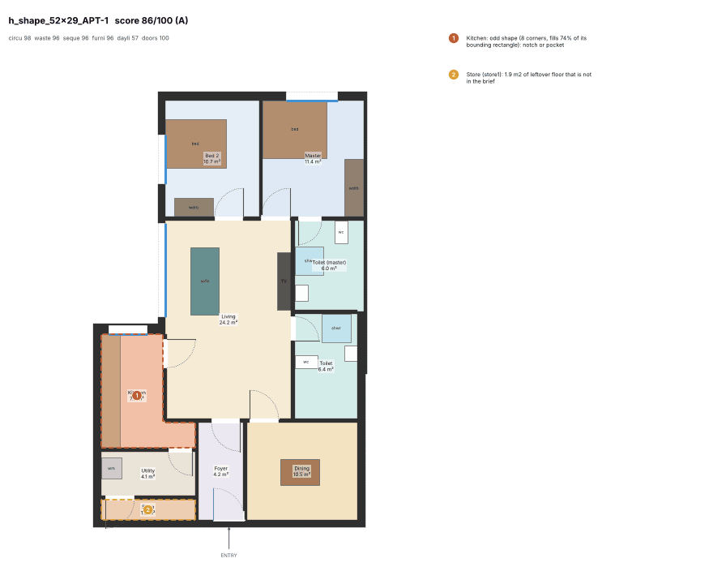
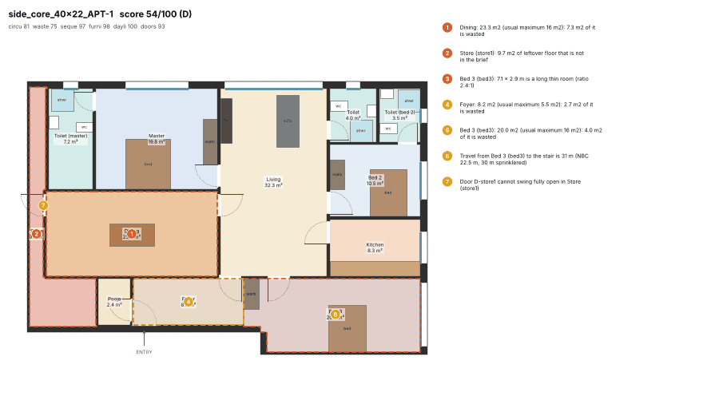
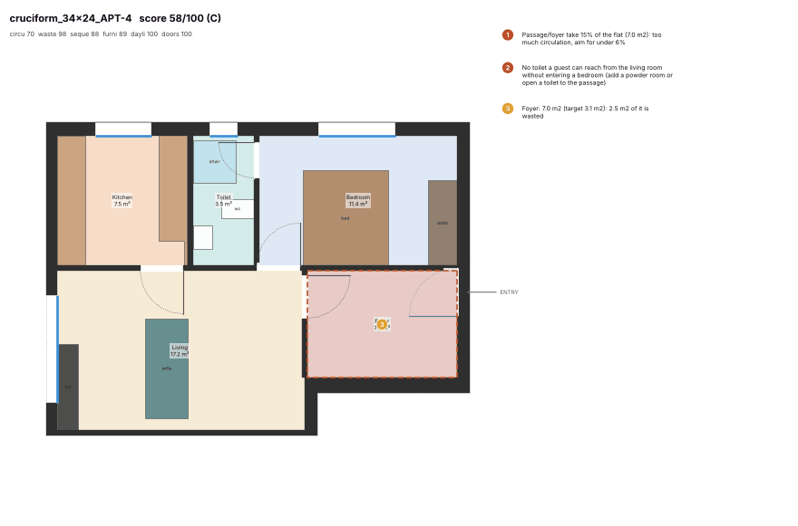
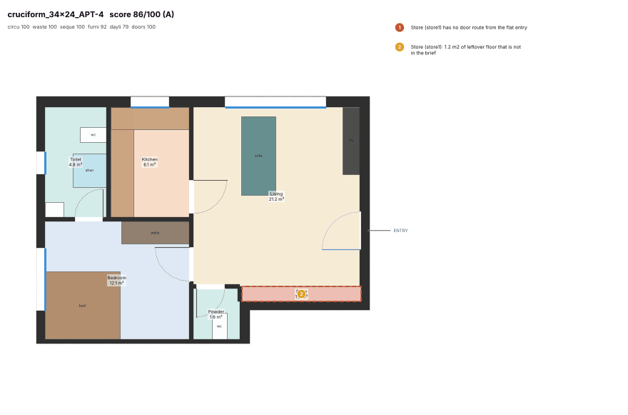

# Flat generator v2

Generator v2 rebuilds the flat layout pipeline around the owner's brief for usable Indian flats:
- you enter into the living room;
- the kitchen sits next to the living/dining;
- a guest toilet opens off the public zone;
- the bedrooms open onto one compact hub;
- circulation is minimal;
- there is no wasted floor.

It is measured with the deterministic critic (`planner_engine/quality.py`, see [critic.md](critic.md)) on the same 78 golden flats as the [baseline](critic.md#6-baseline-todays-generator-on-the-golden-flats).

Code: `planner_engine/diagram.py` (zoning pass), `solver.py` (CP-SAT model), `layout.py` (orchestration, two candidates), `drafting.py` (grow-to-fill, pocket rooms, leftovers, doors), `data/programmes/2bhk.json` (optional utility). Public APIs are unchanged: `solve_flat`, `FlatResult` and `draft` (one optional keyword `hub_point`). The DCPR validation loop is unchanged too: a drafted plan that fails a DCPR room check is never returned.

## 1. Result against the targets

| Target | Baseline | After (final run) | Met |
|---|---|---|---|
| Mean critic score >= 70 | 42.8 | **73.2** (six full runs: 69.7 to 73.5, see section 5) | yes, with run-to-run noise of about ±1.5 |
| No grade F | 35 F | **8 F** | **no**: 8 deep units, see section 6 |
| Median passage + foyer <= 6 % of the flat | 15.1 % | **4.9 %** (mean 4.5 %) | yes |
| No room where the furniture does not fit | 19 flats | **0** `furniture_none` | yes |
| 0 DCPR fails | 1 fail (and 3 flats unsolved) | **0** fails, 78/78 solved | yes (77 rooms on a mechanical duct = DCPR "review", see section 6) |
| >= 95 % of flats within 10 s, max 30 s | 7 flats > 10 s, max 29.6 s | **all 78 <= 8.3 s** (p50 8.1, p95 8.3) | yes |
| Existing tests pass | – | 356 existing + 5 new pass; no existing test edited | yes |

Grades went from 0 A / 11 B / 12 C / 17 D / 35 F (75 solved) to **26 A / 26 B / 14 C / 4 D / 8 F (78 solved)**. The baseline also solved 13 flats only by downgrading the programme ("Use 2 BHK", "Use 1 BHK"); v2 downgrades 2 (`t_shape_52x29` APT-2/6, see section 6).

## 2. What changed

### 2.1 Zoning model (`diagram.zone_programme`, `diagram.flex_links`)

Each flat is read as **public** (entry, living, dining, kitchen, powder, utility, balcony) → **hub** → **private** (bedrooms with attached toilets, dress).

* **Entry.** The front door opens into the foyer, the living room or the dining room. The solver chooses (`solver._door_any`):
  - the foyer is optional and paid for per m2 (circulation), so it appears only when the door is too far from the façade for a lit living room to reach it;
  - entering into the dining half of the living-dining costs 100 000 (the critic scores it 0.85) and is used only when the flat's depth leaves no other way.
* **Hub.** Every programme link "X – passage" for a private room (bedroom, study, common toilet, pooja) becomes *"X opens onto exactly one of (dining, passage, living)"*. The order is a preference: 300 per step down the list, plus 12 000 for each extra space the private doors use (one hub, the critic's `hub_share`). The passage is optional and is a cost, not a room with a target size. The kitchen opens onto dining or living, the balcony onto living or dining, and a wardrobe onto any bedroom.
* **Bedrooms away from the door.** Bedrooms keep 2 m clear of the front door (soft, 2 000).
* **Guest toilet.**
  - 1BHK programmes have only an attached toilet, so a powder room (`wc`, 1.8 m2) is added off the living room. Leaving it out costs 80 000, because a flat without a guest toilet loses about 15 critic points.
  - The guest toilet is pulled within 3 m of the living room (soft, 8 000).
* **Rooms an architect adds, not oversized rooms.** When the flat is bigger than its programme, rooms are added in order (all optional):
  1. an attached toilet for each bedroom without one;
  2. a walk-in wardrobe for the master;
  3. a study, only if the façade has 2.8 m to spare beyond the window rooms;
  4. wardrobes for the other bedrooms;
  5. a pooja room.

  "Bigger than its programme" means the programme's size caps, with lit rooms limited to about 5 m behind the façade, fall short of the net interior. The rooms the user placed are never removed. `FlatResult.diagram` returns the brief that was actually planned.

### 2.2 Circulation as a cost (`solver._Builder`)

* Passage and foyer have no target size. They cost 400 for existing plus 30 per cell; beyond 5 % of the flat each further cell costs 100, priced like wasted floor because the critic gates on `circ_share`.
* Passage and foyer are capped at 3.5:1 (a hub, not a gallery) and at 6 % / 5 % of the interior.
* Drafting never merges a leftover pocket of 1 m2 or more into a passage or foyer.
* Result: median passage + foyer **15.1 % → 4.9 %**, corridor length median 4.9 m → 0 m, `circ_share_high` 64 → 1 flat, `corridor_long` 40 → 7.

### 2.3 Fill the flat without oversizing (solver objective, `drafting.grow_to_fill`, `drafting.fill_pockets`, `_merge_leftover`)

* **Objective.** It mirrors the critic's waste rule. Each room has a soft cap of min(OVERSIZE, 1.3 × target + 0.5) net m2, the same table as `quality.OVERSIZE`. Per cell:
  - uncovered floor: 120;
  - floor above a room's cap: 100;
  - below the cap a room may grow cheaply: living 2, bedrooms 3, toilets 10, wc 15.

  Hard caps (1.3 to 1.6 × the soft cap) stop absurd rooms.
* **Grow-to-fill.** After the solve, room sides are pushed out into floor the solver left uncovered, but only across fully free strips. Rooms stay rectangles, no wall contact or door is lost, and each step is priced with the solver's own objective within aspect, hard cap and the 1/6 glazing rule.
* **Pocket rooms.** The largest remaining empty rectangle becomes a room an architect would put there:
  - an attached toilet for a bedroom that lacks one;
  - a walk-in wardrobe off a bedroom (<= 5.5 m2);
  - the programme's utility beside the kitchen;
  - a pooja room off the hub (<= 2.8 m2).
* **Leftover merge, new rules.**
  - Circulation takes leftovers last and never a pocket of 1 m2 or more.
  - Small rooms (pooja, wardrobe, powder, toilet, store, utility) never absorb a pocket beyond their own size.
  - A merge must keep the room near-rectangular (>= 75 % of its bounding rectangle for living/dining/kitchen, 85 % for others); otherwise the pocket becomes a store.
  - A usable pocket (1.5 to 6 m2, 0.9 m clear) against a bedroom becomes a wardrobe opening off that bedroom: the owner's "leftovers go to wardrobes/storage niches adjacent to bedrooms".
  - Pockets under 0.6 m2 stay solid, as a duct, instead of notching a room. This is plumbing-duct size; larger thresholds scored higher but would hide floor in walls, which the critic cannot see, so they were rejected.
  - A store never gets its door through a toilet.
* Result: median waste **17.8 % → 5.7 %**. `bloated` rooms went 62 → 37 flats, `room_small` 43 → 2.

### 2.4 Furniture-aware minimum sizes (`solver.FURN_MIN`)

Minimum clear dimensions were measured with the critic's own furniture placer (`quality.place_furniture`) on rectangles with a door: the smallest room where the full set fits.

| Room | Short side × net area |
|---|---|
| Master | 3.0 m × 11 m2 |
| Bedroom | 2.8 × 9.5 |
| Living | 3.2 × 12 |
| Dining | 2.7 × 7.5 |
| Kitchen | 2.0 × 6 |
| Toilet | 1.5 × 3.2 |
| Powder (wc) | 1.0 × 1.5 |

* Toilets: hard minimum.
* Living room: hard 2.8 m (below it the critic finds no sofa set at all), soft 3.2 m.
* Bedrooms and living otherwise soft at 150 000 (they are critic gates). The façade-starved flats need some softness: a 3BHK on a 14.7 m façade cannot have every bedroom at 3 m.

Result: `furniture_none` **19 → 0** flats, `fit_toilet` 0.86 → 1.00, `fit_sleep` 0.82 → 0.95.

### 2.5 Other solver changes

* **Glazing (1/6 rule).** It now needs the *overlap* of the room's side with the façade (>= area / 9 + 0.4 m), not the whole side on the façade, and the window run is set from the room's minimum area, not its scaled target. Without this, flats such as `h_shape_52x29_APT-1` (two façade edges of 6.2 and 6.9 m) were infeasible.
* **Toilet ventilation.** Façade or shaft is preferred, at a price of 70 000 for a mechanical duct. Before, a deep flat that could not vent every toilet failed into the fix ladder and lost its programme. Drafting marks such toilets `vent_via = "duct"` (DCPR 39(2) "review").
* **Wet clustering.** Toilets back to back on a shared wall are rewarded (3 000 per pair).
* **Two candidates.** Each flat is solved twice with different seeds (about 4 s each) and both are drafted; the critic, without its slower furniture pass, keeps the better (`layout._pick`). Rooms below their furniture size cost a candidate 10 points. Per-flat scores vary by about 7 points (SD) from run to run, so picking by the critic is worth about +1 on the mean. One 8 s solve beat best-of-two by solver objective, but not by critic score.
* **Fix ladder.** It no longer tries "drop room X" for optional rooms (the solver already leaves out what does not fit), so a genuinely infeasible flat reaches "smaller programme" within the budget.
* **Tried and rejected** (measured on full runs):
  - room edges on a 0.3 m grid: mean 66.2 vs 68-69, and two failures;
  - a hard 3.2 m door-cluster square: mean 64.1;
  - more CP-SAT workers / energetic no-overlap reasoning: no gain;
  - larger living/dining hard caps: 67 m2 dining rooms.

### 2.6 Drafting: doors

* Private doors on the hub are placed where their walls come closest to a common point: two rounds of projecting the centroid of the door walls. The solver may also hand a cluster point (`hub_point`, 4 m square, soft 6 000).
* Wardrobe and pooja doors swing into the small room.

## 3. How it was measured

* **Harness:** `planner_engine.quality.baseline()` on the 78 golden flats (`golden.golden_flats()`: 5 shapes × 3 envelopes, `split_units`), exactly as for the baseline.
* **Solving:** the flats were solved with `layout.solve_flat` in 2 worker processes (each CP-SAT solve uses 4 threads on the shared 4-core machine), the same as `quality.solve_golden(workers=2)`.
* **Outputs:** the solved plans are cached in [`after/golden_plans.json.gz`](after/golden_plans.json.gz) in the baseline's format, so:

```bash
cd engine
.venv/bin/python -m planner_engine.quality --baseline ../docs/quality/after            # rebuild scores + PNGs from the cache
.venv/bin/python -m planner_engine.quality --baseline ../docs/quality/after --resolve  # solve again (not bit-for-bit repeatable)
```

* **Files:** [`after/scores.json`](after/scores.json) holds one row per flat (same fields as `baseline/scores.json`), and `after/<flat>.png` holds 78 renders (1.4 MB in total).
* **Solve time:** this is `solve_flat` wall time including both candidates, the critic pick, drafting and DCPR validation.
* **DCPR:** every plan was re-checked with `checks.run_checks` (the golden gate's flat rules).
* **Critic bugs:** none found. `quality.py` is unchanged.

## 4. Numbers: baseline vs after

### Overall

| | Baseline | After |
|---|---|---|
| Flats solved | 75 / 78 | **78 / 78** |
| Mean / median score | 42.8 / 43.7 | **73.2 / 77.4** |
| Quartiles | 21.3 / 59.1 | 63.1 / 86.5 |
| Min / max | 16.0 / 76.7 | 22.4 / 99.3 |
| Solve time p50 / p95 / max | 8.6 / 23.7 / 29.6 s | 8.1 / 8.3 / 8.3 s |
| Flats over 10 s | 7 | 0 |
| Flats solved only by a smaller programme | 13 | 2 |

### Sub-scores (mean, 0-100)

| | circulation | waste | sequence | furniture | daylight | doors |
|---|---|---|---|---|---|---|
| Baseline | 61.9 | 73.0 | 89.1 | 89.5 | 99.7 | 98.7 |
| After | **88.2** | **89.4** | **94.9** | **98.3** | 83.4 | 97.0 |

Daylight drops because of ducted toilets (`wet_vent`), see section 6.

### Per metric (all flats solved by each generator)

| Metric | Baseline median | After median | Baseline mean | After mean |
|---|---|---|---|---|
| `circ_share` (% of net) | 15.10 | **4.90** | 15.63 | **4.45** |
| `corridor_len` (m) | 4.95 | **0.00** | 5.59 | 1.75 |
| `dead_end` (m) | 0.00 | 0.00 | 0.97 | 0.24 |
| `hub_spread` (m) | 3.52 | 4.29 | 3.39 | 5.62 |
| `hub_share` | 1.00 | 1.00 | 0.97 | 0.85 |
| `travel_to_exit` (m) | 22.8 | 19.8 | 24.2 | 21.3 |
| `room_aspect` | 0.99 | 1.00 | 0.96 | 0.98 |
| `room_shape` | 1.00 | 1.00 | 0.92 | 0.95 |
| `room_size` | 0.94 | **1.00** | 0.93 | 1.00 |
| `waste_share` (% of net) | 17.82 | **5.66** | 20.11 | **8.34** |
| `efficiency` | 0.87 | 0.87 | 0.86 | 0.87 |
| `entry_seq` | 1.00 | 1.00 | 1.00 | 0.98 |
| `kitchen_near` | 1.00 | 1.00 | 1.00 | 1.00 |
| `common_toilet` | 0.60 | **1.00** | 0.54 | **0.90** |
| `privacy` | 1.00 | 1.00 | 1.00 | 1.00 |
| `through_wet` | 1.00 | 1.00 | 0.93 | 1.00 |
| `attached_share` | 0.67 | 0.67 | 0.75 | 0.73 |
| `master_attached` | 1.00 | 1.00 | 1.00 | 1.00 |
| `wet_cluster` | 0.50 | 0.50 | 0.56 | 0.55 |
| `hab_window` | 1.00 | 1.00 | 1.00 | 1.00 |
| `wet_vent` | 1.00 | **0.83** | 1.00 | **0.81** |
| `swing_clash` (count) | 0 | 0 | 0.07 | 0.18 |
| `fit_sleep` | 0.83 | **1.00** | 0.82 | 0.95 |
| `fit_living` | 1.00 | 1.00 | 0.91 | 0.99 |
| `fit_kitchen` | 1.00 | 1.00 | 1.00 | 1.00 |
| `fit_toilet` | 1.00 | 1.00 | 0.86 | **1.00** |

`hub_spread` is worse than the baseline. The baseline's doors sat on long corridors, so the critic's spread was measured along a corridor, while its `corridor_len` was 4.9 m and `circ_share` 15 %. In v2 the doors open onto the dining/living, which removes the corridor but spreads the doors over a larger space: `hub_spread` is the second most frequent weakest link (10 flats).

### By plate shape

| Shape | Baseline n | Baseline mean | Baseline min | After n | After mean | After min | After F |
|---|---|---|---|---|---|---|---|
| central_core | 16 | 33.2 | 17.5 | 16 | 62.6 | 26.7 | 2 |
| cruciform | 16 | 53.1 | 19.1 | 16 | **83.7** | 70.6 | 0 |
| h_shape | 14 | 59.3 | 18.0 | 16 | **89.1** | 78.7 | 0 |
| side_core | 15 | 27.2 | 16.0 | 16 | 56.0 | 22.4 | 4 |
| t_shape | 14 | 42.0 | 19.6 | 14 | 74.7 | 35.3 | 2 |

### By flat size

BHK as planned; the baseline's downgraded flats count at their smaller size.

| BHK | Baseline n | Baseline mean | Baseline min | After n | After mean | After min | After F |
|---|---|---|---|---|---|---|---|
| 1 | 28 | 50.3 | 18.0 | 19 | **84.0** | 35.3 | 2 |
| 2 | 17 | 43.1 | 18.3 | 24 | **74.6** | 22.4 | 4 |
| 3 | 30 | 35.5 | 16.0 | 35 | **66.4** | 26.7 | 2 |

### Findings (flats affected, of 75 baseline / 78 after)

| Issue | Baseline | After |
|---|---|---|
| `circ_share_high` | 64 | **1** |
| `bloated` (room above its cap) | 62 | 37 |
| `room_small` | 43 | **2** |
| `corridor_long` | 40 | **7** |
| `leftover` (store not in brief) | 36 | 47 |
| `common_toilet_far` | 30 | 16 |
| `no_common_toilet` | 28 | **2** |
| `furniture_partial` | 28 | 5 |
| `furniture_none` | 19 | **0** |
| `dead_end` | 18 | 4 |
| `wet_scatter` | 18 | 23 |
| `room_shape` | 18 | 7 |
| `unreachable` (sealed pocket) | 13 | 25 |
| `hub_spread` | 4 | 20 |
| `swing_clash` | 5 | 14 |
| `through_toilet` / `toilet_through` | 5 / 5 | 0 / 0 |

The weakest link (the gate that capped the score) is now `waste_share` in 29 flats, `hub_spread` 10, `fit_sleep` 8, `common_toilet` 7, and none in 16.

`leftover` is reported in more flats than before (47 against 36), but the stores are smaller:
- median store 2.9 m2 against 9.2 m2 in the baseline;
- mean leftover floor per flat 5.0 m2 against 9.2 m2;
- waste overall fell from 17.8 % to 5.7 %. A pocket that no room may take without breaking its shape, its glazing or its size cap is now honestly a store instead of being hidden in a 30 m2 passage or a 40 m2 dining room.

## 5. Run-to-run variance

CP-SAT with several threads on a shared CPU is not repeatable. The same code gave these golden-set results over the last six full runs (runs 4 and 5 below differ only in later drafting tweaks):

| Run | Change | Mean | F | Median `circ_share` |
|---|---|---|---|---|
| 1 | one candidate | 71.6 | 7 | 4.9 % |
| 2 | one candidate (same code as 1) | 69.7 | 8 | 4.9 % |
| 3 | two candidates | 71.7 | 6 | 4.9 % |
| 4 | + furniture weights | 72.8 | 8 | 4.9 % |
| 5 | + hard 2.8 m living | 73.5 | 8 | 4.8 % |
| 6 (final, `after/`) | + dining entry 100 000 | 73.2 | 8 | 4.9 % |

A single flat's score moves by about 7 points (SD) between runs, and the mean by about ±1.5. The mean target is met in every run since the two-candidate pick (71.7 to 73.5), but by a margin of the same order as the noise.

## 6. What is still wrong (honest list)

1. **8 flats are F, all deep units the plate split produces.**
   - `side_core_52x29` APT-1/2/5/6: 2BHK, 146-149 m2 net, behind an 11.8 m façade and 13 m deep.
   - `central_core_52x29` APT-1/5: 3BHK, 14.7 m façade plus a windowless appendix of about 40 m2.
   - `t_shape_52x29` APT-2/6: 109 m2, single 9.5 m façade. Four window rooms at the DCPR minimum width need 9.8 m, so the fix ladder plans a 1BHK. The baseline did the same, and a windowless kitchen fails DCPR 39(1).

   In these flats the floor that daylight can reach (about 5 m behind the façade) is far smaller than the flat. Everything behind it must be windowless: dining, toilets, wardrobes, foyer, pooja, utility, about 60 m2 at most at the critic's size caps, against 75-100 m2 of floor. 15-25 % waste is therefore unavoidable for the programme the unit split assigns. All 8 are capped by `waste_share`. They score 22-38, against 16-24 in the baseline.

   Fixing them needs a different unit split or programme (more frontage per flat, or a 3BHK where the depth allows); that is outside the generator.
2. **Ducted toilets.** 77 of 196 wet rooms (39 %) have no façade or shaft contact and are drawn as mechanical-duct ventilated: DCPR 39(2) "review", not a fail. The baseline kept every toilet on the façade at the cost of everything else (median 15 % passage, 17.8 % waste). Many golden plates (central_core, side_core) have no shaft inside the flat. The duct price (70 000) was tuned: 100 000 gave 51 ducts but a mean of 69.8, and 50 000 gave 82 ducts and about 72. Approved Mumbai plans vent toilets through AVS shafts: adding shafts to the plate design would remove most ducts.
3. **Stores.** 47 flats have a leftover store (68 in total, median 2.9 m2; 25 flats have one without a door). The 8 F flats have 10-24 m2 stores. A pocket smaller than 0.6 m2 is drawn as a solid duct.
4. **Entry.**
   - 23 flats enter straight into the living room.
   - 43 enter through a short foyer (median 4.3 m2, max 8.2 m2) that leads into the living room. The critic scores this 1.0; the owner wanted it only for premium flats, but the solver uses it whenever the front door is too far from the façade.
   - 12 enter into the dining half of the living-dining (critic 0.85), mostly deep units.
5. **Hub spread.** Private doors are spread over 4.3 m (median) and 5.6 m (mean); `hub_spread` is a minor issue in 20 flats. A hard door-cluster constraint made packing worse; it is soft now.
6. **Door swings.** 14 flats have two door swings that clash (the critic reports which). Drafting does not yet flip hinges to avoid them.
7. **Added rooms.** 23 walk-in wardrobes, 23 pooja rooms, 17 powder rooms, 9 attached toilets, plus the programme's optional utility, are added when the flat is bigger than the programme. They are real Indian programme items, kept within the critic's size caps (dress 6, pooja 3, wc 2.5, toilet 5.5 m2). The critic does not count them as leftovers because they are rooms with a use and a door.

## 7. Before / after

Left: baseline; right: v2. Same unit, same plate.

**`h_shape_52x29_APT-1`: 18 F → 86 A.** The baseline had a 15 m2 foyer, a 14 m2 leftover store and a 1BHK instead of the 2BHK. v2 plans the 2BHK: a 4.2 m2 foyer into the living room, both bedrooms and both toilets opening off the living room, the kitchen with utility and the dining by the entry. Left: a 1.9 m2 store and an L-shaped kitchen.




**`side_core_40x22_APT-1`: 16 F → 54 D.** The baseline had a 48 m2 passage with three bedrooms and three toilets hung off it (41 % circulation). v2 has an entry foyer and passage of 8 m2, a central living-dining that serves the bedrooms, and toilets in a row on the façade. Still wrong: a 9.7 m2 store strip along the party wall, a long bedroom 3 (7.1 × 2.9 m) and an oversized dining (23 m2).




**`cruciform_34x24_APT-4`: 58 C → 86 A.** The baseline 1BHK had a 7 m2 foyer and a toilet only through the bedroom. v2 enters into the living room, adds a powder room off the living room, attaches the toilet to the bedroom, and has no passage at all. Left: a 1.2 m2 sealed pocket.




**A remaining F: `side_core_52x29_APT-6`, 20 → 22.** A 2BHK of 149 m2 net behind an 11.8 m façade. The windowless back half ends as two stores (22 and 14 m2): see section 6, item 1.


## 8. Files and tests

* **Changed:** `engine/planner_engine/{diagram,solver,layout,drafting}.py`, `engine/planner_engine/data/programmes/2bhk.json` (optional `utility` off the kitchen, as in the 3BHK and 4BHK presets).
* **Tests added:** `engine/tests/test_diagram_layout.py` (zoning: guest toilet, optional connectors, extras only in big flats, hub links) and `engine/tests/test_solver_drafting.py` (a solved 2BHK: critic `entry_seq` >= 0.85 and `circ_share` <= 12 %, no store of 5 m2 or more, every bedroom opens onto a public space; grow-to-fill keeps rectangles and never shrinks a room).
* **Tests changed:** none. The full engine suite passes (356 existing + 5 new).
* **Outputs:** `docs/quality/after/` (78 renders, `scores.json`, `golden_plans.json.gz`; 1.4 MB).
