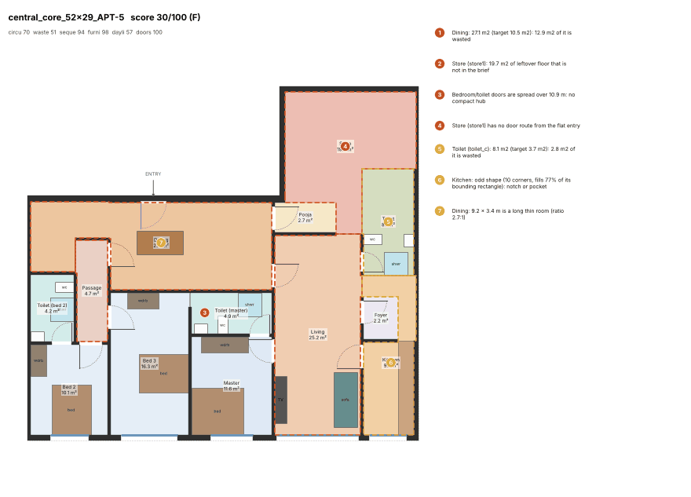
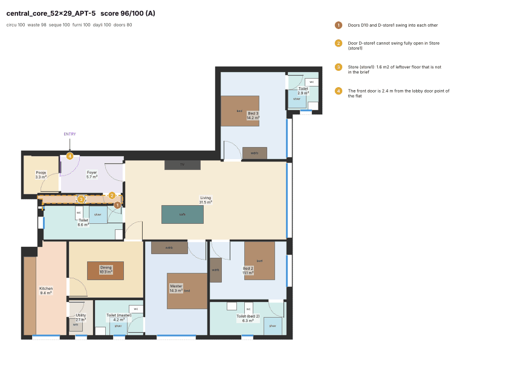
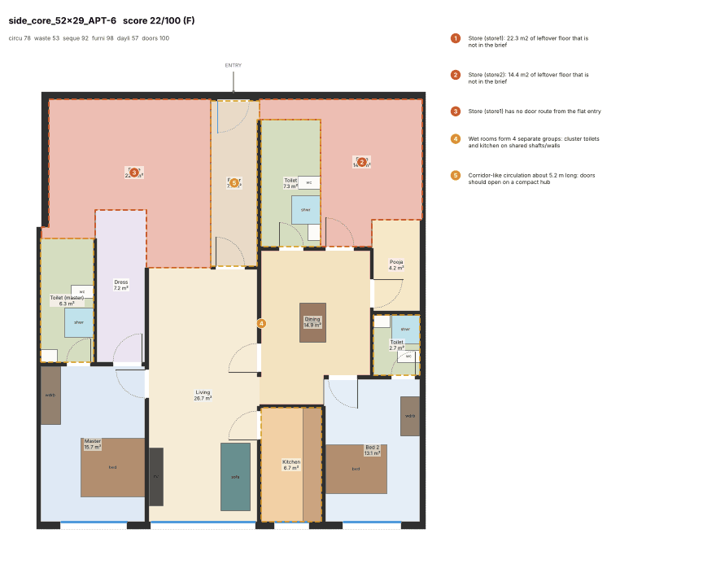
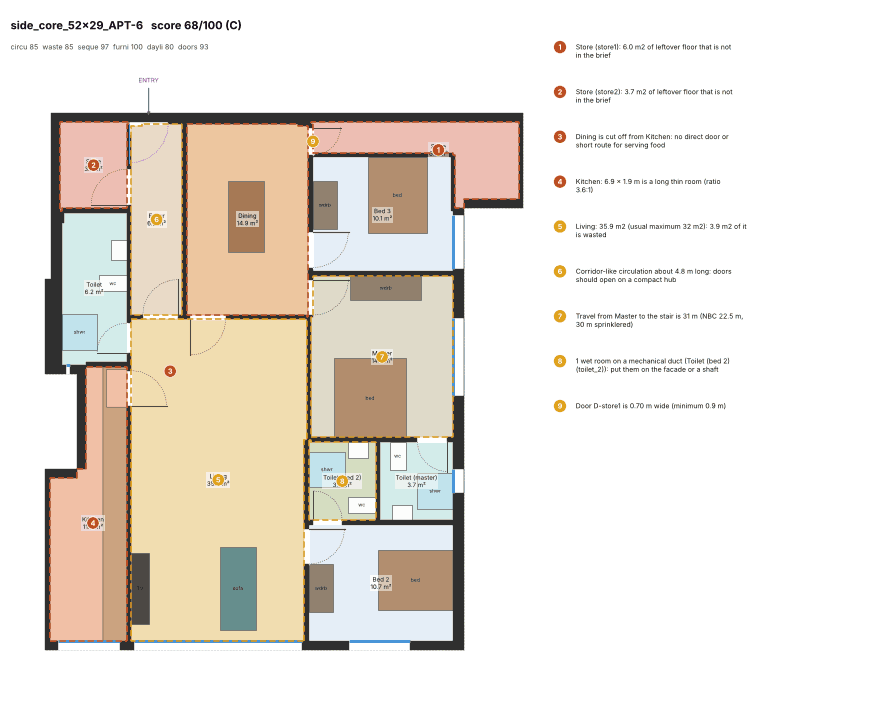
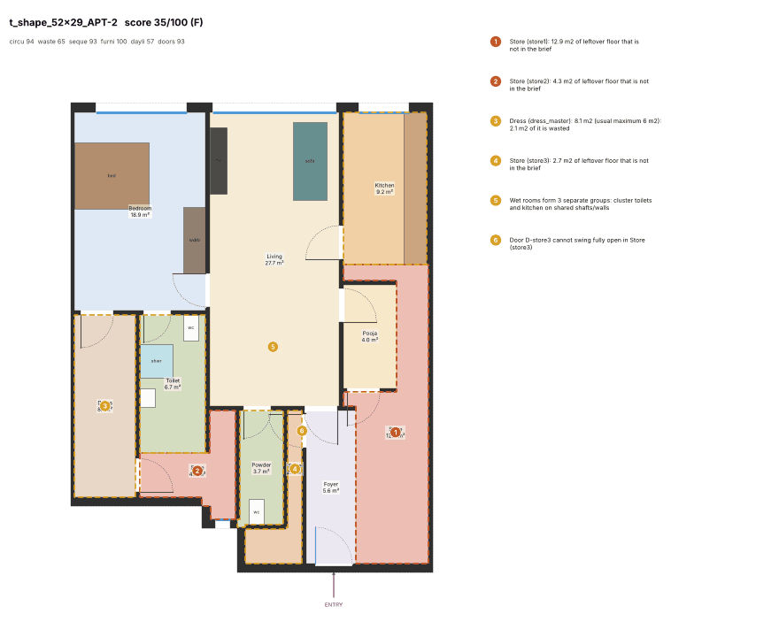
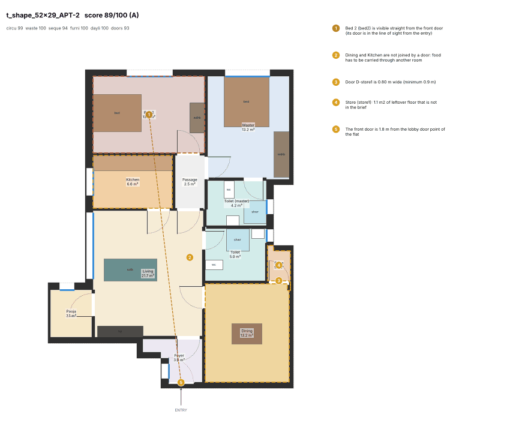
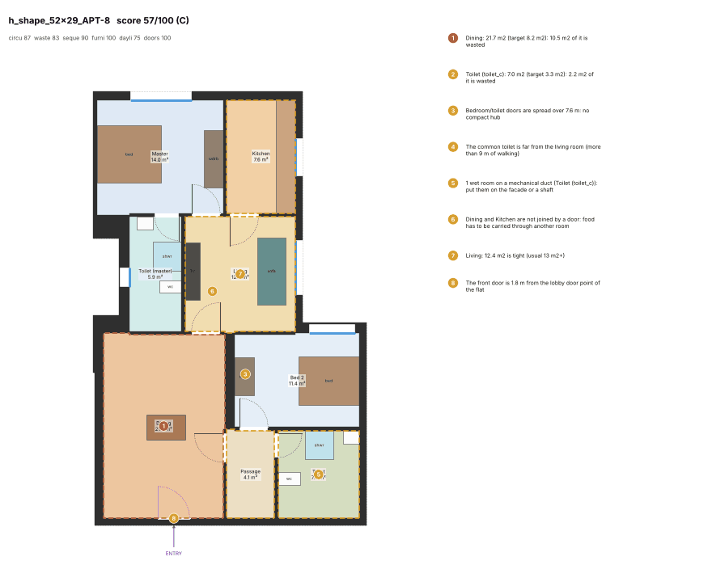

# Flat generator v3

Generator v3 builds on [generator v2](generator-v2.md). It is measured with the upgraded critic, critic v2 (`planner_engine/quality.py`, see [critic.md](critic.md), section 11), on the same 78 golden flats: 5 shapes × 3 envelopes, `golden.golden_flats()` + `units.split_units`.

The owner's brief:
- enter into the living room (only a premium flat may have a short foyer);
- the kitchen sits next to the living/dining;
- a guest toilet near the living room, reachable without crossing a bedroom;
- private bedrooms away from the entry, each with an attached toilet that opens into it;
- one compact hub;
- minimal passage and no wasted floor;
- wet rooms clustered on shafts.

**Baseline.** "v2" below is the generator-v2 plan cache (`after/golden_plans.json.gz`) re-scored with critic v2 ([`after/scores_critic_v2.json`](after/scores_critic_v2.json)): mean 69.9. The 73.2 in generator-v2.md was scored with the old critic.

**v3.** "v3" is one full re-solve of the final code ([`after-v3/`](after-v3/)).

Public APIs are unchanged: `solve_flat`, `FlatResult`, `draft`, `split_units`, `build_plate` and `fit` keep their signatures.

## 1. Result against the targets

| Target | v2 (critic v2) | v3 | Met |
|---|---|---|---|
| Mean critic score >= 78 | 69.9 | **81.0** (the same code scored 82.7 in the previous full run, see section 5) | yes |
| No grade F | 8 F | **0 F** | yes |
| <= 3 grade D | 2 D | **2 D** | yes |
| 0 DCPR fails | 0 | **0** (78/78 solved, `layout.room_check_fails` on every plan) | yes |
| Median passage <= 5 % | 4.90 % | **4.61 %** (passage + foyer, % of net; mean 3.73 %) | yes |
| Attached toilets always open into their bedroom | 0 `toilet_door_public` | **0**: every attached toilet (`toilet_m`, `toilet_2`, `toilet_bed*`, pocket toilets) has a door to a bedroom | yes |
| No bedroom at the entry | 6 flats `bedroom_at_entry` | **0** (`entry_privacy` = 1.0 in all 78) | yes |
| Kitchen always touching dining/living | `kitchen_near` min 1.0 | **min 1.0**: every kitchen has a door or a wall of 1 m or more to the dining/living | yes |
| Wet rooms on a mechanical duct <= 15 % | 77/196 = **39.3 %** | **25/203 = 12.3 %** | yes |
| Solve time >= 95 % within 10 s | 100 % (max 8.3 s) | **100 %** (p50 8.1 s, max 8.3 s); no flat needed the 30 s path | yes |
| Fix the 8 F flats at the source | 22-38 (F) | **58.6-95.8**: 2 A, 3 B, 3 C | yes, see section 2.1 |
| Tests pass | – | full suite passes; 2 tests changed, each with a written reason (section 7) | yes |

Grades went from 13 A / 33 B / 22 C / 2 D / 8 F to **37 A / 24 B / 15 C / 2 D / 0 F**. The median went from 75.1 to 84.3, the quartiles from 60.1 / 80.9 to 72.1 / 89.6, and the minimum from 22.1 to 52.1. No flat was solved with a smaller programme; v2 needed "Use 1 BHK" twice.

## 2. What changed

### 2.1 Plate: chowks for deep flats, AVS on the party walls (`plate.py`, `units.py`)

**Root cause of the 8 F flats.** All eight are deep units (`side_core_52x29` APT-1/2/5/6, `central_core_52x29` APT-1/5, `t_shape_52x29` APT-2/6): 13.6 m deep behind 9.5-15 m of façade. Daylight reaches about 5 m into a flat, so 60-100 m² of each flat could only take windowless rooms. Whatever the solver did, it ended as 15-25 % waste.

**Shared cut positions.** `units.split_pieces` (the old core-plate branch of `split_units`, extracted unchanged) is now the single source of the cut positions, the way the triangle plate already worked:
1. `plate.build_plate` cuts the flat zone provisionally.
2. It puts features on the cuts between flats.
3. `split_units` cuts the same geometry again: the flats plus the shafts and chowks taken out of them (`units.cut_geometry`, rebuilt from `plate.base_outline`). Cuts and features therefore line up.

**Features on each cut (`plate._cut_features`).**
- **Exterior chowk.** A flat whose gross area per metre of façade exceeds `CHOWK_RATIO` = 10 m is deeper than its façade can light. If the cut beside it is at least 10.5 m deep, the cut gets a chowk:
  - a 3.0 m slot open to the sky, cut into the plate outline;
  - it runs from the façade to 2.4 m short of the passage, half in each flat;
  - the flats keep their party wall at the back and gain the slot's sides as façade.

  Flats are served deepest first until none is too deep. This gives 4 chowks on `central_core_52x29`, 2 on `side_core_52x29` and 2 on `t_shape_52x29`.
- **AVS.** Every other cut of 6 m or more gets an air-ventilation shaft:
  - 1.6 × 2.4 m = 3.84 m², which meets the DCPR 39(2) default of 3.0 m² with a 1.5 m side;
  - it straddles the party wall 4.6 m behind the façade, or sits flush with the passage wall in a shallow flat;
  - it keeps 3.5 m clear of both flats' entry doors, so the living room can still reach the door.
- Both are parameters (`chowks`, `party_shafts`, 0/1, default 1), so a user can switch them off.

**Programme.** `pick_preset` is unchanged, but it now sees the chowk façade. The six deep 2BHK/1BHK flats become 3BHK and 2BHK flats of 84-126 m² net, which suits their light. The 4BHK programme was also tried for the large 150-167 m² 3BHK flats (approved 4BHK p25-p50 is 133-142 m²). It scored worse: 71.1 against 75.9 on those 16 flats, with more ducts and one 29.6 s solve. It was rejected and `data/programmes` is unchanged.

**Cost: less sellable floor.**
- The flat zone shrinks by **3.7 %** over the 15 golden plates (9,832 → 9,466 m²).
- On the 52.9 × 29 m plates the loss is larger: `central_core` −10.9 %, `t_shape` −7.7 %, `side_core` −6.3 %.
- AVS alone take 1-2 % elsewhere.

**Unchecked assumption.** The 3.0 m chowk width as a legal light source for habitable rooms on a 24-storey tower is an assumption. DCPR exterior-open-space rules depend on height, and a consultant must confirm them (see section 6).

### 2.2 Solver (`solver.py`): critic rules and approved patterns as soft costs

- **Hub doors are priced, not ranked** (`_adjacent_any`, `diagram.hub_door_cost`):
  - Bedrooms and studies pay `PATTERN_W × ln(p_best / p)`, where p is the approved share of what bedrooms open onto (an "unnamed" hub counts as a passage). For a 2BHK: passage 0, dining 2,381, living 2,648.
  - A guest/common toilet opening onto the dining room costs 40,000 (critic `toilet_door`); onto the living room or passage it costs 0.
  - The kitchen opening onto the living room instead of the dining room costs 40,000 (critic `dining_kitchen`).
- **Direction prior** (`_direction`, `diagram.direction_cost`). Bedrooms, the kitchen and toilets pay when their centroid lies no deeper from the entrance than the living room's. This is used only where approved flats put them further in a clear majority (forward sectors >= 60 % and n_projects >= 5). For a 2BHK the cost is 2,487-3,545.
- **Rule (b): patterns only where strong.** Every figure needs n_projects >= 5. The 4+ BHK direction figures fail this, so they add nothing.
- **Useful passage.** If a passage exists, at least 2 private doors open onto it (fewer if the flat has fewer); otherwise it would be a one-door orphan pocket. A foyer that exists must be the entrance.
- **Entry (rule (c)).**
  - The foyer costs nothing in a premium flat (3BHK+ or more than 110 m² carpet, `diagram.wants_foyer`).
  - In a compact flat it costs 50,000. That is cheaper than entering through the dining room (100,000), so a compact flat gets a foyer only when the living room cannot reach the door.
  - **The front door now slides along the flat's lobby frontage** (`door_pos`). Before, it was fixed at the middle of that edge, which often kept the living room from reaching it. `SolveResult.door_along` carries the position to drafting.
- **The v3 zoning also applies to 1BHK flats.** Before, they had no flexible hub door and fell back to the legacy model (`_Builder.zoned`).
- **Bedrooms away from the door.** A bedroom within 2.2 m of the front door now costs 30,000; it was 2,000 at 2.0 m.
- **Mechanical duct.** The price went from 70,000 to 90,000; the new shafts make the higher price affordable.

### 2.3 Drafting (`drafting.py`)

- **Sealed stores were a float bug.** Solver rectangles carry float noise such as `-10.219999999999999`, while leftover pockets did not. Two rooms whose walls differed by 1e-15 "shared" no wall, so the store got no door. That caused most of v2's 41 `orphan_pocket` flats.
  - All room cells are now rounded to 1 mm (`_on_grid`). It deliberately avoids `shapely.set_precision`, which attaches a precision grid that breaks `geo.clear_width`.
  - Pockets are grown back up to 0.3 m into the free floor so they meet their neighbours (`_snap_pockets`).
- **Pockets that only touch toilets** (`_seal_pockets`). Up to 2 m² the pocket becomes a solid plumbing duct. Larger, it joins the toilet if the toilet stays at least 75 % rectangular; otherwise it stays a store.
- **Doors of doorless rooms** prefer the hub or kitchen over a bedroom, and never a pooja room first.
- **Line of sight.** A bedroom door that falls in the front door's line of sight (rays ±0.3 m, the critic's) slides along its wall out of the line where the wall allows (`_out_of_sight`).

### 2.4 Tried and rejected

| Change | Result |
|---|---|
| 4BHK programme for 150-167 m² flats | 71.1 against 75.9 on 16 flats, 1 solve of 29.6 s |
| Foyer removed outright from compact flats | deep 2BHK flats then entered through the dining room (critic 0.85, gate 0.55); replaced by the 50,000 price |
| AVS only on cuts of 8 m or more | the 1BHK/2BHK powder rooms went back onto a duct; 6 m kept |
| Foyer price 25,000 / duct price 70,000 | mean 81.2, duct share 14.3 %; 50,000 / 90,000 gave 82.7 and 13.1 % |

## 3. How it was measured

```bash
cd engine
.venv/bin/python -m planner_engine.quality --baseline ../docs/quality/after-v3 --resolve   # solve + score + render (2 workers)
.venv/bin/python -m planner_engine.quality --baseline ../docs/quality/after-v3             # rebuild scores/PNGs from the cache
.venv/bin/python -m planner_engine.quality --baseline ../docs/quality/after --scores scores_critic_v2.json --no-render  # v2 baseline
```

- `after-v3/golden_plans.json.gz` holds the plans, `after-v3/scores.json` one row per flat, and `after-v3/*.png` 78 renders (1.4 MB in total).
- Solving used 2 worker processes. Each CP-SAT solve uses 4 threads on the shared 4-core machine, so there were at most 2 solves in parallel.
- Solve time is `solve_flat` wall time.
- DCPR was re-checked with `layout.room_check_fails` (the golden gate's flat rules).

## 4. Numbers: v2 vs v3 (critic v2, 78 flats each)

### Sub-scores (mean)

| | circulation | waste | sequence | furniture | daylight | doors |
|---|---|---|---|---|---|---|
| v2 | 92.6 | 87.8 | 94.9 | 98.3 | 78.6 | 97.0 |
| v3 | 92.5 | **93.8** | **97.4** | 98.2 | **93.5** | 97.1 |

### Per metric

| Metric | v2 median | v3 median | v2 mean | v3 mean |
|---|---|---|---|---|
| `circ_share` (% of net) | 4.90 | 4.61 | 4.45 | 3.73 |
| `corridor_len` (m) | 0.00 | 0.00 | 1.75 | 1.51 |
| `dead_end` (m) | 0.00 | 0.00 | 0.24 | 0.09 |
| `hub_spread` (m) | 4.29 | 5.73 | 5.62 | 6.01 |
| `hub_share` | 1.00 | 0.75 | 0.85 | 0.79 |
| `travel_to_exit` (m) | 19.8 | 20.0 | 21.3 | 21.5 |
| `room_aspect` | 1.00 | 1.00 | 0.98 | 0.99 |
| `room_shape` | 1.00 | 1.00 | 0.99 | 0.98 |
| `room_size` | 1.00 | 1.00 | 1.00 | 1.00 |
| `waste_share` (% of net) | 5.66 | 5.97 | 8.34 | **6.35** |
| `efficiency` | 0.87 | 0.86 | 0.87 | 0.85 |
| `orphan` (count) | 1.00 | **0.00** | 0.71 | **0.00** |
| `entry_seq` | 1.00 | 1.00 | 0.98 | 0.99 |
| `kitchen_near` | 1.00 | 1.00 | 1.00 | 1.00 |
| `common_toilet` | 1.00 | 1.00 | 0.91 | 0.87 |
| `privacy` | 1.00 | 1.00 | 1.00 | 1.00 |
| `through_wet` | 1.00 | 1.00 | 1.00 | 1.00 |
| `attached_share` | 0.67 | 0.67 | 0.73 | 0.75 |
| `master_attached` | 1.00 | 1.00 | 1.00 | 1.00 |
| `wet_cluster` | 0.50 | 0.50 | 0.55 | 0.55 |
| `entry_privacy` | 1.00 | 1.00 | 0.97 | **1.00** |
| `entry_sight` | 1.00 | 1.00 | 0.91 | **0.98** |
| `zone_order` | 1.00 | 1.00 | 0.98 | 0.99 |
| `toilet_door` | 1.00 | 1.00 | 0.85 | **0.98** |
| `dining_kitchen` | 0.60 | **1.00** | 0.66 | **0.90** |
| `hab_window` | 1.00 | 1.00 | 1.00 | 1.00 |
| `window_ratio` | 0.19 | 0.19 | 0.19 | 0.19 |
| `wet_vent` | 0.83 | **1.00** | 0.81 | **0.94** |
| `wet_duct` (count) | 1.00 | **0.00** | 0.99 | **0.32** |
| `swing_clash` (count) | 0 | 0 | 0.18 | 0.12 |
| `swing_free` (count) | 0 | 0 | 0.04 | 0.15 |
| `fit_sleep` | 1.00 | 1.00 | 0.95 | 0.96 |
| `fit_living` | 1.00 | 1.00 | 0.99 | 0.97 |
| `fit_kitchen` | 1.00 | 1.00 | 1.00 | 1.00 |
| `fit_toilet` | 1.00 | 1.00 | 1.00 | 1.00 |

### Findings (flats affected)

| Finding | v2 | v3 |
|---|---|---|
| `orphan_pocket` | 41 | **0** |
| `unreachable` (sealed pocket) | 25 | **0** |
| `wet_duct` | 46 | **19** |
| `toilet_to_dining` | 28 | **4** |
| `dining_kitchen_link` / `dining_isolated` | 28 / 14 | **11 / 3** |
| `bedroom_in_sight` | 12 | **2** |
| `bedroom_at_entry` | 6 | **0** |
| `zone_order` | 4 | 2 |
| `dead_end` | 4 | 0 |
| `leftover` (store not in brief) | 47 | 41 |
| `bloated` (room above its cap) | 37 | 31 |
| `common_toilet_far` | 16 | **21** (worse) |
| `hub_spread` | 9 | **16** (worse) |
| `swing_blocked` | 3 | **12** (worse) |
| `aspect` | 2 | 6 (worse) |
| `no_common_toilet` | 2 | 4 (worse) |

**Weakest link** (the gate that capped the score), in flats:

| Gate | Flats |
|---|---|
| `waste_share` | 30 |
| none | 17 |
| `common_toilet` | 9 |
| `hub_spread` | 8 |
| `fit_sleep` | 5 |
| `dining_kitchen` | 4 |
| `corridor_len` | 3 |

`orphan` was the weakest link in 22 v2 flats and now caps none.

### By plate shape

| Shape | v2 mean | v2 min | v2 F | v3 mean | v3 min | v3 D | v3 F |
|---|---|---|---|---|---|---|---|
| central_core | 60.1 | 28.5 | 2 | **81.0** | 52.1 | 1 | 0 |
| cruciform | 80.3 | 58.6 | 0 | **88.6** | 69.4 | 0 | 0 |
| h_shape | 82.3 | 59.5 | 0 | 82.6 | 57.1 | 0 | 0 |
| side_core | 56.6 | 22.1 | 4 | **67.8** | 54.1 | 1 | 0 |
| t_shape | 70.4 | 36.1 | 2 | **85.3** | 71.1 | 0 | 0 |

### By flat size (BHK as planned)

| BHK | v2 n | v2 mean | v3 n | v3 mean | v3 min |
|---|---|---|---|---|---|
| 1 | 19 | 82.2 | 17 | **92.6** | 86.5 |
| 2 | 24 | 66.8 | 21 | **80.2** | 57.1 |
| 3 | 35 | 65.5 | 40 | **76.4** | 52.1 |

### The 8 former F flats

| Flat | v2 score (BHK, net m²) | v3 score (BHK, net m²) |
|---|---|---|
| side_core_52x29_APT-1 | 34.4 F (2, 147) | 65.1 C (3, 125) |
| side_core_52x29_APT-2 | 36.1 F (2, 146) | 77.9 B (3, 125) |
| side_core_52x29_APT-5 | 32.0 F (2, 147) | 58.6 C (3, 125) |
| side_core_52x29_APT-6 | 22.1 F (2, 149) | 67.6 C (3, 126) |
| central_core_52x29_APT-1 | 28.5 F (3, 145) | 77.1 B (3, 124) |
| central_core_52x29_APT-5 | 32.1 F (3, 147) | **95.8 A** (3, 124) |
| t_shape_52x29_APT-2 | 36.1 F (1, 104) | **88.9 A** (2, 87) |
| t_shape_52x29_APT-6 | 38.2 F (1, 103) | 83.7 B (2, 84) |

### Entry

| | Into living | Foyer | Dining |
|---|---|---|---|
| Compact flats (< 3BHK and <= 110 m²), 38 | 24 (v2 15) | **10** (v2 20) | **4** (v2 3) |
| Premium flats, 40 | 11 | 28 | 1 |

## 5. Run-to-run variance

CP-SAT with several threads is not repeatable, and a single flat moves by several points between runs.

| Run | Code | Mean | F / D | Duct share |
|---|---|---|---|---|
| A | final, previous full run | 82.7 | 0 / 1 | 13.1 % |
| B | final (`after-v3/`) | 81.0 | 0 / 2 | 12.3 % |
| earlier | iterations with weaker settings | 79.8-81.2 | 0 / 2-4 | 12-15 % |

The mean target (78) is met by about 3 points in both runs of the final code, above the observed noise.

## 6. What is still wrong (honest list)

1. **Chowks are an assumption.** The 3.0 m exterior chowk is treated as a façade: windows of bedrooms and kitchens and vents of toilets go on it.
   - DCPR 2034 sizes exterior open spaces by building height. A 3 m slot 11 m deep on a 24-storey tower may not qualify as a light source for habitable rooms. A consultant must confirm it, as for the AVS size.
   - If it does not qualify, the chowk still ventilates wet rooms, but the six deep flats lose their bedroom windows.
   - The chowks cost floor area (section 2.1).
2. **Waste is still the main cap** (weakest link in 30 flats).
   - 41 flats keep a leftover store, and 31 have a room above its size cap.
   - The two D flats are large 3BHKs of 165 m²: `central_core_40x22_APT-4` (52.1) and `side_core_40x22_APT-3` (54.1).
   - The golden plate split makes flats of 150-167 m² gross, larger than approved 3BHKs (p90 119.5 m² carpet), and the 4BHK alternative scored worse.
3. **Regressions against v2.** Some flats score lower than in v2 (v2 → v3):
   - `h_shape_52x29_APT-8` 82.0 → 57.1;
   - `h_shape_52x29_APT-1` 81.5 → 65.2;
   - `side_core_52x29_APT-7` 72.6 → 58.7;
   - `central_core_40x22_APT-4` 64.6 → 52.1.

   The `h_shape_52x29` 2BHK flats (8.5 m wide, 13.6 m deep) used a foyer and a 24 m² living room in v2. In v3 the compact-flat foyer price leads to dining-room entries and oversized dining rooms there.
4. **Entry.**
   - 10 compact flats still have a foyer: the living room cannot reach the door even with the sliding door.
   - 5 flats (4 compact, 1 premium) enter through the dining room (critic 0.85).
   - The owner asked for living-room entry in all compact flats; 24 of 38 have it.
5. **The front door slides.** It now sits up to a few metres from `unit.core_link`. The critic's `entry_off_core` is informational and appears in 42 flats.
   - `travel_to_exit` still measures from `unit.core_link`.
   - Anything that draws the lobby from `core_link` should use the plan's entry door instead.
6. **Smaller regressions.**
   - Store doors swing into small stores: `swing_blocked` in 12 flats.
   - The guest toilet is more than 9 m from the living room in 21 flats (`common_toilet_far`), because toilets no longer open onto the dining room.
   - `hub_spread` worsens (median 4.3 → 5.7 m), because bedrooms now prefer the passage (the approved pattern) over the dining room.
7. **Patterns are mild.** At `PATTERN_W` = 1,500 the direction and hub priors steer only between layouts of similar quality. Critic-derived costs (toilet onto dining, kitchen onto living, bedroom at the door) are far larger.

## 7. Files and tests

**Changed:**
- `engine/planner_engine/plate.py`: `_cut_features`, `base_outline`, chowk/AVS constants, `chowks` / `party_shafts` parameters.
- `engine/planner_engine/units.py`: `split_pieces`, `cut_geometry`; `split_units` cuts the same geometry as the plate.
- `engine/planner_engine/diagram.py`: approved-pattern costs, `wants_foyer`.
- `engine/planner_engine/solver.py`: priced hub doors, direction prior, useful passage, foyer = entry, sliding front door, zoning for 1BHK, door/duct weights.
- `engine/planner_engine/layout.py`: carries the solved door position into drafting.
- `engine/planner_engine/drafting.py`: mm grid, pocket snap/seal, door preference, line-of-sight door slide.

**Unchanged:** `data/programmes/*.json` (the 4BHK change was reverted).

**Tests changed:** `engine/tests/test_solver_drafting.py`, `test_infeasible_core_names_rooms` and `test_fix_ladder_finishes_the_plan`.
- **Reason:** they put a 4BHK into `central_core_52x29_APT-1` to get an impossible brief. v3's chowk gives that flat 30 m of façade, and a 4BHK now fits.
- **New flats:**
  - the explanation test uses `h_shape_52x29_APT-1` (100 m², 15.8 m façade);
  - the fix-ladder test uses `t_shape_40x22_APT-1` (87 m²: 4BHK → 3BHK → 2BHK), because in the 100 m² flat the 3BHK attempt can use up the 9.5 s budget.
- The reason is written in the test file.

No other test was edited. The full engine suite passes and ruff is clean.

## 8. Before / after

Left/top: v2 (`after/`); right/bottom: v3 (`after-v3/`). Same plate envelope. The unit outline changes where v3 cut a chowk or a shaft.

**`central_core_52x29_APT-5`: 32.1 F → 95.8 A.**
- **v2:** a 3BHK behind 15 m of façade, ending in a 19.7 m² sealed store, a 27 m² dining room and all three toilets on a mechanical duct.
- **v3:** a chowk on the party wall gives the flat 30 m of façade.
  - The living room, Bed 2, Bed 3 and their toilets have windows on the chowk.
  - The common toilet is on the new AVS, so no wet room is ducted.
  - A foyer (premium flat) leads into a 31.5 m² living room.
- **Left:** a 1.6 m² store.




**`side_core_52x29_APT-6`: 22.1 F → 67.6 C.**
- **v2:** a 2BHK of 149 m² with 22 m² and 14 m² stores.
- **v3:** a 3BHK. The master, its toilet, Bed 2 and Bed 3 take their windows from the chowk; the common toilet is on an AVS.
- **Still wrong:**
  - a 36 m² living room;
  - two stores (6.0 and 3.7 m²);
  - a kitchen 1.9 m wide off the living room, which cuts the dining room off from it;
  - Bed 3 has no attached toilet;
  - Bed 2's toilet is on a duct.




**`t_shape_52x29_APT-2`: 36.1 F → 88.9 A.**
- **v2:** a 1BHK in 104 m², with 13 m², 4 m² and 3 m² stores and both wet rooms on a duct.
- **v3:** a 2BHK.
  - The living room, kitchen and Bed 2 have windows on the new chowk.
  - Both toilets are on an AVS.
  - The master's toilet opens into the master.
- **Still wrong:** the kitchen opens onto the living room, not the dining room; a 3 m² foyer in a compact flat; Bed 2's door is in the front door's line of sight.




**A regression: `h_shape_52x29_APT-8`, 82.0 → 57.1** (section 6, item 3).


