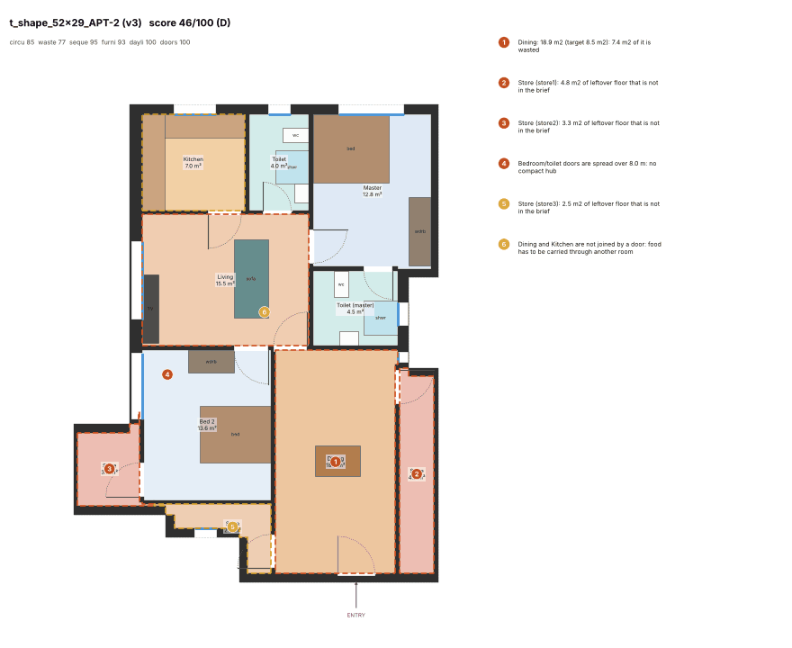
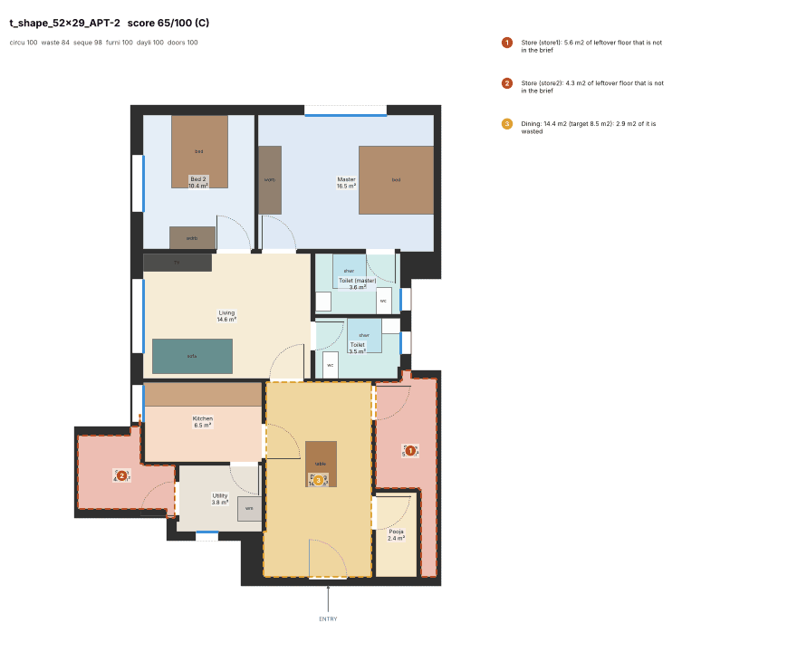
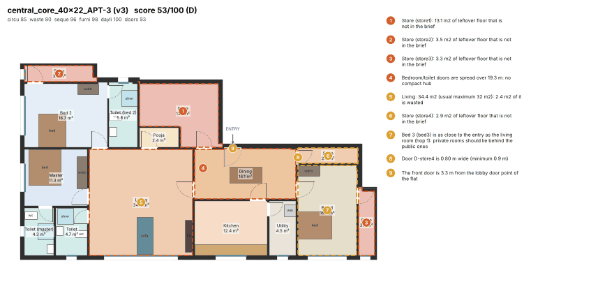
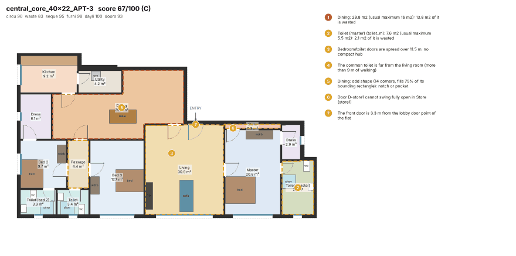
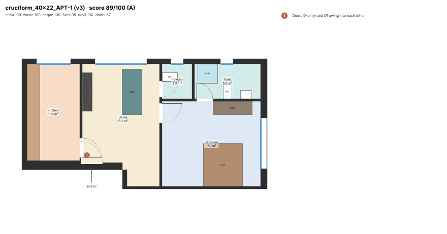
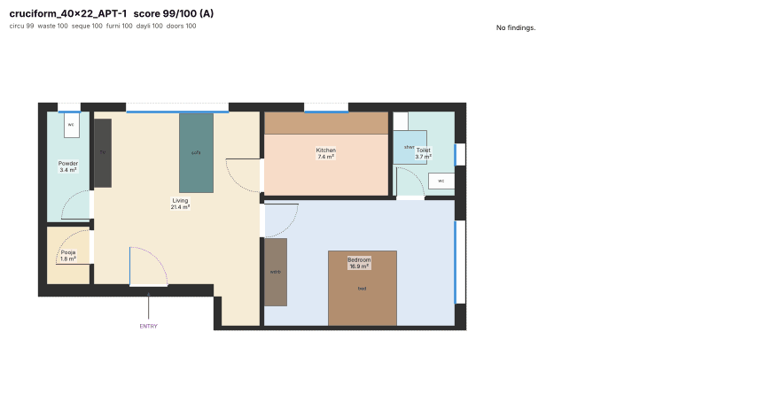
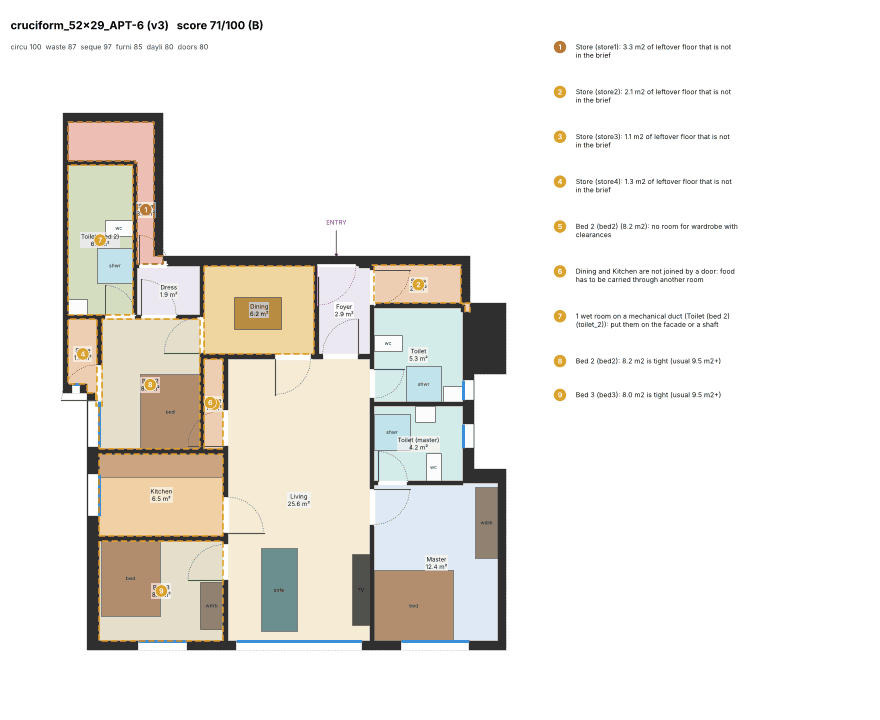
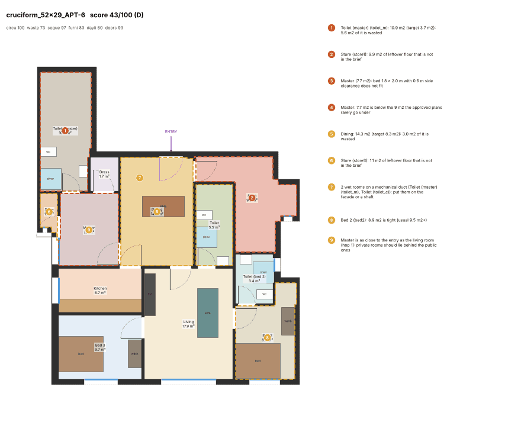
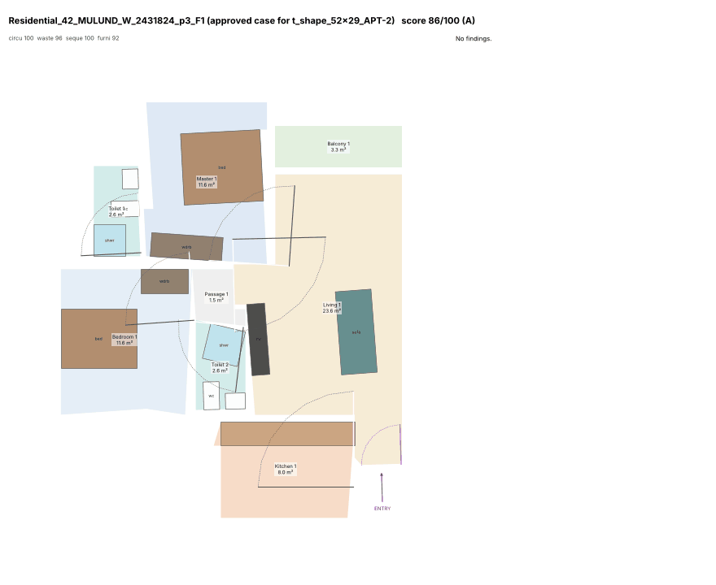
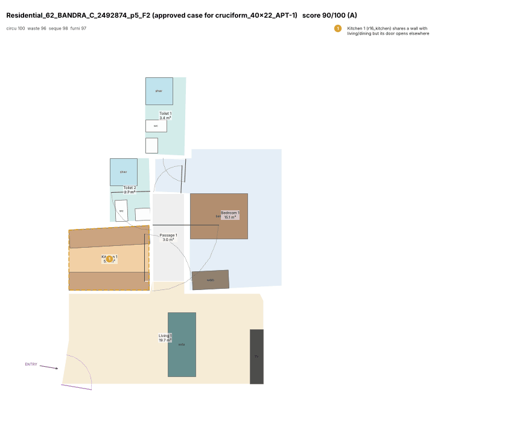

# Flat generator v4: case-based arrangement from approved flats

Generator v4 builds on [generator v3](generator-v3.md). It adds a library of approved Mumbai flats, retrieves the most similar ones for each flat, and lets them steer the room arrangement through the CP-SAT solver. It is measured with the **current critic** (critic v2 plus the three rules of [critic.md](critic.md) section 12) on the 78 golden flats (5 shapes × 3 envelopes).

**Short answer: the main targets are not met.** The case library, retrieval and adaptation work, and the dining room now touches the kitchen in 95 % of flats. The critic mean barely moves: 77.1 for v4 against 76.9 for v3 on the same plates, inside the run-to-run noise. Large 3BHK flats still lose most of their score to waste.

## 0. Read this first: the golden plates changed under this step

While this step ran, `engine/planner_engine/plate.py` (and `engine.py`, `server.py` and the app) were changed by another, uncommitted step in the working tree, which wired the core library into the plates. Those files are outside this step's allowed files, and I did not edit them. The new cores change the golden flats themselves: their outlines, doors and some programmes.

- **v3 on the old plates** (the `after-v3/` cache re-scored, `scores_critic_v3.json`): mean 80.4. Re-solving the HEAD code on the HEAD plates gave 80.9.
- **v3 on the current plates** (HEAD `solver/layout/diagram/drafting/models.py` plus the current working tree): **mean 76.9** (a second equivalent run gave 77.1).
- So the plate change alone costs about 4 points. The only fair comparison is v3 and v4 **on the same current plates**, and every v3 figure below is that one ([`after-v4/scores_v3_same_plates.json`](after-v4/scores_v3_same_plates.json)).

## 1. Result against the targets

| Target | v3, same plates | v4 ([`after-v4/`](after-v4/)) | Met |
|---|---|---|---|
| Mean critic score >= 85 | 76.9 | **77.1** (second run: 78.2) | **no** |
| No grade D/F | 9 D, 0 F | **2 D, 3 F** (second run: 9 D, 0 F) | **no** |
| Entry into the living room (foyer only for large flats) >= 85 % | 63/78 = 81 % (direct into living 38 = 49 %) | **64/78 = 82 %** (direct 37 = 47 %; second run 67/78 = 86 %) | **no** (borderline) |
| Dining touching the kitchen >= 90 % (door, or a shared wall >= 0.8 m: critic `dining_kitchen` >= 0.7) | 49/60 = 82 % | **57/60 = 95 %** (second run 54/60 = 90 %) | **yes** |
| 0 DCPR fails | 0 | **0** (`layout.room_check_fails` on all 78) | **yes** |
| >= 95 % of flats within 10 s | 100 % (max 8.6 s) | **100 %** (p50 9.0 s, p95 9.3 s, max 9.7 s); 1 of 78 took the 30 s path in one of the tuning runs (17 s) | **yes** |
| APIs and tests pass | – | `solve_flat`, `FlatResult`, `draft`, `Plan` are backward compatible; the full suite passes after 2 test-flat changes forced by the plate change, see section 7 | yes |

"Large" means more than 110 m² carpet, the owner's "large/premium". The entry count is: entries into the living room, plus foyer entries in large flats.

## 2. What was built

### 2.1 Case library (`engine/tools/build_casebase.py` → `planner_engine/data/casebase_v1.json.gz`, 0.11 MB)

1. Take every kept flat of `data/mined/graphs_v2.jsonl.gz` (1,264), one per (project, signature): 974.
2. Convert each with `approved_bench.convert`. Keep it only when the conversion is reliable (`approved_bench.usable`: little guessed or dropped floor, every room reachable): 593.
3. Score each with the current critic (the approved-plan exclusions of `approved_bench`). The 593 grade 157 A / 280 B / 138 C / 17 D / 1 F.
4. Keep the flats that score **>= 70** (A/B), have a living room and a kitchen, and 1-4 bedrooms.

That leaves **432 cases from 38 projects**: 68 1BHK, 243 2BHK, 121 3BHK. There is no 4BHK case.

Each case is stored in a canonical **entrance frame**:
- `v` (depth) runs from the side the front door faces out of to the opposite side of the bounding box;
- `u` runs along the entrance side, to the right of a person in the doorway;
- both are normalised to [0, 1].

The frame comes from the converted plan: the entrance room's wall at the entry point gives the inward direction, snapped to an axis.

Per case the library stores:
- programme counts (rooms with types and areas, BHK);
- carpet area;
- bounding-box W × D in metres;
- door position (u, v);
- façade coverage of the front, back, left and right sides, from the mined `facade_sides`;
- the entry room type;
- each room as a normalised rectangle, a normalised polygon and its façade sides;
- the door graph (room index pairs);
- the critic score and grade.

In 90 % of the cases the door sits within v <= 0.31 of the front, so the frame is stable. 398 of the 432 cases enter into the living room, 31 into a foyer and 3 into a dining room.

### 2.2 Retrieval (`casebase.retrieve(unit, programme, k)`)

The flat's frame comes from its solver grid (`casebase.unit_frame`): the grid's bounding box, the door edge's inward normal, the door position, and façade coverage per side from the grid's façade edges. The expected carpet is 0.92 × the net interior.

**Filter:**
- same BHK;
- carpet within ±20 %.

When fewer than k cases pass, the filter widens to ±35 % and then to BHK ±1.

**Rank** by the distance

```
2·|Δ ln(D/W)| + 1.5·|Δ door u| + Σ|Δ façade coverage per side| + 0.5·|Δ number of façade sides| + 2·|ln(carpet ratio)| − 0.01·(score − 75)
```

Each case is tried as drawn and mirrored (u → 1 − u, left and right façades swapped), and the better of the two counts. Ties break on the case id, so retrieval is deterministic (tested).

### 2.3 Adaptation (`casebase.adapt(case, ug, specs, links, mirror)`)

1. **Map** each case room's rectangle from (u, v) into the flat's 10 cm grid. This stretches the case independently along the two axes, mirrored when chosen.
2. **Match** case rooms to programme rooms by Hungarian assignment (`casebase.hungarian`, no scipy at runtime).
   - Dry rooms are matched first, on type compatibility plus |ln(scaled case area / target)|. master↔bedroom costs 0.5 and foyer↔passage 0.8. A room may stay unmatched at a cost of 2.5.
   - Wet rooms are matched second. A wet room pays 1.5 more when the case toilet's bedroom is not the bedroom the programme attaches it to.
3. **Guide** the solver (`solver._Builder._guide`). All of it is soft, so geometry, minimum sizes, DCPR, windows and ventilation stay exactly as in v3:
   - room centre to case centre: 6 per cell per axis, plus 3 per cell of side-length difference;
   - **relative order**: for every pair of matched major rooms whose case centres are at least 1 m apart on an axis, a pair in the opposite order costs 2,500;
   - solution hints: each matched room's case rectangle and its presence;
   - when the case enters into the living room and the flat has no more than 110 m² carpet, a foyer costs 40,000;
   - **hard** in guided solves only: the kitchen door opens onto the dining room when the flat has one (the owner's "kitchen close to dining"). A guided layout that cannot do it fails, and v3 or another case wins.

### 2.4 Choosing the plan (`layout.solve_flat`)

When the flat has at least 8 s of budget and the library returns cases, four candidates get equal time slices of (9.5 − 0.5 − 4 × 0.35) / 4 ≈ 1.9 s each:
- the unguided v3 layout;
- one layout guided by each of the top 3 cases.

Each candidate is drafted and scored by the **full critic, furniture included** (about 0.2-0.3 s; v3 used a furniture-free proxy), and the best one is kept.

Fallbacks:
- If the v3 layout is proven infeasible, the cases are skipped (they add only soft costs) and the v3 fix ladder runs.
- If it timed out empty, the cases still try.
- With a smaller budget, the v3 two-seed path runs unchanged.

What is recorded:
- the chosen case id goes to `FlatResult.case_id` and to the new optional `Plan.case_id` (default `None`; `models.py`, one field);
- it is appended to the message ("Arrangement after approved case …");
- `FlatResult.candidates` lists every candidate's case id and critic score.

## 3. Numbers (critic as of this step, 78 flats each, same plates)

| | v3 | v4 run A (`after-v4/`) | v4 run B (`scores_v4_run_b.json`) |
|---|---|---|---|
| Mean / median | 76.9 / 81.1 | 77.1 / 79.9 | 78.2 / 82.2 |
| p25 / p75 | 69.3 / 87.7 | 67.7 / 86.7 | 69.2 / 88.6 |
| Min | 40.1 | 28.0 | 43.7 |
| A / B / C / D / F | 28 / 29 / 12 / 9 / 0 | 29 / 27 / 17 / 2 / 3 | 33 / 25 / 11 / 9 / 0 |
| 1BHK mean (n = 18) | 90.2 | 92.7 | 92.9 |
| 2BHK mean (n = 13) | 72.9 | 77.1 | 74.4 |
| 3BHK mean (n = 46) | 73.1 | 71.2 | 73.6 |
| Case layout chosen | – | 45 / 78 | 44 / 78 |
| Solve time p50 / max | 8.1 / 8.6 s | 9.0 / 9.7 s | 8.9 / 9.5 s |
| Sub-scores: circulation / waste / sequence / furniture / daylight / doors | 92.9 / 92.6 / 96.9 / 97.5 / 95.9 / 96.1 | 93.1 / 92.1 / 97.3 / 97.0 / 91.7 / 95.4 | 92.2 / 91.9 / 97.4 / 97.4 / 91.4 / 96.2 |

### Entry room

| | Living | Foyer, large | Foyer, compact | Dining |
|---|---|---|---|---|
| v3 | 38 | 25 | 9 | 6 |
| v4 run A | 37 | 27 | 10 | 4 |
| v4 run B | 38 | 29 | 8 | 3 |

### Issues (flats affected; v3 → v4 run A)

| Change | Issues |
|---|---|
| Better in v4 | `dining_kitchen_link` 9 → **2**; `dining_isolated` 2 → 1; `bedroom_at_entry` 10 → 8; `hub_spread` 17 → 12; `entry_off_core` 44 → 41; `bloated` 32 → 30; `door_narrow` 9 → 7 |
| About the same | `leftover` 46 → 48; `common_toilet_far` 18 → 20; `no_common_toilet` 4 → 4; `toilet_to_dining` 5 → 4; `travel_far` 7 → 6 |
| Worse in v4 | `wet_duct` 11 → 23; `swing_blocked` 15 → 21; `hub_split` 3 → 8; `room_small` 5 → 10; `furniture_partial` + `furniture_none` 6 → 12; `wet_scatter` 2 → 6 |

**Weakest link** (v3 → v4 run A):

| Gate | v3 | v4 |
|---|---|---|
| `waste_share` | 33 | 31 |
| `common_toilet` | 7 | 11 |
| `hub_spread` | 9 | 6 |
| none | 5 | 11 |

### Run-to-run noise decides the mean

CP-SAT with 4 threads is not repeatable, and one flat can move by 30-45 points between runs:
- `side_core_40x22_APT-3`: 74.4 (v3) → 28.0 (v4 run A) → 55.3 (an earlier v4 run);
- `t_shape_52x29_APT-2`: 85.6, 53.0 and 46.3 in three v3 runs.

All golden runs of this step:

| Code | Runs: mean |
|---|---|
| v3 (same plates) | 76.9, 77.1 |
| v4 final configuration | 77.1, 78.2 |
| v4 variants tried (section 5) | 75.0-78.8 |

The v4-v3 difference (+0.2 to +1.3) is inside this noise. I do not claim a mean improvement.

## 4. Before / after (v3 → v4, same plates)

Left/top v3, right/bottom v4.

**`t_shape_52x29_APT-2`: 46.3 D → 65.0 C** (case `Residential_42_MULUND_W_2431824:p3:F1`).
- **v3:** findings `bloated`, `leftover`, `hub_spread` and `dining_kitchen_link` (the dining room is not joined to the kitchen).
- **v4:**
  - the kitchen sits beside the entrance zone as in the case;
  - the bedrooms are at the deep façade;
  - the master and common toilets are back to back;
  - the kitchen opens onto the dining room.
- **Still wrong:**
  - the front door opens into the dining room, because the case has no dining room, so the programme's dining room is unguided;
  - two leftover stores, 5.6 m² and 4.3 m².




**`central_core_40x22_APT-3`: 52.6 → 67.4** (case `Residential_36_CHEMBUR_W_2415483:p5:F1`). `zone_order`, `door_narrow` and the leftover store are gone. New findings: `common_toilet_far`, `room_shape` and `swing_blocked`. A large 3BHK still carries oversized rooms.




**`cruciform_40x22_APT-1`: 89.3 → 99.1** (case `Residential_62_BANDRA_C_2492874:p5:F2`). The flat enters into the living room, with the kitchen and the bedroom behind it, side by side, as in the case. The powder room and pooja room are off the living room. No findings.




**A regression: `cruciform_52x29_APT-6`, 70.8 → 42.9** (case `Residential_31_KOLEKALYAN_H_E_2425449:p5:F7`).
- The 1.9 s guided search ended with a 9.9 m² leftover store, a 10.9 m² master toilet and a master bedroom below its furniture size.
- It still beat the 1.9 s v3 layout of the same run. The v3 run on the same plates got 70.8 with two 3.75 s searches.




### Approved case next to the generated plan

`t_shape_52x29_APT-2` and its approved case. The case enters into the living room, with the kitchen beside the door and the bedrooms and toilets deep. The generated plan keeps "kitchen near the entrance, bedrooms deep", but enters into the dining room, which the case lacks.




`cruciform_40x22_APT-1` and its approved case. In both, the flat enters into the living room and the kitchen and bedroom sit side by side behind it. The case's passage and second toilet are not in the 1BHK programme, so they are not copied.




## 5. Tried and rejected (one golden run each; mean with the current critic, same plates)

| Variant | Mean | Why rejected |
|---|---|---|
| v3 layout at 40 % of the time, 3 cases warm-started from it, pick with the furniture-free proxy | 75.0 (2 F) | The warm start kept the cases close to v3. The proxy pick chose plans whose furniture then failed. |
| 4 equal slices, cold cases, full-critic pick, soft dining-kitchen touch (30,000) for every candidate | 77.6-78.8 | The soft touch did not raise the dining-kitchen share (41-44/60); replaced by the hard kitchen→dining door in guided solves (54-57/60). |
| `wants_foyer` = carpet > 110 m² only (no free foyer for compact 3BHKs) | 77.1 (v3 path), 77.9 | The entry share rose to 87-88 %, but the mean fell about 1 point; reverted, so `diagram.py` is unchanged. |
| v3 + only the top case, 2 × 4.1 s | 78.7 | Not distinguishable from 4 × 1.9 s; k = 3 as specified. |
| Case hints as corners only vs corners + sides + presence, and CP-SAT `repair_hint` | – | 6 hard flats × 8 variants at 1.9 s: full hints slightly better on average, `repair_hint` mixed; kept full hints and no repair. |

A per-flat experiment on 12 flats showed why four short candidates are worth trying. The best of {v3, 3 cases} at 1.9 s each averaged 71.7. The best of two unguided 3.75 s seeds averaged 67.5. On the whole golden set this gain did not show beyond the noise.

## 6. What is still wrong (honest list)

1. **Waste is still the cap.** It is the weakest link in about 31 flats. The worst flats are the 135-150 m² 3BHKs on the `side_core` plates:
   - one CP-SAT slice often leaves 20-35 m² uncovered, which becomes a leftover store;
   - there is no approved 3BHK case of that size (the library's largest 3BHKs are about 120 m²);
   - the 4BHK programme was rejected in v3, and the library has no 4BHK case.
2. **Time is split four ways.** Each candidate gets about 1.9 s instead of v3's 3.75 s. Large flats need longer searches. With 10 s per flat the extra candidates only trade search depth for diversity.
3. **Case guidance only covers matched rooms.** A programme room with no counterpart in the case is unguided (the dining room in a case drawn without one), and case rooms outside the programme are ignored. The library has no 4BHK.
4. **The entry target is borderline** (82-86 % counting large-flat foyers). Direct entry into the living room is only about 47 %, because large flats (40 of 78) still take the free foyer of v3.
5. **Regressions:** more ducted wet rooms (11 → 23), blocked door swings (15 → 21) and split hubs (3 → 8). Guided layouts follow the case's room order rather than the shafts the solver would otherwise cluster on.
6. **The plates changed during this step** (section 0). Every absolute number is about 4 points below the `after-v3/` scorecard for that reason, not because of v4.

## 7. How it was measured; files; tests

```bash
cd engine
.venv/bin/python tools/build_casebase.py                                        # case library (about 60 s, 2 workers)
.venv/bin/python -m planner_engine.quality --baseline ../docs/quality/after-v4 --resolve   # solve + score + render, 2 workers
```

- 2 solver processes, each running CP-SAT with 4 threads on the shared 4-core machine; time is `solve_flat` wall time.
- DCPR was re-checked with `layout.room_check_fails`.
- The v3-on-same-plates run used the HEAD `solver/layout/diagram/drafting/models.py` over the current working tree.

`after-v4/` (1.8 MB) holds:
- `golden_plans.json.gz`, `scores.json` and 78 renders;
- `v3/`: 4 v3 renders on the same plates;
- `cases/`: 3 approved-case renders;
- `scores_v3_same_plates.json` and `scores_v4_run_b.json`.

**Files:**
- new: `planner_engine/casebase.py`, `planner_engine/data/casebase_v1.json.gz`, `tools/build_casebase.py`, `tests/test_casebase.py`;
- changed: `solver.py` (`guide` parameter and `_guide`), `layout.py` (retrieval, four candidates, full-critic pick, `case_id` and `candidates` on `FlatResult`), `models.py` (`Plan.case_id`, optional, default `None`);
- changed tests: `tests/test_solver_drafting.py` (2 test flats);
- unchanged: `diagram.py`, `drafting.py` and `data/programmes`.

**Tests:**
- `tests/test_casebase.py` (5 tests): library size and normalisation, Hungarian optimality, deterministic retrieval within BHK and area, adaptation into the grid, entrance frame.
- Two tests in `tests/test_solver_drafting.py` were edited. Both failed with the **v3 code too** on the current plates (checked by running them on HEAD `solver/layout/diagram/drafting/models.py` over the working tree), because the plate change of section 0 changed their flats:
  - `test_fix_ladder_finishes_the_plan`: a 4BHK now fits in `t_shape_40x22_APT-1`, so the test moved to the 53 m² `cruciform_34x24_APT-1` (4BHK → 3BHK → 2BHK → 1BHK, about 4 s);
  - `test_v2_plan_enters_living_with_little_circulation`: the cruciform 2BHK flats grew to 105 m² and leave stores over 5 m², so the test now takes a 2BHK of at most 90 m² (`h_shape_52x29_APT-4`, 75 m²).
  - The reason is written in the test file.
- The full engine suite passes, and ruff is clean on the changed files.
