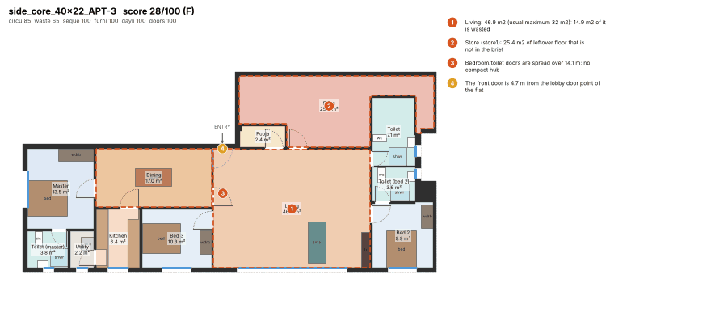
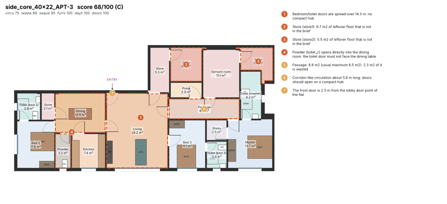
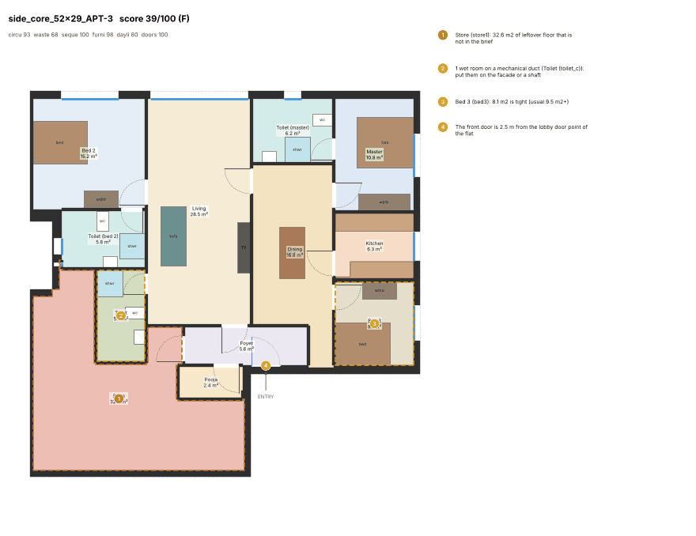
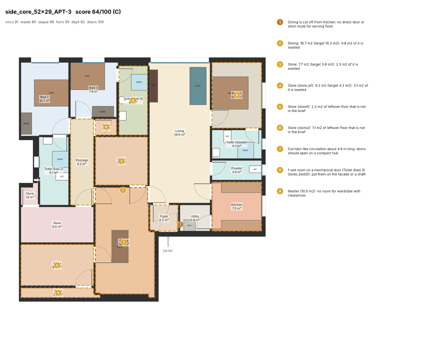
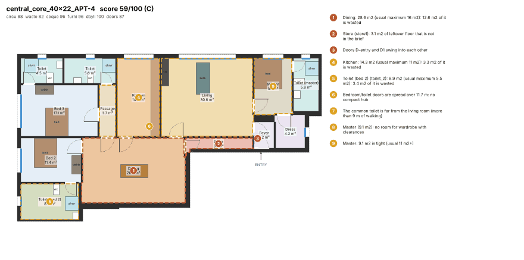
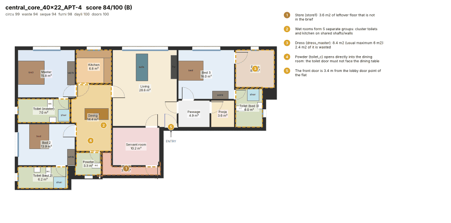
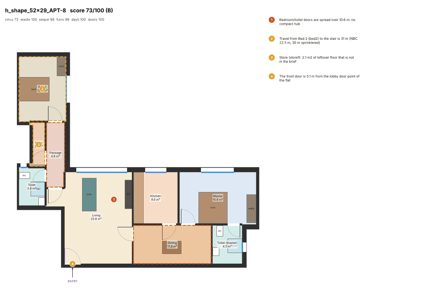
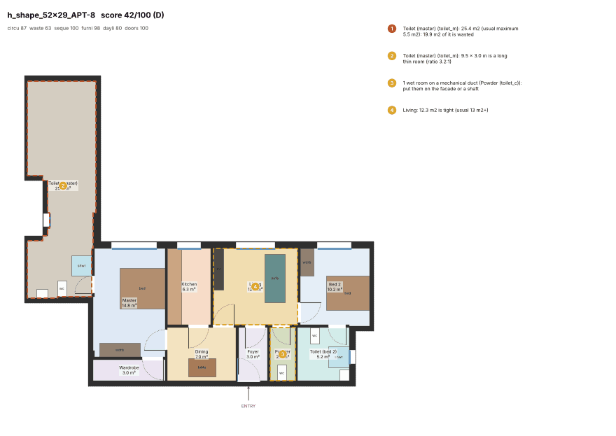

# Flat generator v5: briefs sized to the carpet, side-core slabs re-cut, cleaner drafting

Generator v5 builds on [generator v4](generator-v4.md). It is measured with the same critic (`engine/planner_engine/quality.py`, unchanged) on the golden flats. Every figure is from fresh solves with `PLANNER_PLAN_CACHE=0`.

**Short answer: most targets are met, but not the three headline ones.**
- Mean critic score: 80.6 and 81.9 in two full runs, 81.3 on average. The target was 83.
- Flats with an unbriefed store of 3 m² or more: 22 on average. The target was 8 or fewer.
- Bloated flats: 36 on average. The target was 10 or fewer.

Side-core flats gain 15 points. 3BHK flats gain 8 points. F grades, entries through the dining room and ducted wet rooms are gone or almost gone. Every bedroom now has its own toilet in every flat where the brief asks for it.

## 0. Read this first: the golden set changed (78 → 80 flats)

v5 changes the unit count of the 34 × 24 side-core slab, which the brief allows ("plate.py: unit count"). It now has six flats of 90-104 m² gross (2BHK) instead of four of 156 m² (3BHK). Every other plate splits exactly as in v4.

- That gives 80 golden flats instead of 78.
- `side_core_34x24_APT-n` names a different flat in v4 and v5.
- Like-for-like figures (the 74 unchanged flats) are given next to the full-set figures.

## 1. Targets (v5 = mean of two fresh full runs, A and B)

v4 is the committed v4 run (`after-v4/golden_plans.json.gz`) re-measured with the same metric script. The brief's "fresh v4 run" figures are quoted in brackets where they differ.

| Target | v4 | v5 run A ([`after-v5/`](after-v5/)) | v5 run B | v5 mean | Met |
|---|---|---|---|---|---|
| Mean ≥ 83 | 77.1 (78.2) | 80.6 | 81.9 | **81.3** | **no** |
| No F | 3 F | 0 | 0 | 0 | yes |
| ≤ 3 D | 2 | 4 | 2 | 3 | yes (on the mean; run A alone has 4) |
| side_core mean ≥ 75 | 60.6 | 75.1 | 76.0 | **75.6** | yes (like-for-like 12 flats: 60.0 → 73.3) |
| 3BHK mean ≥ 78 | 71.2 (72.4) | 79.2 | 80.8 | **80.0** | yes |
| Flats with a ≥ 3 m² store not in the brief ≤ 8 | 31 (33) | 24 | 20 | **22** | **no** |
| Bloated flats ≤ 10 | 30 (38) | 41 | 31 | **36** | **no** |
| Ducted wet rooms ≤ 12 % | 16.2 % (23 flats) | 8.3 % (10 flats) | 6.1 % (9 flats) | 7.2 % | yes |
| Door-swing clashes ≤ 5 flats | 27 (21) | 1 | 0 | 0.5 | yes |
| All bedrooms attached in ≥ 80 % of 2BHK > 70 m² and 3BHK+ | 3/58 | 60/60 | 60/60 | 100 % | yes |
| Entry through the dining room | 4 (3) | 0 | 0 | 0 | yes |
| 0 DCPR fails | 0 | 0 | 0 | 0 | yes |
| ≥ 95 % within 10 s | 100 % | 78/80 | 78/80 | 97.5 % | yes (2 flats take the 30 s fix ladder: max 27 s) |

Like-for-like, on the 74 flats both versions share:

| | v4 | v5 run A | v5 run B |
|---|---|---|---|
| Mean | 77.9 | 80.7 | 81.9 |
| 3BHK mean | 72.0 | 79.2 | 80.8 |

Run-to-run noise is large:
- Single flats move by ±15 points between runs (CP-SAT is not repeatable).
- Three full v5-equivalent runs during development scored 81.8, 83.2 and 81.1.
- The 83.2 run was not one of the two final runs and is not counted.

## 2. By shape and BHK

| Shape | v4 | v5 A | v5 B | v5 mean |
|---|---|---|---|---|
| central_core | 74.2 | 82.9 | 85.1 | 84.0 |
| cruciform | 81.3 | 81.4 | 84.0 | 82.7 |
| h_shape | 87.2 | 82.8 | 83.1 | 83.0 |
| side_core | 60.6 | 75.1 | 76.0 | 75.6 |
| t_shape | 83.0 | 81.9 | 81.9 | 81.9 |

| BHK (bedrooms in the plan) | v4 | v5 A | v5 B |
|---|---|---|---|
| 1 | 92.7 (n 18) | 90.8 (17) | 92.3 (17) |
| 2 | 77.1 (13) | 75.1 (20) | 76.2 (20) |
| 3 | 71.2 (46) | 79.2 (42) | 80.8 (42) |
| 4 | 72.0 (1) | 76.3 (1) | 63.9 (1) |

Other counts, v4 → v5 A / B:

| Count | v4 | v5 A / B |
|---|---|---|
| leftover issue (any size) | 48 | 40 / 41 |
| hub_spread | 12 | 16 / 16 |
| entry into a foyer / the living room | 37 / 37 | 35 / 45, 28 / 52 |

h_shape gets worse:
- `h_shape_52x29_APT-1` and `APT-8` are 2BHKs with a 3.5 m × 7.5 m arm.
- In v5 the arm stays empty and is merged into the master toilet (19-25 m²): about 40 points against 73 in v4. See section 5.

## 3. What changed

### 3.1 Unit splitting (`plate.py`, unit count only; `units.py`)

**Side-core unit count (`plate.default_params`, `SIDE_SHALLOW_DEPTH`, `SIDE_SHALLOW_GROSS`).**
- The old rule sized a slab at about 150 m² gross per flat. A side-core slab whose flats are 10.5-11.5 m deep is now sized at about 120 m².
- On the 34 × 24 slab, the 150 m² rule made L-shaped 3BHKs of 156 m². Each had a 23 m² windowless lobe between the party wall and the lobby, which became the "store" leftover.
- Six flats of 90-104 m² have no such lobe (dark area 0-9 m²) and fit the 2BHK band.
- Shallower slabs (40 × 22, 10.1 m deep) keep four flats. At six flats, the middle flats are about 11 m wide, too narrow to light a 2BHK (`window_rooms_fit`), so they came out as 1BHKs of 88 m² carpet.
- Deeper slabs (52 × 29, 13.6 m deep) keep eight. At ten flats, the middle flats become 7 m × 13.6 m slots, which is worse.

**Dark area (`units.dark_area`).**
- This is the floor farther than 8 m from every façade edge of the flat's grid: where no window room can reach.
- It is about 16-29 m² in the side-core flats and under 8 m² everywhere else.
- It drives two things:
  - **The brief**: a flat with a dark band gets one or two extra store rooms with a door, of 4 m² each (`BAND_STORES`, one per 6 m² of dark floor the servant room and store leave). That makes the band a service band, not leftover floor.
  - **The search** (`layout.POCKET_DARK_M2 = 8`): in such flats the brief's servant room and stores are placed by the solver itself, against the lobby. Elsewhere, drafting still cuts them from the pockets the layout leaves.

### 3.2 Programmes sized to the carpet (`units.size_programme`, `data/programmes/*.json`)

**BHK choice.**
- The BHK follows the Mumbai bands, in m² carpet:

  | BHK | Band |
  |---|---|
  | 1BHK | 35-50 |
  | 2BHK | 55-80 |
  | 3BHK | 85-120 |
  | 4BHK | 130-180 |

  A flat steps up a BHK only when its carpet is 5 % clear of the band's floor.
- The façade must also fit: each window room needs its own stretch of one straight façade run (`facade_runs` and `window_rooms_fit`).
- Flats of 130-140 m² stay premium 3BHKs (`BHK_MIN_CARPET = {4: 140}`). Measured 4BHK layouts of the side-core flats scored 55-70 against 60-80 for 3BHK, because the case library has no 4BHK case.

**Bedrooms and toilets.**
- Every bedroom gets its own toilet in 3BHK+ flats and in 2BHKs above 70 m² carpet.
- The common toilet becomes a powder room linked to the living room.

**Rooms added when there is spare floor**, in this order, until the brief reaches the flat's usable floor:
1. Dress room off the master bedroom.
2. Main rooms grown to the approved p75 sizes.
3. Servant room off the kitchen (3BHK+ above 110 m²).
4. Study.
5. Pooja room.
6. Store.
7. Dress rooms for the other bedrooms.

The fix ladder's "smaller programme" is sized the same way.

### 3.3 Solver (`solver.py`)

- **Entry never into the dining room** (`ENTRY_NO_DINING`): the front door opens into the living room or a foyer whenever the flat has one.
- **Guided (case) solves keep wet rooms on the façade or a shaft** (`GUIDE_VENT`): no duct. Only the unguided v3 layout may still duct a toilet.
- **Spreading the excess (`CAP_TIER`, `CAP_TIER_W`)**:
  - Floor more than 1.8 m² above a room's waste cap costs 15 more per cell. It is still cheaper than leaving the floor uncovered for living rooms, dining rooms and bedrooms.
  - So floor a flat cannot use is spread over several rooms instead of making one 26 m² dining room.
  - `drafting.grow_to_fill` prices growth the same way.

### 3.4 Case retrieval (`casebase.py`)

- The retrieval distance gains a wet-stack term (`WET_STACK_W`): the mean distance from each of the case's toilets, stretched onto the flat, to the flat's façade or shaft edges.
- Cases whose wet stack lands on the flat's own vents rank first.

### 3.5 Drafting (`drafting.py`, `diagram.py`)

- **Brief stores**: the brief's stores, servant room and band stores are cut from dark pockets off the hub or kitchen, under their brief id and target (`fill_pockets`, `_brief_store_dims`). A long pocket is cut near-square at the owner's door wall, not as a thin strip (`_trim_pocket`).
- **Oversized rooms** (`split_bloated`): an oversized living or dining room gives a bay at one short end to an unplaced brief store or servant room. An oversized bedroom gives one to a walk-in wardrobe. The room keeps its window wall, its door walls and the front door.
- **Door swings** (`unclash_doors`): each door's hinge end is chosen so that no two swings overlap and every leaf opens fully inside its room. For a small room, the side it opens to is chosen too. The entry door always opens inward, and a leaf never opens into a narrow passage.

## 4. Before / after (v4 left, v5 run A right)

**side_core 40 × 22 APT-3, 28 → 68.**
- In v4, the 3BHK brief in 156 m² of interior left a 47 m² living room and a 25 m² sealed pocket against the lobby.
- In v5, the band along the lobby holds the servant room, a store, a pooja room and a passage.
- Two smaller unbriefed stores (5-7 m²) remain.




**side_core 52 × 29 APT-3, 39 → 65.**
- The corner flat is 13.6 m deep.
- In v5 the brief's store and two band stores (8-9 m² each, so above their waste caps) take the dark corner by the lobby, and every bedroom has its toilet.
- The dining room (19 m²) is still oversized.




**central_core 40 × 22 APT-4, 59 → 84.**
- In v4, the dining room was 29 m² and the master bedroom 9 m².
- In v5, a toilet for every bedroom, a dress room, a pooja room and a servant room use that floor.
- The dining room is 14 m².




**h_shape 52 × 29 APT-8, 73 → 42: the main regression.**
- v4 put bed 2 in the flat's arm.
- With the v5 brief (bed 2 with its own toilet, powder by the living room), the search leaves the arm empty.
- Drafting then joins the sealed pocket to the master toilet (`_seal_pockets`), which makes it 25 m².




## 5. What is still wrong (honest list)

- **Mean 81.3, not 83.** The gap is mostly:
  - the h_shape arm flats (about 40);
  - the four 170 m² side-core 3BHKs of 40 × 22 (50-68);
  - the big 2BHKs of cruciform 52 × 29 (54-78).
- **Unbriefed stores (22 flats).** Most are 3-6 m² remnants next to a brief store, the powder room, the kitchen or a wardrobe, after drafting has cut the brief rooms. They are not large dark pockets: those are gone or briefed.
  - The largest left are in side_core 52 × 29 APT-3 and APT-4, with 5-16 m² beyond the two band stores.
- **Bloated rooms (36 flats, no better than v4).**
  - Dining rooms in flats that are large for their BHK.
  - Toilets of 7-8 m² that grew into pockets.
  - Servant rooms that the solver makes 11-12 m² (the solver's hard cap for small rooms is 1.3 × the waste cap; the critic flags 2 m² past the cap).
  - The two 19-25 m² toilets of the h_shape arm flats.

  Tightening `room_specs`' hard cap for small rooms, and capping `_seal_pockets`' join, are the next steps. A sealed store instead trips the critic's `orphan` gate, so the second needs a door rule too.
- **Section 1a of the brief, done in part.**
  - The units are re-cut only through the unit count of one slab.
  - Shifting the lobby edge, or re-cutting party walls so a band joins a flat's service zone, was not done: the party walls carry the plate's air shafts, which are outside this step's files.
  - The dark-band rule (3.1) treats the band as a service band instead.
- **4BHK.** 4BHK in 130-140 m² flats was measured and rejected (worse layouts; no 4BHK case in the library).

## 6. Reproduce

```
cd engine
PLANNER_PLAN_CACHE=0 .venv/bin/python -m planner_engine.quality --baseline ../docs/quality/after-v5 --resolve
```

This is run A: 6 min 14 s on 4 cores, with renders in `after-v5/*.png` and the scorecard in `after-v5/scores.json`. Run B is the same solve without the renders. Both runs' per-flat metrics are in [`after-v5/metrics_run_a.json`](after-v5/metrics_run_a.json) and [`after-v5/metrics_run_b.json`](after-v5/metrics_run_b.json):
- score;
- issues;
- bedroom toilets;
- ducts;
- entry;
- DCPR fails;
- solve time.

## 7. Tests

- New tests:
  - `test_rules_plate_units`: market bands and façade; attached toilets and the powder room; spare floor goes into rooms.
  - `test_casebase`: wet-stack retrieval.
  - `test_solver_drafting`: swing unclash; brief store in a pocket; entry never into the dining room; oversized dining gives a bay; dark pocket keeps the stores in the search; cap tier.
- One test changed, with its reason written in the test: `test_solver_minimums_survive_drafting` took its 3BHKs from the 34 × 24 side-core slab, which now has 2BHKs. It now takes them from the 40 × 22 slab. The assertions are unchanged.
- Public APIs (`solve_flat`, `FlatResult`, `draft`, `Plan`, `split_units`, `pick_preset`) are unchanged. New keyword arguments are optional.
