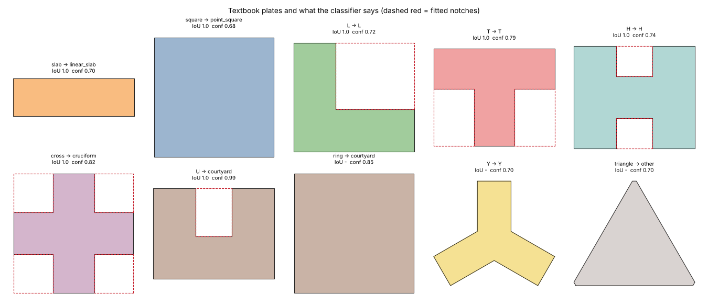
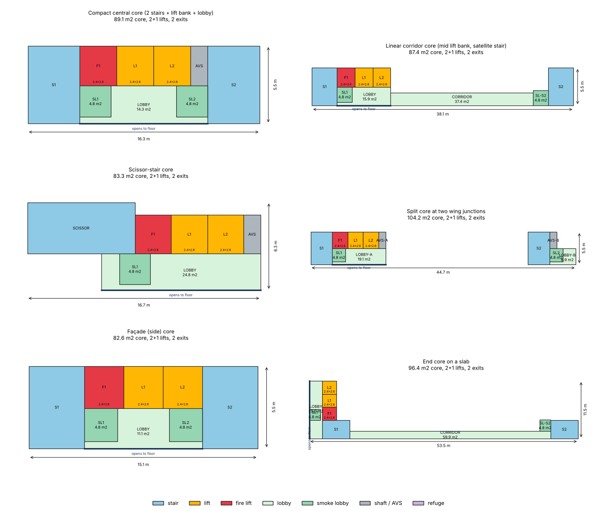

# Plate typology and core library (Phase 1, part A + B)

Modules: `engine/planner_engine/typology.py`, `engine/planner_engine/cores.py`. Tests: `engine/tests/test_typology_cores.py`
(217 tests, all passing). Data: `data/mined/typology_v1.json` (per-project outline, label, by-eye labels, core clusters).
Tools: `engine/tools/extract_plate_outlines.py` (outline from a PDF page), `engine/tools/build_typology_dataset.py`
(dataset build, finalize and the markdown tables below). Nothing is wired into `plate.py` yet (Phase 2).

## 1. What and why

The owner's brief: plans must be usable, cores are chosen not fixed, and plate shape is learned from approved plans by
approximation. This part delivers two things the planner can call:

* `typology.classify(polygon)` puts a building outline in one of `linear_slab, L, T, H, cruciform, Y, point_square,
  courtyard, other` and says why (descriptors, wings with length/width, the notches it used, a confidence, reasons).
* `cores.choose_core(plate_type, flats_per_floor, height_m, footprint)` ranks six parametric core types by code
  compliance, core efficiency (core area / plate area) and suitability for the plate, with reasons; every core type returns
  typed part polygons with NBC 2016 Part 4 / DCPR 2034 dimensions.

## 2. Plate typology

### How it works

1. **Rectilinearise.** Opening with a 2.0 m mitred buffer removes balconies, ducts and chajjas (anything thinner than 4 m),
   closing with 2.5 m fills light wells and slots (thinner than 5 m). The first version used a mitre limit of 4 and grew
   spikes at sharp raw corners (measured: agreement 48 % to 60 % after fixing it with a limit of 1.45). The plate is then
   rotated onto its dominant axes (length-weighted histogram peak refined over +-3 degrees; a plain mean was thrown off by
   a few skewed walls).
2. **Descriptors** (`typology.describe`): aspect, rectangularity (area / min rotated rectangle), convexity, bbox fill,
   orthogonality, compactness, mirror symmetry, boundary direction families, holes. They are reported with every result.
3. **Template fit** (rectilinear plates). A plan = bounding box minus rectangular notches. Corner notches give L (1), T (2 on
   one side), Z (2 opposite), cross (4); mid-side notches give U (1), H (2 facing), S (2 offset), comb (>= 2 on one side).
   The best notch rectangles are found exactly with 2-D prefix sums on a 0.5 m raster, so wavy walls only change the score a
   little. A notch must be >= 4 m and >= 18 % of the short side each way, pay for itself (>= 7 % of the bbox area) and
   satisfy a per-family size rule (an L notch spans >= 25 % of both sides, a T stem is >= 25 % of its side and >= 18 % of the bar
   length, an H pair takes >= 30 % of the side ...). Every notch costs 3 % of the bbox area, so a simpler plan wins unless a
   notch is worth it. Slab versus point tower is the bbox aspect (>= 1.9 is a slab). The result carries the fit IoU and
   the margin to the best candidate of another family; confidence = 0.5 * IoU term + 0.5 * margin term.
4. **Oblique and special cases.** Three boundary-direction families 60 degrees apart: non-convex is Y, convex is a triangle
   (parked: `label = other`, `subtype = triangle`, `experimental = True`) or a hex point tower. An enclosed hole >= 40 m2
   and >= 4 m wide is a closed courtyard; a single deep mid-side notch is an open courtyard (U).

`typology.core_position(outline, core_xy)` places a core in the plate: `central` (middle fifth of both bbox axes), `reentrant`
(within 25 % of the long side of an inner corner of the fitted notches: the knee of an L, the junction of a T), `end`
(outer third of the long axis of an elongated plate), else `side`.

### Outline extraction from the PDFs

`extract_plate_outlines.py` imports the wall-mask helpers of `extract_pdf_topology.py` (not edited): strokes -> orthogonal
segments (page rotated onto the dominant direction) -> paired-line wall mask at 0.05 m per pixel -> binary closing (0.5 m,
larger where needed) -> holes filled -> connected components of 120-6000 m2 -> contour. All 649 plan pages were run (0.7-1.4 s
each); 625 gave at least one component. One typical-floor page per project was chosen (title with "TYPICAL"/"x TO y"/"&",
not refuge/podium/terrace; the median-area page of those) and the outline was checked against the drawing by eye; seven pages
were swapped for better ones and two needed a larger closing radius (49 and 69: 2.5 m).

**Not solved:** pages whose walls are single hatched lines (49, 69) or whose plan is rotated against the page (35) give broken or
partial outlines. They are listed in the table as "excluded" and left out of every agreement figure below (3 of 50). The
largest component is taken, so a page with two towers classifies the bigger one only. No outline of the 50 is a Y or a
triangle, so the Y bucket is verified on synthetic plates only.

### Agreement with the by-eye labels

Three numbers, in the order they were obtained (all on the 50 approved projects, one typical floor each):

| step | what | result |
|---|---|---|
| first pass | I labelled all 50 outlines by eye (first-pass labels), then ran the classifier | 24 / 50 = 48 % on the first run; 30 / 50 after the mitre fix; 31 / 50 = 62 % at the end of tuning, labels still unchanged |
| tuning | per-family size rules, comb/S models, relaxed cross, mitre fix, slab aspect 1.9; 16 labels were re-judged after measuring the notches (listed below) | |
| final review (in-sample) | the final classifier drawn on every outline with its fitted notches (`img/typology-review-*.png`), I agree or disagree per plate | **45 / 47 = 95.7 %** (3 unusable outlines excluded); my two disagreements: #46 (a modest side bay called "courtyard") and #63 (a stepped slab called T) |
| blind hold-out | 32 other pages of the same projects (not selected before), shown without classifier output, labelled by eye first; 7 had unusable outlines | **22 / 25 = 88 %** |

The honest reading: the 45/47 figure is in-sample (the thresholds were tuned on those plates and 16 of my labels moved toward
the measured notch sizes, because the eye over-reads a 3-7 m step as a wing and under-reads a comb). The blind figure is the
better estimate of what to expect: about 88 % with n = 25, so roughly 70-97 % at 95 % confidence. The three hold-out
misses (H10, H13, H14) are all at a threshold: a 4 m deep step (below the 25 % L rule), an aspect of 1.62 that I read as 1.9,
and a 6.5 x 11 m corner bay that I did not count as a notch.

Labels changed after measuring (first pass -> final), with the reason: #33, #36 point_square (corner notch 9 x 7 m is under the
25 % rule, irregular compact blob); #37, #48 L (the stepped corner notch is 40 % x 48 % of the sides, an L by the rule);
#38, #52 linear_slab (the "waist" is only 3 m deep each side); #40 courtyard (one 7.5 x 11 m open notch, the second is a 2-3 m
step); #46 courtyard (later disagreed with it, see above); #51, #77 other (comb: a slab with three projecting wings);
#61, #66 point_square (steps under 4 m); #62 L; #70 point_square (notches 4.5-7 m on a 30 m plate); #71 T; #72 H (bar off-centre).

Reproduce: `.venv/bin/python tools/build_typology_dataset.py --raw-out raw.json --finalize ../data/mined/typology_v1.json --out ...`
(the raw outlines come from the first stage; both stages are in the docstring). Review images:
`img/typology-review-1..4.png` (label vs classifier, dashed red = fitted notches),
`img/typology-<type>.png` (all approved plates of one type).

### Per-type statistics (47 usable projects)

Flats/floor is a *lower bound*: the number of kitchen/living labels OCR found inside the outline (a label missed by OCR is a flat
missed). Flat area is the sum of the non-common room areas of the flat records of the page in `topology_v1.jsonl.gz`
(flats with a suspect merge or fewer than 4 rooms dropped; the flat grouping is only 40 % right per DATASET_VALIDATION, so read
it as an order of magnitude: carpet-ish area, not RERA area, per page not per outline). Core position uses the lift/fire-lift
labels inside the outline, clustered within 10 m (stairs are rarely labelled, so stairs are not counted).

| type | n | outline m2 (p50, range) | bbox long x short m (p50) | flats/floor est (p50, range) | flat area m2 (p50, p10-p90, n) | core: central / reentrant / end / side | passenger+fire lifts per core (p50) | cores per plate (p50) |
|---|---|---|---|---|---|---|---|---|
| point_square | 13 | 571 (202-1014) | 30 x 23 | 3 (1-8) | 71 (44-105, n=27) | 9 / 0 / 0 / 4 | 3 | 1 |
| linear_slab | 13 | 656 (175-1707) | 44 x 15 | 6 (2-16) | 57 (37-76, n=64) | 7 / 0 / 1 / 5 | 3 | 1 |
| L | 5 | 720 (306-860) | 37 x 21 | 6 (2-8) | 57 (34-79, n=18) | 4 / 0 / 0 / 1 | 3 | 1 |
| T | 5 | 426 (263-708) | 40 x 18 | 4 (2-7) | 44 (26-59, n=12) | 2 / 2 / 0 / 1 | 2 | 2 |
| H | 5 | 832 (426-1518) | 46 x 28 | 7 (4-9) | 59 (35-77, n=23) | 3 / 2 / 0 / 0 | 4 | 1 |
| cruciform | 1 | 1034 (1034-1034) | 53 x 29 | 2 (2-2) | 38 (31-64, n=8) | 1 / 0 / 0 / 0 | 6 | 1 |
| courtyard | 3 | 611 (440-1308) | 29 x 26 | 4 (4-15) | 53 (40-106, n=14) | 2 / 1 / 0 / 0 | 3 | 1 |
| other | 2 | 1612 (1531-1693) | 77 x 30 | 6 (6-6) | 112 (98-158, n=4) | 0 / 2 / 0 / 0 | 3 | 6 |

What the data says (47 plates): the primary core is central in 28, on a side in 11, at a re-entrant corner or junction in 7 and
at an end in 1. 30 plates have one core, 13 have two, and the long slabs (51, 55, 77 ...) have up to 6 (one per wing; a "wing
building" is several cores in a row). The median core has 2 passenger lifts and 1 fire lift; 41 of 47 plates have a fire lift
label (32 of the 37 plates on floor 8 or above). Point towers: 13, slabs: 13, then L, T, H at 5 each, one cruciform, three
courtyard/U, two combs. Mumbai residential here is mostly compact blocks and slabs; cruciform, Y and triangle are rare.

### Per-project table

Columns: sheet = the page used; classifier / confidence; eye (final) and eye (first pass); flats per floor (lower bound); cores =
lifts + fire lifts and position of up to three core clusters.

| # | project | page / sheet | outline m2 | bbox m | classifier | conf | eye (final) | eye (first pass) | flats/floor est | cores (lifts+fire, position) |
|---|---|---|---|---|---|---|---|---|---|---|
| 28 | MALABAR_HILL_2510686 | p6 17TH FLOOR PLAN | 548 | 24 x 24 | point_square/square | 0.60 | point_square | point_square | 2 | 2+3 central |
| 29 | AMBIVALI_2448071 | p7 PLAN. 10TH FLOOR PLAN. | 656 | 43 x 18 | linear_slab/double-loaded | 0.10 | linear_slab | linear_slab | 8 | 4+1 central |
| 30 | KANJUR_W_2517064 | p8 22ND TO 27TH,29TH TO 34TH, | 1014 | 47 x 25 | point_square/squat-rect | 0.25 | point_square | point_square | 6 | 4+2 central |
| 31 | KOLEKALYAN_H_E_2425449 | p8 7TH FLOOR PLAN | 1308 | 72 x 26 | courtyard/U | 0.78 | courtyard | courtyard | 15 | 1+2 reentrant; 1+2 reentrant; 2+0 reentrant |
| 32 | MALABAR_HILL_2480558 | p12 26TH TO 30TH,33RD & 34TH T | 562 | 24 x 24 | point_square/square | 0.68 | point_square | point_square | 2 | 2+3 central |
| 33 | CHEMBUR_W_2415517 | p14 TYPICAL FLOOR PLAN | 573 | 36 x 22 | point_square/squat-rect | 0.10 | point_square | other | 4 | 2+1 central |
| 34 | CHINCHAVALI_P_S_2507687 | p12 24TH TO 28TH FLOOR PLAN | 1034 | 53 x 29 | cruciform | 0.66 | cruciform | cruciform | 2 | 5+1 central |
| 35 | MAGATHANE_R_C_2445666 | p7 10TH TO 13TH FLOOR PLAN (W | 513 | 33 x 28 | point_square/square | 0.14 | other (excluded: outline partial (rotated wings)) | other | 3 | 5+0 central; 0+1 side |
| 36 | CHEMBUR_W_2415483 | p14 TYPICAL FLOOR PLAN | 571 | 36 x 22 | point_square/squat-rect | 0.10 | point_square | other | 4 | 2+1 central |
| 37 | GHATKOPAR_2450932 | p4 (TOWER-1A & 1B) 6TH FLOOR  | 720 | 44 x 21 | L | 0.68 | L | linear_slab | 6 | 2+1 central; 2+1 side |
| 38 | BORIVALI_R_N_2466206 | p8 15th & 16th FLOOR PLAN | 804 | 44 x 22 | linear_slab/double-loaded | 0.10 | linear_slab | H | 6 | 2+1 central |
| 39 | DAHISAR_R_N_2472088 | p13 17TH TO 19TH FLOOR PLAN | 860 | 37 x 32 | L | 0.41 | L | L | 8 | 4+2 central |
| 40 | PAHADI_GOREGAON_W_2473781 | p0 1ST, 2ND, 41H TO 9TH 11TH  | 440 | 26 x 22 | courtyard/U | 0.24 | courtyard | H | 4 | 0+1 central |
| 41 | MULUND_E_2520067 | p2 5TH FLOOR PLAN ( WING - A& | 695 | 54 x 15 | linear_slab/double-loaded | 0.32 | linear_slab | linear_slab | 9 | 2+0 central; 1+0 side; 1+0 end |
| 42 | MULUND_W_2431824 | p2 7TH & 8TH FLOOR PLAN | 415 | 40 x 18 | T/symmetric | 0.54 | T | T | 4 | 2+0 reentrant; 1+0 reentrant |
| 43 | PAHADI_GOREGAON_E_2501459 | p5 9th & 10th FLOOR PLAN | 708 | 53 x 19 | T/symmetric | 0.42 | T | T | 7 | 3+1 central; 0+1 reentrant |
| 44 | MULUND_W_2483367 | p2 7TH & 8TH FLOOR PLAN | 426 | 40 x 18 | T/symmetric | 0.47 | T | T | 4 | 2+0 reentrant; 1+0 reentrant |
| 45 | MATUNGA_2488676 | p8 31ST TO 34TH & 36TH TO 38T | 318 | 21 x 16 | point_square/squat-rect | 0.44 | point_square | point_square | 2 | 3+1 central |
| 46 | BANDRA_C_2491470 | p10 13TH & 15TH FLOOR PLAN | 611 | 29 x 27 | courtyard/U | 0.38 | point_square | point_square | 4 | 2+2 central |
| 47 | PAHADI_GOREGAON_W_2518985 | p2 TYPICAL 8TH TO 11TH FLOOR  | 876 | 33 x 30 | point_square/square | 0.41 | point_square | point_square | 4 | 4+1 central |
| 48 | GHATKOPAR_2522274 | p5 (TOWER-1A & 1B) 8TH FLOOR  | 727 | 44 x 21 | L | 0.64 | L | linear_slab | 6 | 2+1 central; 2+1 side |
| 49 | MATUNGA_2479330 | p7 22ND TO 26TH. 30TH FLOOR P | 698 | 38 x 36 | L | 0.10 | other (excluded: outline broken (hatched walls, closing 2.5 m)) | other | 3 | 1+1 central; 0+1 outside |
| 50 | DAHISAR_R_N_2486114 | p12 17TH & 19TH FLOOR PLAN | 426 | 29 x 21 | H | 0.73 | H | H | 6 | 2+2 central |
| 51 | BANDRA_EAST_2449614 | p2 3RD TO 5TH FLOOR PLAN IRD  | 1531 | 76 x 30 | other/comb | 0.10 | other | linear_slab | 6 | 2+1 reentrant; 2+1 central; 2+1 reentrant |
| 52 | BORIVALI_R_N_2490559 | p8 15th & 16th FLOOR PLAN | 804 | 44 x 22 | linear_slab/double-loaded | 0.10 | linear_slab | H | 6 | 2+1 central |
| 53 | PAHADI_GOREGAON_W_2504545 | p8 28TH TO 30TH FLOOR PLAN | 460 | 26 x 26 | H | 0.19 | H | H | 4 | 0+2 central |
| 54 | BHULESHWAR_2488638 | p10 17TH. FLOOR PLAN | 440 | 37 x 13 | linear_slab/single-loaded | 0.59 | linear_slab | linear_slab | 5 | 1+2 central |
| 55 | MUMBAI_2496369 | p2 21st Floor Plan | 686 | 52 x 14 | linear_slab/double-loaded | 0.49 | linear_slab | linear_slab | 6 | 2+1 side; 1+1 end |
| 56 | AMBIVALI_2460650 | p3 9TH TO 11TH FLOOR PLAN 9TH | 1516 | 60 x 36 | H | 0.47 | H | H | 9 | 3+1 reentrant; 1+1 reentrant |
| 57 | MATUNGA_2488701 | p11 18TH & 19TH FLOOR PLAN | 384 | 29 x 14 | linear_slab/double-loaded | 0.38 | linear_slab | linear_slab | 2 | 3+1 side |
| 58 | AMBIVALI_2498225 | p11 16TH TO 18TH FLOOR PLAN | 910 | 42 x 23 | point_square/squat-rect | 0.51 | point_square | point_square | 8 | 2+1 side; 2+1 side |
| 59 | MATUNGA_2450067 | p11 14TH & 15TH FLOOR PLAN | 388 | 30 x 14 | linear_slab/double-loaded | 0.40 | linear_slab | linear_slab | 2 | 3+1 side |
| 60 | MUMBAI_2514980 | p2 1st & 2nd Floor Plan With  | 632 | 53 x 14 | linear_slab/double-loaded | 0.29 | linear_slab | linear_slab | 4 | 1+1 side; 1+1 side |
| 61 | DADAR_NAIGAON_F_S_2495129 | p2 38RD & 4TH FLOOR PLAN | 317 | 26 x 14 | point_square/squat-rect | 0.19 | point_square | other | 3 | 0+1 side |
| 62 | BANDRA_C_2492874 | p10 13TH & 15TH FLOOR PLAN | 306 | 24 x 18 | L | 0.18 | L | other | 2 | 2+2 side |
| 63 | PAHADI_GOREGAON_E_2462100 | p5 9th & 10th FLOOR PLAN | 705 | 52 x 19 | T/symmetric | 0.42 | linear_slab | T | 7 | 4+0 central; 1+0 reentrant |
| 64 | AMBIVALI_2488333 | p3 9TH TO 11TH FLOOR PLAN 9TH | 1518 | 60 x 36 | H | 0.42 | H | H | 9 | 3+1 reentrant; 1+1 reentrant |
| 65 | DAHISAR_R_N_2454455 | p5 15TH & 16TH FLOOR PLAN | 593 | 38 x 17 | linear_slab/double-loaded | 0.51 | linear_slab | linear_slab | 7 | 3+1 central; 2+0 side |
| 66 | DADAR_NAIGAON_F_S_2518470 | p2 & 4TH FLOOR PLAN | 314 | 26 x 14 | point_square/squat-rect | 0.18 | point_square | other | 3 | 0+1 side |
| 67 | CHINCHAVALI_P_S_2451944 | p11 20TH & 21ST FLOOR PLAN | 1707 | 90 x 21 | linear_slab/double-loaded | 0.51 | linear_slab | linear_slab | 16 | 2+0 end; 2+0 central |
| 68 | MALABAR_HILL_2486775 | p6 24TH FLOOR PLAN | 670 | 48 x 16 | linear_slab/double-loaded | 0.44 | linear_slab | linear_slab | 2 | 2+2 side |
| 69 | MATUNGA_2445227 | p1 10TH FLOOR PLAN | 334 | 22 x 19 | T/symmetric | 0.42 | point_square (excluded: outline broken (single-line walls, closing 2.5 m)) | point_square | 2 | 2+2 reentrant |
| 70 | OSHIWARA_2492780 | p1 2ND TO 5TH FLOOR PLAN ( TO | 614 | 30 x 28 | point_square/square | 0.16 | point_square | H | 4 | 1+2 central |
| 71 | PAHADI_GOREGAON_W_2513703 | p9 26TH TO 28TH FLOOR PLAN | 263 | 26 x 15 | T/symmetric | 0.54 | T | L | 2 | 0+2 side |
| 72 | MAGATHANE_R_C_2476688 | p5 9TH TO 11TH TYPICAL FLOOR  | 832 | 46 x 28 | H | 0.54 | H | courtyard | 7 | 5+2 central |
| 73 | MAHIM_2516532 | p2 4TH TO 6TH FLOOR PLAN | 202 | 16 x 14 | point_square/square | 0.49 | point_square | point_square | 1 | 1+1 side |
| 74 | BANDRA_B_2498297 | p10 16TH TO 18TH FLOOR PLAN | 617 | 31 x 23 | point_square/squat-rect | 0.33 | point_square | point_square | 3 | 4+1 central |
| 75 | BANDRA_B_2471483 | p11 TYPICAL FLOOR PLAN ( 15TH  | 318 | 25 x 19 | L | 0.15 | L | L | 2 | 1+0 central |
| 76 | BHULESHWAR_2477747 | p2 2ND & 3RD FLOOR PLAN | 175 | 22 x 8 | linear_slab/single-loaded | 0.61 | linear_slab | linear_slab | 2 | 0+3 central |
| 77 | BANDRA_EAST_2513819 | p7 9TH TO 13TH FLOOR PLAN | 1693 | 78 x 30 | other/comb | 0.16 | other | linear_slab | 6 | 2+1 reentrant; 2+1 central; 2+1 reentrant |

## 3. Core library

Local frame of every core: +x along the lobby, y = 0 at the lobby edge where the core opens onto the floor, +y into the
core. `Core.place(x, y, angle, mirror)` moves a core; `Core.to_model_parts()` maps the parts onto `models.CorePart`
(`smoke_lobby -> lobby`, `shaft/refuge -> service`) for Phase 2. `Core.check()` returns the dimensional/code checks, `Core.metrics()`
the areas. Part kinds: `stair, lift, fire_lift, lobby, smoke_lobby, shaft (AVS / pressurisation), refuge`.

| type | what it is | when | diagram |
|---|---|---|---|
| `central_compact` | two stairs at the ends, lifts between them in one row (two facing rows above 4 lifts), lobby in front, smoke-check lobbies and an AVS shaft above 24 m | point towers, crosses, T/H crossings (approved plans 28 and 32) | `img/core-central_compact.png`, `img/core-central_compact-by-height.png` |
| `linear_corridor` | lift bank and stair 1 widen the corridor at mid length, stair 2 is a satellite about half the plate length away (travel distance 22.5 m) | slabs, long wings | `img/core-linear_corridor.png` |
| `scissor` | one scissor stair (two exits in one enclosure) beside the lifts | small plates, lowest area; needs the authority to accept the pair (flagged, scored down) | `img/core-scissor.png` |
| `split_junction` | cluster A = stair + all lifts + lobby, cluster B = stair + AVS shaft, 24 m apart | H, T and cross plates with long arms | `img/core-split_junction.png` |
| `side_core` | compact core with the back wall on the façade: naturally ventilated stairs, no AVS shaft | L plates, wings, slabs with the core on the long face | `img/core-side_core.png` |
| `end_core` | lifts stacked along the short end wall, stair beside, satellite stair at the far end | slabs | `img/core-end_core.png` |

Reference case (60 m, 6 flats per floor, 700 m2 plate; core area includes stairs, lifts, lobby, smoke lobbies, shafts; corridor
strips to a satellite stair are not charged to the core):

| type | bbox m (main cluster) | core m2 | % of 700 m2 plate | stair / lift / lobby / shaft m2 | exits | checks passed |
|---|---|---|---|---|---|---|
| `central_compact` | 16.3 x 5.5 | 89.1 | 12.7% | 40.0 / 21.8 / 23.9 / 3.4 | 2 | 17/17 |
| `linear_corridor` | 11.5 x 5.5 | 87.4 | 12.5% | 40.0 / 21.8 / 25.6 / 0 | 2 | 18/18 |
| `scissor` | 16.7 x 6.3 | 83.3 | 11.9% | 28.4 / 21.8 / 29.6 / 3.4 | 2 | 14/15 (+authority warning) |
| `split_junction` | 12.7 x 5.5 | 104.2 | 14.9% | 40.0 / 21.8 / 35.6 / 6.7 | 2 | 18/18 |
| `side_core` | 15.1 x 5.5 | 82.6 | 11.8% | 40.0 / 21.8 / 20.7 / 0 | 2 | 17/17 |
| `end_core` | 8.1 x 11.5 | 96.4 | 13.8% | 40.0 / 21.8 / 34.6 / 0 | 2 | 18/18 |

### Rules used (and what is assumed)

From the repository rule files: two staircases above 15 m (NBC-4-4.4.2.1), stair flight width 1.5 m for high-rise residential
(NBC-4-T6), fire lift, smoke-check lobbies and refuge floors above 24 m (NBC-4-C1.12), travel distance 22.5 m, passage / lobby
at least 1.5 m (DCPR Reg 37(12)), lift shaft 2.4 x 2.6 m clear and lobby depth from `design.yaml`. Additionally: lobby depth in
front of every lift >= lift depth (checked by casting a ray from each lift door), risers <= 0.19 m and treads >= 0.25 m
(a 3.0 m storey gets 18 risers of 0.167 m, 9 per flight, run 2.0 m, which matches the 2.00 m stair runs on the approved
sheets), 0.2 m stair well, one smoke-check lobby (2.2 x 2.2 m, as on the approved sheets) per stair above 24 m.

Assumptions not in the rule files (also in `cores.ASSUMPTIONS`; the architect should confirm): 1.2 m stair width up to 15 m;
4.5 persons per flat and 7 % five-minute up-peak for the lift traffic estimate; 13-person cars; one fire lift per 1200 m2 above
24 m; refuge area >= 4 % of the floor (>= 15 m2) every 7th floor; a scissor pair counts as two exits only with the authority's
acceptance; 4 lifts per bank maximum.

| height m | flats/floor | stairs | flight w | passenger lifts | fire lifts | smoke lobbies | refuge floors |
|---|---|---|---|---|---|---|---|
| 12 | 4 | 1 | 1.2 | 1 | 0 | no | [] |
| 20 | 4 | 2 | 1.5 | 2 | 0 | no | [] |
| 30 | 6 | 2 | 1.5 | 2 | 1 | yes | [7] |
| 45 | 6 | 2 | 1.5 | 2 | 1 | yes | [7, 14] |
| 75 | 8 | 2 | 1.5 | 3 | 1 | yes | [7, 14, 21] |
| 120 | 10 | 2 | 1.5 | 6 | 1 | yes | [7, 14, 21, 28]... |

**Lift count vs the approved plans.** The traffic estimate was compared with the lift labels of the primary core of the 47
plates (floors taken from the sheet title, a lower bound): exact for 21 of 47, within one lift for 36 of 47, mean absolute
error 0.83 lifts. Approved plans mostly carry 2 passenger lifts whatever the flats per floor (median 2, up to 5), so the
estimate agrees with practice at the low end and is only loosely tied to flats per floor; a grid over persons per flat
(4.5-6.5) and up-peak share (7-13 %) did not do better (MAE 0.83-1.8), so the defaults stay. The OCR lift count also includes
stretcher/evacuation lifts labelled "LIFT", so this is a plausibility check, not a calibration.

### Selector

`choose_core` builds all six types for the plate, drops those that fail a check or do not fit, and scores the rest
0.45 * efficiency (core 8 % -> 1.0, 20 % -> 0.0) + 0.35 * suitability for the plate type + 0.20 * egress (remote stairs 1.0, two stairs in
one core 0.7, scissor 0.2), x0.85 with a warning. Suitability priors (`PLATE_SUITABILITY`) are architect priors informed by the counted
core positions above (central dominates point towers and crosses; slabs split between central and side; T/H junctions);
the counts are small, so the priors were not fitted. Above the NBC height the selected core always has >= 2 exits and a fire lift
above 24 m (tested for every plate type at 16, 24, 40, 75 and 120 m).

## 4. Limits, failures, next steps

* Outline extraction fails on 3 of 50 projects (hatched or single-line walls, rotated wing plans) and takes the largest
  component only. Fixing it means a wall detector for single thick lines and per-component rotation.
* The classifier was tuned on the same 50 plates it is scored on; the blind hold-out (22/25, 88 %) is small. Y and triangle are
  untested on real plans (none in the data); Y rests on synthetic plates and the direction-family test.
* A notch counts only above 4 m / 18-25 % of the short side. Architects may call a 4-5 m step a wing; the thresholds are in
  `typology.CFG` and are the first knob if the owner disagrees.
* `flats_per_floor_est` is a lower bound from OCR labels; flat areas depend on a 40 %-correct flat grouping. Stairs could not be
  counted from labels. Core positions use OCR labels of lifts only.
* Core dimensions are generic modules: no structure grid, no duct/electrical rooms beyond one AVS shaft, no lift machine room,
  no door positions yet. Phase 2 needs a door/edge model to tie the lobby edge to the flat entrances and the corridor.
* The 0.45/0.35/0.20 weights and the suitability table are judgement, not fitted.
* `engine/tools/extract_pdf_topology.py` was being edited by another agent while this ran; the outline tool only imports its
  low-level helpers (`load_vectors`, `dominant_angle`, `orth_segments`, `Grid`, `wall_mask`, `rotate_pts`) and the build tool its OCR helpers.
